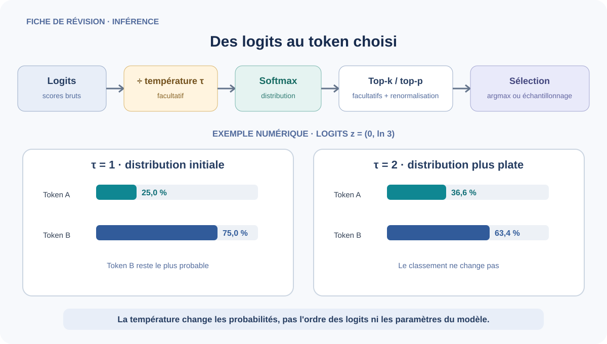

<!--
LLM-LAB-PAGE-MAP v1
id: "fr/probabilites"
summary: "Explique comment les logits deviennent une distribution conditionnelle sur le prochain token, et comment cette distribution intervient dans la sélection sans garantir la vérité."
scope: "Construit la distribution du prochain token par softmax et montre l’effet de la température sur sa concentration."
purpose: "Transformer des logits en probabilités sur le vocabulaire et distinguer une distribution normalisée d’une prédiction calibrée."
suggested_route:
  previous: "fr/logits"
  next: "fr/entropy"
hierarchy:
  parents: ["fr/logits", "fr/generation"]
  children: ["fr/entropy", "fr/vraisemblance"]
related: ["fr/probabilites-exercises"]
revision_support:
  status: integrated_sufficient
  evidence:
    - anchor: revision-summary
      note: "Le rappel relie softmax, distribution conditionnelle, température, sélection et limites de calibration/vérité. Le workbench numérique, les avertissements et les quatre questions corrigées couvrent normalisation, concentration et interprétation."
tags: ["type:concept-lesson", "destination:understand", "topic:probabilites", "level:core", "language:fr", "status:published"]
-->



::: {.chapter-lead}
Pourquoi « Vous » reçoit-il 60 % dans le premier tour du scribe ? Partons de quatre scores fictifs, puis changeons la température pour voir comment elle redistribue les probabilités.
:::

::: {.callout-tip title="L'idée à retenir en une minute" #revision-summary}
La softmax transforme les logits en une **distribution conditionnée par le préfixe**. Elle garantit des valeurs positives dont la somme vaut un ; elle ne garantit ni calibration, ni vérité factuelle.

:::

## Des logits à une distribution catégorielle

À une position donnée, le modèle produit un logit $z_i$ pour chaque token $i$ du vocabulaire. Les logits sont des scores non normalisés : ils peuvent être négatifs ou positifs et ne somment pas à un.

La softmax transforme ces scores en probabilités :

$$
p_i=\operatorname{softmax}(z)_i=\frac{e^{z_i}}{\sum_{j=1}^{V}e^{z_j}}.
$$

Les probabilités sont positives et leur somme vaut un. Cette normalisation ne prouve ni que les valeurs sont calibrées, ni que le token le plus probable est factuellement correct. Les implémentations numériques utilisent des formes stables de softmax/log-softmax pour limiter les débordements.

### Exemple numérique

<a id="running-example-next-token"></a>

Pour le préfixe « C'est une bonne situation, ça, scribe ? », prenons un vocabulaire jouet de quatre tokens. Les logits de l’[exemple de projection de sortie](logits.qmd#running-example-output-projection) sont choisis pour retrouver les probabilités du premier tour du fil rouge. Les exponentielles somment à 10, donc la softmax divise chacune par 10.

::: {.probability-example}

| Token candidat | Logit | Exponentielle | Probabilité |
|---|---:|---:|---:|
| « Vous » | $\ln 6$ | 6 | 0,6 |
| « Je » | $\ln 2$ | 2 | 0,2 |
| « Moi » | $0$ | 1 | 0,1 |
| « Oui » | $0$ | 1 | 0,1 |
:::


La continuation illustrative prend « Vous ». Une fois ce token ajouté au préfixe, le [tour suivant de la génération](generation.qmd#la-boucle-sur-un-exemple) utilise une nouvelle distribution.

## Probabilité conditionnelle dans un modèle autorégressif

La distribution du token suivant dépend du préfixe :

$$
p_\theta(x_t\mid x_{<t}).
$$

Un même token peut donc recevoir des probabilités différentes selon le préfixe. La probabilité d'une séquence entière combine ces probabilités conditionnelles position par position ; le produit et son logarithme sont traités dans la page sur la [vraisemblance](vraisemblance.qmd). Le tokenizer compte également : les probabilités portent sur les unités tokenisées, pas directement sur les mots ou les propositions sémantiques.

À une même position, une softmax intervient dans l’attention et une autre après la projection de sortie. [Deux softmax, deux axes](exercises/logits.qmd#ex-attention-vocabulary-softmax) vous fait calculer ce que chacune normalise et tester si un poids d’attention permet de retrouver la probabilité du prochain token.

## Normalisation, calibration et vérité

- **Normalisation :** propriété algébrique selon laquelle les probabilités somment à un.
- **Calibration :** propriété empirique selon laquelle, sur une population pertinente, les événements annoncés avec une probabilité donnée surviennent à une fréquence compatible.
- **Vérité factuelle :** propriété de la sortie par rapport au monde et aux preuves disponibles ; elle ne découle pas des deux propriétés précédentes.

Une probabilité de 0,9 ne signifie donc pas automatiquement « 90 % de chances que la réponse soit vraie ». La calibration doit être évaluée sur des données pertinentes tenues à l'écart de l'ajustement, et une bonne calibration globale ne garantit pas la fiabilité de chaque réponse individuelle.


::: {.callout-warning title="Idées reçues"}
- **« Un logit positif est une probabilité élevée. »** Non : le signe dépend du niveau de référence des scores. Un logit de 10 peut encore être moins probable qu'un autre logit de 12.
- **« Le plus grand logit mesure l'écart de confiance. »** Le classement du maximum donne l'argmax, mais l'incertitude dépend de l'ensemble des logits et de leur échelle.
- **« Les logits sont comparables entre modèles sans précaution. »** Pas nécessairement : architectures, températures et entraînements peuvent produire des échelles différentes.
:::

<details class="spot-the-fallacy">
<summary>Piège fréquent : « Deux modèles ayant le même logit maximal pour un mot ont la même certitude »</summary>
<div class="fallacy-content">
<p><strong>Contre-exemple :</strong> Considérons le modèle A avec des logits $(10, 2, 1)$ et le modèle B avec $(10;\ 9{,}9;\ 9{,}8)$. Les points-virgules séparent les trois logits ; la virgule reste le séparateur décimal. Les deux ont le même logit maximal ($z_1 = 10$). Après softmax, le modèle A attribue plus de 99 % de probabilité au premier token, contre environ 36,7 % pour le modèle B. La distribution dépend de tous les écarts entre logits, pas de la valeur absolue du maximum. Une probabilité élevée n'établit ni la calibration ni la vérité de la prédiction.</p>
</div>
</details>

## De la distribution au token choisi

<ol class="probability-flow" aria-label="Des logits au token sélectionné" aria-describedby="probability-flow-description">
  <li><a href="logits.qmd">Logits</a></li>
  <li>Température ÷ τ</li>
  <li>Softmax</li>
  <li>Filtres top-k/top-p</li>
  <li>Argmax ou tirage</li>
  <li><a href="generation.qmd">Token réinjecté</a></li>
</ol>
<p id="probability-flow-description" class="meta-flow__relation">La température et les filtres sont facultatifs. La température agit sur les logits avant la softmax. Dans l’implémentation de référence du projet, top-k et top-p filtrent ensuite la distribution et la renormalisent ; l’ordre peut varier selon les bibliothèques. Une distribution, même filtrée, n’est pas encore un token sélectionné.</p>

Choisir le token argmax à chaque position n'est pas équivalent à rechercher globalement la meilleure séquence, et peut donner un texte différent de l'échantillonnage. La stratégie de décodage est un choix distinct de l'entraînement.

Pendant l’entraînement, une [fonction de perte](cross-entropy.qmd) confronte les logits aux tokens cibles.

Cette distribution est le point de départ de trois usages. [Générer](generation.qmd) choisit un token. [Scorer](vraisemblance.qmd) lit la probabilité d’un token observé. [Apprendre](loss.qmd) agrège les pénalités calculées sur les cibles pour construire l’objectif du lot.

## Température et stratégie de génération

Pour une température $\tau>0$, la distribution devient :

$$
p_i^{(\tau)}=\operatorname{softmax}(z/\tau)_i.
$$

### Explorer l'effet de la température

À $\tau=1$, « Vous » reçoit 60 %. Avant de passer à $\tau=0{,}5$, prédisez ce qui changera. La répartition des probabilités, le token en tête, ou les deux ?

```{=html}
<div class="interactive-toy-box" id="temp-explorer" data-temperature-explorer hidden>
  <label for="temp-slider-fr">Température (τ) <output for="temp-slider-fr">1</output></label>
  <input type="range" class="form-range" id="temp-slider-fr" min="0.1" max="3" step="0.05" value="1">
  <div class="d-flex flex-wrap gap-2">
    <button class="btn btn-sm btn-outline-secondary" type="button" data-temperature="0.5">τ = 0,5</button>
    <button class="btn btn-sm btn-outline-secondary" type="button" data-temperature="1">τ = 1</button>
    <button class="btn btn-sm btn-outline-secondary" type="button" data-temperature="2">τ = 2</button>
  </div>
  <div class="interactive-bars" data-temperature-bars></div>
</div>
<noscript><p>Sans JavaScript, comparez le tableau à τ = 1 au calcul à τ = 0,5 ci-dessous.</p></noscript>
<script src="../scripts/temperature-explorer.js" defer></script>
```

<details>
<summary>Vérifier la prédiction</summary>

À $\tau=0{,}5$, diviser les logits par la température revient à les doubler. Les exponentielles passent de $(6,2,1,1)$ à $(36,4,1,1)$. La softmax divise alors chaque valeur par $42$. « Vous » passe de 60 % à environ 85,7 % et reste en tête.

</details>

Une température plus faible tend à rendre la distribution plus concentrée ; une température plus élevée tend à l'aplatir. Pour $\tau>0$, l'ordre des logits et l'argmax restent inchangés, mais les probabilités changent. La température modifie la distribution utilisée pour le décodage, pas les paramètres du modèle ; elle ne peut pas établir la vérité d'une sortie.

Avec des logits finis, plus la température augmente, plus la distribution se rapproche de l'uniforme. Quand $\tau$ tend vers l'infini, chaque probabilité tend vers $1/V$. À basse température, un tirage sans filtre peut encore retenir un candidat de probabilité positive.

La softmax possède également deux propriétés utiles : elle conserve l'ordre des logits et elle est invariante à l'ajout d'une même constante à tous les scores. Pour $\tau=1$, les rapports de probabilités vérifient $p_i/p_j=e^{z_i-z_j}$ ; plus généralement, $p_i^{(\tau)}/p_j^{(\tau)}=e^{(z_i-z_j)/\tau}$.




::: {.language-switch}
[Français](probabilites.qmd) · [English](../en/probabilities.qmd)
:::

:::: {.supplementary-resources}

<details class="learning-resources">
<summary>
  <span class="learning-resources__title">Ressources complémentaires</span>
  <span class="learning-resources__description">Expérimenter, approfondir et s'exercer sur les notions de cette leçon.</span>
</summary>
::: {.learning-resources__content}

### Exercices

Les questions et exercices de cette leçon sont regroupés sur sa [page d’exercices dédiée](exercises/probabilites.qmd).


### Pour poursuivre

- [Entropie](entropy.qmd) — dispersion de la distribution prédictive avant l'observation du prochain token.
- [Entropie croisée](cross-entropy.qmd) — calcul de la pénalité à une position.
- [Exercices de fondations mathématiques](exercises-foundations.qmd#fondations) — exercices corrigés sur la softmax, la perte et des notions associées ; d'autres thèmes restent prévus.

### Autre exemple à deux candidats

Avec deux logits $z=(0;\log 3)$, la softmax donne $p=(0{,}25;0{,}75)$. Le second token est plus probable, mais cette distribution ne signifie pas qu'il est trois fois plus vrai : elle reflète les scores du modèle dans ce contexte.

{fig-alt="Les logits passent éventuellement par une division par la température, puis par softmax. Des filtres top-k ou top-p facultatifs peuvent ensuite être appliqués avec renormalisation, avant une sélection par argmax ou échantillonnage. Avec z égal à (0, ln 3), les probabilités passent de 25/75 % à température 1 à 36,6/63,4 % à température 2 ; le classement reste inchangé." fig-cap="Les étapes ont des rôles distincts : transformer les scores, construire une distribution, restreindre les candidats, puis sélectionner un token." width=100%}

### Comparer avec un autre jeu de quatre logits

Avec $z=(3{,}0;1{,}5;1{,}0;0{,}2)$, on obtient les valeurs suivantes, arrondies en pourcentage.

| Température | A | B | C | D |
|---:|---:|---:|---:|---:|
| 0,2 | 99,9401 | 0,0553 | 0,0045 | 0,0001 |
| 1 | 70,4585 | 15,7214 | 9,5355 | 4,2846 |
| 5 | 33,5306 | 24,8401 | 22,4763 | 19,1530 |

À $\tau=5$, les quatre probabilités sont à moins de 10 points de pourcentage de la valeur uniforme de 25 %. Pour retrouver le tableau, réutilisez la fonction `stable_softmax` de l’atelier avec ces quatre logits et ces trois températures.

Pour limiter les débordements numériques, on soustrait généralement le maximum avant l'exponentiation : $e^{z_i-m}/\sum_j e^{z_j-m}$, avec $m=\max_j z_j$. Une implémentation testée de la softmax avec température est disponible dans `src/llm_lab/foundations/attention.py` (`softmax_with_temperature`) et couverte par `tests/unit/test_attention.py`.

::: {.micro-workbench}
::: {.micro-workbench-header}
<span>MICRO-ATELIER NUMÉRIQUE · EXPÉRIMENTATION AVEC LE SOFTMAX TEMPÉRÉ</span>
<span>Python 3.12+ / NumPy</span>
:::
::: {.micro-workbench-body}
```python
import numpy as np

logits = np.log([6, 2, 1, 1])

def stable_softmax(z, temperature=1.0):
    scaled = z / temperature
    exp_z = np.exp(scaled - np.max(scaled))
    return exp_z / np.sum(exp_z)

# Températures proposées dans l’explorateur
p_cold, p_standard, p_hot = (stable_softmax(logits, t) for t in (0.5, 1, 2))

for temperature, probabilities in zip((0.5, 1, 2), (p_cold, p_standard, p_hot)):
    print(f"Probabilité du token en tête (τ={temperature}) = {probabilities[0]:.2%}")

assert p_cold[0] > p_standard[0] > p_hot[0]
assert np.argmax(p_cold) == np.argmax(p_standard) == np.argmax(p_hot)
```
:::
::: {.micro-workbench-footer}
La température module la sélectivité du décodage sans jamais modifier l'ordre relatif des logits ($z_i > z_j \implies p_i > p_j$).
:::
:::

### Références

- [PyTorch — Softmax](https://docs.pytorch.org/docs/stable/generated/torch.nn.Softmax.html) et [LogSoftmax](https://docs.pytorch.org/docs/stable/generated/torch.nn.LogSoftmax.html).
- [PyTorch — Numerical accuracy](https://docs.pytorch.org/docs/stable/notes/numerical_accuracy.html).

:::

</details>

::::
