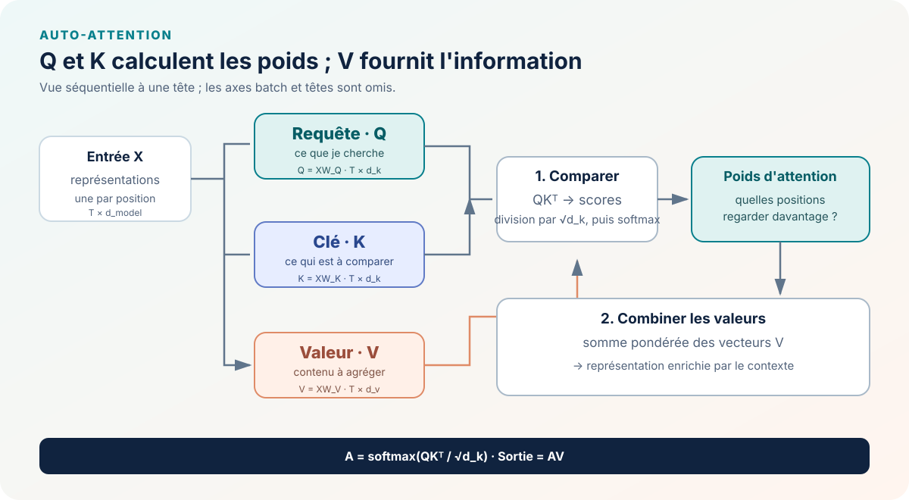

<!--
LLM-LAB-PAGE-MAP v1
id: "fr/queries-keys-values"
scope: "Définit les projections qui produisent requêtes, clés et valeurs à partir des représentations d’entrée, et leur rôle distinct dans le calcul d’attention ; laisse le produit scalaire, le masquage et la normalisation à la page sur l’attention à produit scalaire."
purpose: "Le lecteur doit pouvoir distinguer Q, K et V, identifier les projections apprises qui les produisent et expliquer comment ils contribuent respectivement au calcul des poids d’attention et à la combinaison de l’information."
suggested_route:
  previous: "fr/contextualized-representations"
  next: "fr/scaled-dot-product-attention"
hierarchy:
  parents: ["fr/contextualized-representations", "fr/transformer"]
  children: ["fr/scaled-dot-product-attention"]
related: []
tags: ["type:concept-lesson", "destination:understand", "topic:queries-keys-values", "level:core", "language:fr", "status:published"]
-->

::: {.chapter-lead}
À chaque position, le Transformer calcule trois vecteurs à partir de la représentation du token : une **requête** (Q), une **clé** (K) et une **valeur** (V). Les requêtes et les clés servent à calculer les poids d'attention ; ces poids déterminent ensuite comment combiner les valeurs.
:::

<div class="epistemic-badges">
  <span class="epistemic-badge badge-concept">Concept vérifié</span>
  <span class="epistemic-badge badge-code">Micro-code exécutable</span>
  <span class="epistemic-badge badge-status">Architecture : Transformer</span>
</div>

<div class="pipeline-stepper" role="navigation" aria-label="Étapes du pipeline LLM">
  <a class="step-item" href="text-data.qmd">1. Texte</a>
  <span class="step-arrow">→</span>
  <a class="step-item" href="embedding-space.qmd">2. Embeddings</a>
  <span class="step-arrow">→</span>
  <span class="step-item active">3. Attention (Q, K, V)</span>
  <span class="step-arrow">→</span>
  <a class="step-item" href="logits.qmd">4. Logits</a>
  <span class="step-arrow">→</span>
  <a class="step-item" href="cross-entropy.qmd">5. Perte & Entraînement</a>
</div>

::: {.callout-tip title="L'idée à retenir en une minute"}
**Q et K calculent les poids ; V fournit ce qui est agrégé.** Pour chaque position, le modèle compare sa requête aux clés accessibles, transforme les scores en poids avec le softmax, puis applique ces poids aux vecteurs de valeur.

**Première lecture :** retenez cette séparation des rôles et vérifiez le petit calcul numérique ci-dessous. Vous pourrez ensuite étudier les projections apprises et les dimensions des matrices.

**Pour approfondir :** suivez le calcul complet dans [l'attention à produit scalaire mise à l'échelle](scaled-dot-product-attention.qmd), puis la contrainte temporelle dans le [masque causal](causal-masking.qmd).
:::

Imagine une collection de fiches. Une **requête** exprime ce qu'une position cherche ; une **clé** aide à comparer les positions disponibles ; une **valeur** porte l'information qui sera agrégée. Cette analogie distingue les rôles, mais ne signifie pas que le modèle effectue une recherche symbolique explicite.

## L'idée en un schéma

{fig-alt="Les représentations d'entrée sont projetées en requêtes, clés et valeurs. Les requêtes sont comparées aux clés ; les poids obtenus pondèrent les valeurs pour produire une représentation contextualisée." width=100%}

Le calcul se déroule en deux étapes :

1. **Comparer.** La requête d'une position est comparée aux clés des positions auxquelles elle a le droit d'accéder. Ces comparaisons donnent des scores, mis à l'échelle puis éventuellement masqués avant d'être transformés en poids par le *softmax*. Le masque dépend du type d'attention ; il n'est pas nécessairement causal.
2. **Combiner.** Le modèle calcule une somme pondérée des valeurs. Les positions qui reçoivent un poids plus élevé contribuent davantage à cette nouvelle représentation.

Le vocabulaire vient d'une analogie avec la recherche d'information : une requête indique ce qu'on cherche, une clé permet de comparer les éléments disponibles, et une valeur contient l'information à récupérer. Dans un réseau neuronal, ces rôles sont portés par des vecteurs appris ; ils ne sont pas des étiquettes lisibles par un humain.

## Un exemple numérique : les poids ne sont pas les valeurs

Considérons une requête qui produit deux scores d'attention, \(s=(0,\ln 3)\). Après *softmax*, les poids valent \((0{,}25, 0{,}75)\). Si les deux vecteurs de valeur sont ici de simples scalaires \(v_1=2\) et \(v_2=10\), la sortie agrégée est :

\[
o=0{,}25\times 2+0{,}75\times 10=8.
\]

Cet exemple sépare les deux rôles : les scores issus de Q et K déterminent **les poids** ; les valeurs V fournissent **les contenus agrégés**. Il ne signifie pas que les valeurs sont toujours scalaires, ni que les poids révèlent à eux seuls une explication de la prédiction. Dans un vrai modèle, les scores et les valeurs sont des vecteurs calculés par des projections apprises.

## D'où viennent Q, K et V ?

On part d'une matrice $X\in\mathbb{R}^{T\times d_{model}}$, qui rassemble les représentations des $T$ positions. Trois transformations apprises produisent :

$$
Q=XW_Q,\qquad K=XW_K,\qquad V=XW_V.
$$

Les matrices $W_Q$, $W_K$ et $W_V$ sont apprises pendant l'entraînement. Elles transforment chaque représentation d'entrée pour lui donner un rôle différent dans le calcul de l'attention. Dans l'attention à produit scalaire standard, les valeurs $V$ ne déterminent pas directement les scores : ceux-ci sont calculés à partir de $Q$ et $K$.

::: {.callout-note collapse="true" title="Projections en pratique : code et dimensions (facultatif)"}
Avec $W_Q,W_K\in\mathbb{R}^{d_{model}\times d_k}$ et $W_V\in\mathbb{R}^{d_{model}\times d_v}$, les formes obtenues sont $Q,K\in\mathbb{R}^{T\times d_k}$ et $V\in\mathbb{R}^{T\times d_v}$. Les biais éventuels sont omis ici.

::: {.micro-workbench}
::: {.micro-workbench-header}
<span>MICRO-ATELIER NUMÉRIQUE · PROJECTIONS LINÉAIRES</span>
<span>Python 3.12+ / NumPy</span>
:::
::: {.micro-workbench-body}
```python
import numpy as np

# 1. Représentations de trois positions (d_model = 4)
X = np.array([
    [1.0, 0.5, 0.2, 0.1],  # position 0
    [0.1, 0.9, 0.8, 0.3],  # position 1
    [0.4, 0.2, 0.7, 0.9],  # position 2
])
T = X.shape[0]

# 2. Matrices de projection apprises
W_Q = np.array([[0.5, 0.1], [0.2, 0.8], [0.1, 0.3], [0.9, 0.4]])
W_K = np.array([[0.2, 0.7], [0.4, 0.1], [0.6, 0.5], [0.3, 0.2]])
W_V = np.array([[1.0, 0.0, 0.2], [0.0, 1.0, 0.5], [0.5, 0.2, 0.0], [0.1, 0.8, 0.4]])

# 3. Chaque position est projetée en Q, K et V
Q = X @ W_Q
K = X @ W_K
V = X @ W_V
assert Q.shape == (T, 2) and K.shape == (T, 2) and V.shape == (T, 3)
```
:::
::: {.micro-workbench-footer}
Invariant vérifié : chaque projection conserve le nombre de positions $T$ ; les dimensions des vecteurs projetés peuvent différer.
:::
:::
:::

## Pourquoi séparer ces trois rôles ?

- **Q et K déterminent où regarder.** Les scores $QK^\top$ comparent chaque requête à chaque clé. Dans un Transformer autorégressif, le masque causal exclut les positions futures avant le *softmax*.
- **V détermine quelle information est transmise.** Une fois les poids calculés, ils servent à combiner les vecteurs de valeur.
- **Les trois sont appris ensemble.** Le modèle apprend les transformations utiles à son objectif ; il ne s'agit pas de champs définis à la main.

La formule complète d'une tête d'attention est présentée dans la page sur l'[attention à produit scalaire mise à l'échelle](scaled-dot-product-attention.qmd). La page sur le [masque causal](causal-masking.qmd) explique comment empêcher une position de consulter le futur.

## Idées reçues et contre-exemples

- **« Une clé est une étiquette sémantique lisible. »** En général, non : ses coordonnées sont apprises et n'ont pas d'interprétation humaine directe garantie.
- **« La valeur la plus proche est forcément la plus utile. »** Les poids ne sont pas calculés à partir d'une distance universelle entre les valeurs : ils dépendent des requêtes et des clés.
- **« Q, K et V ont toujours la même dimension. »** Pas nécessairement : la dimension des clés peut différer de celle des valeurs, selon l'architecture.
- **« Un poids d'attention élevé explique à lui seul une prédiction. »** Il décrit une étape de l'agrégation, pas l'effet de cette information sur la sortie finale du modèle.

<details class="spot-the-fallacy">
<summary>Piège fréquent : « Un poids d'attention de 0,95 prouve que ce token est la cause principale de la réponse »</summary>
<div class="fallacy-content">
<p><strong>Réfutation rigoureuse :</strong> Le poids d'attention $\alpha_{ij}$ mesure uniquement l'alignement relatif entre la requête $q_i$ et la clé $k_j$. Si le vecteur de valeur $v_j$ correspondant a une norme faible ou est orthogonal à la direction utile pour la prédiction, cette position aura une contribution marginale. De plus, la sortie d'attention traverse ensuite une connexion résiduelle, une normalisation et un réseau MLP, qui modifient profondément l'information transmise.</p>
</div>
</details>

## Repères historiques

Les mécanismes d'attention ont notamment été étudiés dans les modèles de traduction neuronale de Bahdanau, Cho et Bengio (2014). *Attention Is All You Need* (Vaswani et al., 2017) a placé l'auto-attention au cœur de l'architecture Transformer et formalisé l'attention à produit scalaire mise à l'échelle.

- [Bahdanau et al. (2014), *Neural Machine Translation by Jointly Learning to Align and Translate*](https://arxiv.org/abs/1409.0473)
- [Vaswani et al. (2017), *Attention Is All You Need*](https://arxiv.org/abs/1706.03762)

## Liens avec les autres concepts

- Comprendre les scores et le *softmax* dans [l'attention à produit scalaire mise à l'échelle](scaled-dot-product-attention.qmd).
- Voir comment le [masque causal](causal-masking.qmd) bloque l'accès aux positions futures.
- Replacer ces opérations dans la [synthèse du Transformer](transformer.qmd).
- Relier le *softmax* aux [probabilités](probabilites.qmd).

::: {.self-check}
## Vérifier sa compréhension

[Exercices approfondis sur ce thème](exercises.qmd#attention).

Une position reçoit les poids d’attention $(0{,}75,\,0{,}25)$ et les vecteurs de valeur sont $v_1=(2,0)$ et $v_2=(0,4)$. Calculez la sortie. Si l’on échange $v_1$ et $v_2$ sans changer les poids, la sortie reste-t-elle identique ?

<details>
<summary>Afficher le raisonnement</summary>

La sortie est la somme pondérée : $0{,}75(2,0)+0{,}25(0,4)=(1{,}5;1)$. Après échange des valeurs, elle devient $0{,}75(0,4)+0{,}25(2,0)=(0{,}5;3)$. Les poids déterminent la contribution relative des positions ; les valeurs déterminent le contenu agrégé. Les poids seuls ne suffisent donc pas à déterminer la sortie.

</details>
:::

::: {.callout-note collapse="true" title="Code et tests de référence (approfondissement)"}
Pour comprendre les formes des matrices et des vecteurs utilisés ici, voir [Tenseurs](tensors.qmd).

Une implémentation de référence testée numériquement est disponible dans `src/llm_lab/foundations/attention.py` (`scaled_dot_product_attention`). Les tests unitaires associés dans `tests/unit/test_attention.py` vérifient la préservation des formes, la somme unitaire des poids et la stabilité numérique.

- [Implémentation de référence](https://github.com/JM-Brun/llm-lab/tree/main/src/llm_lab/foundations/attention.py)
- [Tests unitaires](https://github.com/JM-Brun/llm-lab/tree/main/tests/unit/test_attention.py)
- [Critères prévus pour l'attention causale](https://github.com/JM-Brun/llm-lab/blob/main/docs/roadmap.md#deferred--causal-attention-implementation)
:::

<div class="route-nav-cards">
  <a class="route-nav-card" href="contextualized-representations.qmd">
    <span class="nav-direction">← Étape précédente</span>
    <span class="nav-title">Représentations contextualisées</span>
  </a>
  <a class="route-nav-card" href="scaled-dot-product-attention.qmd">
    <span class="nav-direction">Étape suivante →</span>
    <span class="nav-title">Attention à produit scalaire mise à l'échelle</span>
  </a>
</div>

::: {.language-switch}
**Langue :** [Français](queries-keys-values.qmd) · [English](../en/queries-keys-values.qmd)
:::
