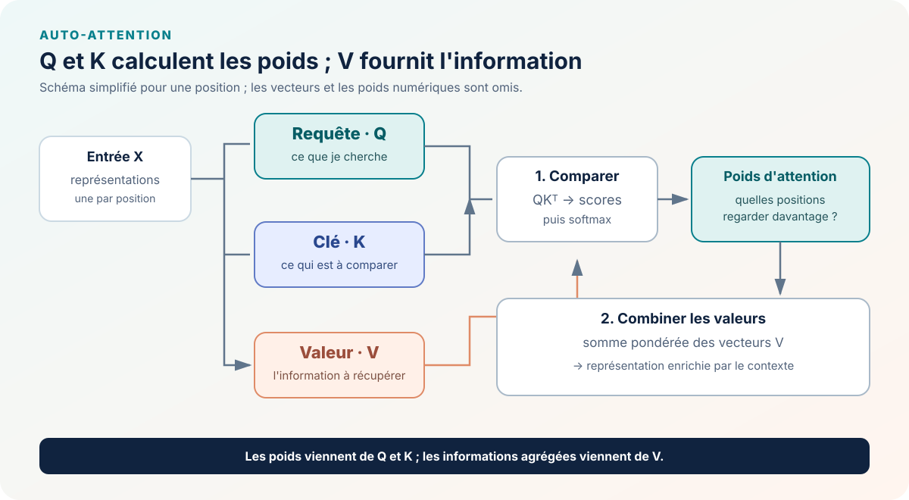

::: {.chapter-lead}
À chaque position, le Transformer calcule trois vecteurs à partir de la représentation du token : une **requête** (Q), une **clé** (K) et une **valeur** (V). Les requêtes et les clés servent à calculer les poids d'attention ; ces poids déterminent ensuite comment combiner les valeurs.
:::

## L'idée en un schéma

{fig-alt="Les représentations d'entrée sont projetées en requêtes, clés et valeurs. Les requêtes sont comparées aux clés ; les poids obtenus pondèrent les valeurs pour produire une représentation contextualisée." width=100%}

Le calcul se déroule en deux étapes :

1. **Comparer.** La requête d'une position est comparée aux clés des positions auxquelles elle a le droit d'accéder. Ces comparaisons donnent des scores, mis à l'échelle puis éventuellement masqués avant d'être transformés en poids par le *softmax*. Le masque dépend du type d'attention ; il n'est pas nécessairement causal.
2. **Combiner.** Le modèle calcule une somme pondérée des valeurs. Les positions qui reçoivent un poids plus élevé contribuent davantage à cette nouvelle représentation.

Le vocabulaire vient d'une analogie avec la recherche d'information : une requête indique ce qu'on cherche, une clé permet de comparer les éléments disponibles, et une valeur contient l'information à récupérer. Dans un réseau neuronal, ces rôles sont portés par des vecteurs appris ; ils ne sont pas des étiquettes lisibles par un humain.

## Un exemple numérique : les poids ne sont pas les valeurs

Considérons une requête qui produit deux scores d'attention, \(s=(0,\ln 3)\). Après *softmax*, les poids valent \((0{,}25, 0{,}75)\). Si les deux vecteurs de valeur sont ici de simples scalaires \(v_1=2\) et \(v_2=10\), la sortie agrégée est :

\[
o=0{,}25\times 2+0{,}75\times 10=8.
\]

Cet exemple sépare les deux rôles : les scores issus de Q et K déterminent **les poids** ; les valeurs V fournissent **les contenus agrégés**. Il ne signifie pas que les valeurs sont toujours scalaires, ni que les poids révèlent à eux seuls une explication de la prédiction. Dans un vrai modèle, les scores et les valeurs sont des vecteurs calculés par des projections apprises.

## D'où viennent Q, K et V ?

On part d'une matrice $X\in\mathbb{R}^{T\times d_{model}}$, qui rassemble les représentations des $T$ positions. Trois transformations apprises produisent :

$$
Q=XW_Q,\qquad K=XW_K,\qquad V=XW_V.
$$

Les matrices $W_Q$, $W_K$ et $W_V$ sont apprises pendant l'entraînement. Elles transforment chaque représentation d'entrée pour lui donner un rôle différent dans le calcul de l'attention. Dans l'attention à produit scalaire standard, les valeurs $V$ ne déterminent pas directement les scores : ceux-ci sont calculés à partir de $Q$ et $K$.

Avec $W_Q,W_K\in\mathbb{R}^{d_{model}\times d_k}$ et $W_V\in\mathbb{R}^{d_{model}\times d_v}$, les formes obtenues sont $Q,K\in\mathbb{R}^{T\times d_k}$ et $V\in\mathbb{R}^{T\times d_v}$. Les biais éventuels sont omis ici.

## Pourquoi séparer ces trois rôles ?

- **Q et K déterminent où regarder.** Les scores $QK^\top$ comparent chaque requête à chaque clé. Dans un Transformer autorégressif, le masque causal exclut les positions futures avant le *softmax*.
- **V détermine quelle information est transmise.** Une fois les poids calculés, ils servent à combiner les vecteurs de valeur.
- **Les trois sont appris ensemble.** Le modèle apprend les transformations utiles à son objectif ; il ne s'agit pas de champs définis à la main.

La formule complète d'une tête d'attention est présentée dans la page sur l'[attention à produit scalaire mise à l'échelle](scaled-dot-product-attention.qmd). La page sur le [masque causal](causal-masking.qmd) explique comment empêcher une position de consulter le futur.

## Idées reçues et contre-exemples

- **« Une clé est une étiquette sémantique lisible. »** En général, non : ses coordonnées sont apprises et n'ont pas d'interprétation humaine directe garantie.
- **« La valeur la plus proche est forcément la plus utile. »** Les poids ne sont pas calculés à partir d'une distance universelle entre les valeurs : ils dépendent des requêtes et des clés.
- **« Q, K et V ont toujours la même dimension. »** Pas nécessairement : la dimension des clés peut différer de celle des valeurs, selon l'architecture.
- **« Un poids d'attention élevé explique à lui seul une prédiction. »** Il décrit une étape de l'agrégation, pas l'effet de cette information sur la sortie finale du modèle.

## Repères historiques

Les mécanismes d'attention ont notamment été étudiés dans les modèles de traduction neuronale de Bahdanau, Cho et Bengio (2014). *Attention Is All You Need* (Vaswani et al., 2017) a placé l'auto-attention au cœur de l'architecture Transformer et formalisé l'attention à produit scalaire mise à l'échelle.

- [Bahdanau et al. (2014), *Neural Machine Translation by Jointly Learning to Align and Translate*](https://arxiv.org/abs/1409.0473)
- [Vaswani et al. (2017), *Attention Is All You Need*](https://arxiv.org/abs/1706.03762)

## Liens avec les autres concepts

- Comprendre les scores et le *softmax* dans [l'attention à produit scalaire mise à l'échelle](scaled-dot-product-attention.qmd).
- Voir comment le [masque causal](causal-masking.qmd) bloque l'accès aux positions futures.
- Replacer ces opérations dans la [synthèse du Transformer](transformer.qmd).
- Relier le *softmax* aux [probabilités](probabilites.qmd).

## Code et tests

Pour comprendre les formes des matrices et des vecteurs utilisés ici, voir [Tenseurs](tensors.qmd).

Le dépôt ne contient pas encore d'implémentation Q/K/V réutilisable dans **src/llm_lab/**. Avant d'en ajouter une, il faudra notamment vérifier les dimensions des tenseurs, les projections, la propagation des gradients et le comportement en attention multi-têtes.

- [Code source existant](https://github.com/JM-Brun/llm-lab/tree/main/src/llm_lab)
- [Tests existants](https://github.com/JM-Brun/llm-lab/tree/main/tests)
- [Critères prévus pour l'attention causale](https://github.com/JM-Brun/llm-lab/blob/main/docs/roadmap.md#deferred--causal-attention-implementation)

::: {.language-switch}
**Langue :** [Français](queries-keys-values.qmd) · [English](../en/queries-keys-values.qmd)
:::
