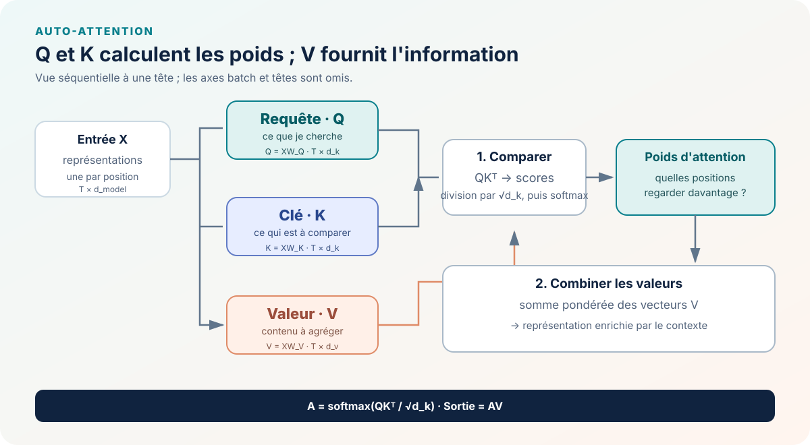
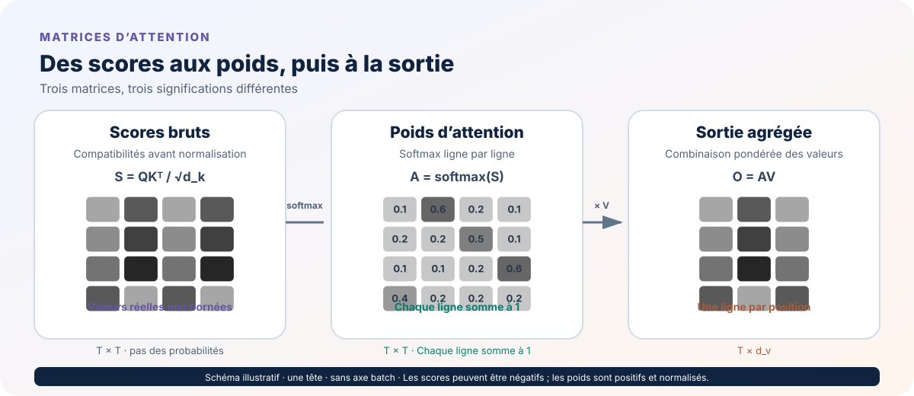

<!--
LLM-LAB-PAGE-MAP v1
id: "fr/queries-keys-values"
summary: "Distingue les trois projections apprises de l’auto-attention : Q formule les requêtes, K permet de calculer les compatibilités et V porte le contenu agrégé."
scope: "Distingue les trois projections apprises d’un état de bloc et leur rôle dans une tête d’auto-attention."
purpose: "Expliquer pourquoi l’auto-attention projette l’état d’entrée du bloc en Q, K et V, distinguer la compatibilité (Q/K) du contenu agrégé (V), et prévoir les effets d’une modification isolée de projection."
suggested_route:
  previous: "fr/transformer"
  next: "fr/scaled-dot-product-attention"
hierarchy:
  parents: ["fr/transformer"]
  children: ["fr/queries-keys-values-advanced"]
related: ["fr/contextualized-representations", "fr/scaled-dot-product-attention", "fr/cross-attention", "fr/transformer-block-walkthrough", "fr/queries-keys-values-exercises"]
revision_support:
  status: integrated_sufficient
  evidence:
    - anchor: revision-summary
      note: "Le récapitulatif distingue Q/K (scores et poids) de V (contenu agrégé), précise ce qui change si V varie seul et renvoie aux limites d'interprétation ; les questions de compréhension et les exercices associés sont regroupés sur la page compagne dédiée."
tags: ["type:concept-lesson", "destination:understand", "topic:queries-keys-values", "level:core", "language:fr", "status:published"]
-->



::: {.chapter-lead}
La page précédente, [Le Transformer dans un GPT : architecture et calcul](transformer.qmd), a montré que l'auto-attention est une sous-couche du bloc répété. Partons maintenant d'une difficulté simple : comment une position peut-elle exploiter le contexte fourni par les autres tokens ?
:::

## Le problème : utiliser le contexte

Dans « Le chat a poursuivi le chien parce qu'il était rapide », le pronom **il** peut renvoyer au chat ou au chien. Un modèle ne peut donc pas toujours interpréter un token à partir de sa seule représentation locale : il doit pouvoir exploiter l'information portée par d'autres positions de la séquence.

C'est le rôle de l'auto-attention. Pour chaque position, le mécanisme construit deux choses : **où regarder** dans le contexte et **quelle information en rapporter**. Q, K et V fournissent les représentations nécessaires à ces deux opérations.

Pour le token courant dans « C'est une bonne situation, ça, scribe ? », Q est comparée aux K des positions accessibles ; les poids obtenus servent ensuite à agréger leurs V. Cette lecture décrit le calcul, pas une recherche consciente ni une interprétation humaine de la phrase.

Cet exemple est adapté de [Neha KK](https://medium.com/@nkk18072004/understanding-queries-keys-and-values-in-transformers-149ed07c9f8b). Il motive le besoin de contexte ; il ne prouve pas qu'une tête isolée résout la coréférence ni ne décrit les poids d'un modèle entraîné.

  Concept vérifié
  Architecture : Transformer

:::: {.pipeline-stepper .meta-flow .meta-flow--branch role="group" aria-label="Carte des projections parallèles Q, K et V et de leur recombinaison"}
::: {.meta-flow__source}
<strong>Entrée commune</strong>Représentations d'entrée de chaque position
:::
::: {.meta-flow__source .meta-flow__branch--active}
<strong>Projections apprises Q, K et V</strong>Trois transformations parallèles du même état d’entrée
:::
::: {.meta-flow__branches}
::: {.meta-flow__branch}
<strong>Q · Query</strong>Vecteur comparé aux clés
:::
::: {.meta-flow__branch}
<strong>K · Key</strong>Vecteur comparé aux requêtes
:::
::: {.meta-flow__branch}
<strong>V · Value</strong>Le contenu qui pourra être agrégé
:::
:::
::: {.meta-flow__relation}
Q et K déterminent les poids ; V fournit le contenu à mélanger
:::
::: {.meta-flow__result}
<strong>QKᵀ → scores → <a href="scaled-dot-product-attention.qmd#calcul-en-cinq-étapes">calcul des poids</a></strong>
:::
::: {.meta-flow__result}
<strong>Poids × V → somme pondérée → sortie de l’attention</strong>
:::
::::

## Trois rôles complémentaires

On peut distinguer les trois projections en suivant le trajet de l'information :

- **Q — la requête :** ce que la position courante cherche à faire correspondre dans le contexte ;
- **K — la clé :** ce que chaque position présente pour être comparé à la requête ;
- **V — la valeur :** l'information portée par cette position et susceptible d'être transmise.

Q et K servent donc à déterminer **la répartition de l'attention**. V fournit **le contenu agrégé** à l'aide de cette répartition. K et V peuvent représenter des caractéristiques différentes : la compatibilité sert au routage, tandis que la valeur porte le contenu transmis. Ce sont des vecteurs numériques appris, pas des étiquettes lisibles ni des réponses toutes faites.

::: {.callout-tip title="Une autre intuition : un moteur de recommandation"}
Imaginez un système qui compare une demande à plusieurs éléments proposés, puis combine des informations issues des éléments selon les poids calculés :

- **Q (requête)** représente ce que la position courante cherche à faire correspondre ;
- **K (clé)** fournit ce qui est comparé à cette requête ;
- **V (valeur)** fournit le contenu qui sera combiné selon les poids obtenus.

L'analogie aide à séparer **le calcul de compatibilité** (**Q/K**) du **transport de contenu** (**V**). Mais un Transformer ne consulte pas un catalogue de fiches : Q, K et V sont des vecteurs continus appris, et l'attention calcule une somme pondérée plutôt qu'une sélection discrète d'un résultat.

Cette intuition complémentaire est développée dans l'article [Understanding Transformers (Part 4)](https://joseparreogarcia.substack.com/p/understanding-transformers-part-4). Elle prépare la lecture des équations ci-dessous ; elle ne les remplace pas.
:::

<picture>
  <source media="(max-width: 600px)" srcset="../images/queries-keys-values-mobile.svg">
  
</picture>

### Matrice des scores, des poids et de la sortie

<picture>
  <source media="(max-width: 600px)" srcset="../images/attention-matrices-mobile.svg">
  
</picture>

Le schéma fait apparaître deux chemins : l'un détermine la pondération, l'autre fournit le contenu. **Pourquoi faut-il trois projections distinctes pour construire ces deux chemins à partir d'une même entrée ?**

## Pourquoi trois projections à partir de la même entrée ? {#pourquoi-trois-projections-à-partir-de-la-même-entrée}

En auto-attention, Q, K et V sont trois transformations apprises du même flux de représentations. Appelons $H_{\mathrm{in}}$ l’entrée du bloc : dans le premier bloc, elle provient des embeddings de tokens et du mécanisme d’entrée propre à l’architecture. Dans les blocs suivants, elle contient des états déjà contextualisés. Dans une pile de blocs Transformer, ces projections sont recalculées à l’intérieur de chaque sous-couche d’attention, à partir de l’état d’entrée du bloc concerné. Elles contribuent à produire les états transmis au bloc suivant ; elles ne constituent pas une opération placée après les représentations contextualisées finales. Dans le GPT de référence de ce projet, les embeddings positionnels absolus appris sont **additionnés** aux embeddings de tokens avant le premier bloc ([embeddings positionnels](positional-encoding.qmd)). Avec [RoPE](rope.qmd), les requêtes et clés reçoivent une rotation positionnelle après la projection linéaire. Les équations ci-dessous décrivent les projections avant cette rotation.

Dans le [bloc pré-LN du GPT de référence](transformer.qmd), une LayerNorm s’applique position par position avant les projections. L’entrée commune des projections est donc $X=\operatorname{LN}_1(H_{\mathrm{in}})$. Le chemin résiduel reçoit $H_{\mathrm{in}}$.

Pour une séquence de $T$ positions, on écrit $X\in\mathbb{R}^{T\times d_{model}}$ :

$$
\begin{aligned}
Q &= XW_Q,\\
K &= XW_K,\\
V &= XW_V.
\end{aligned}
$$

Les matrices $W_Q$, $W_K$ et $W_V$ sont **distinctes, mais apprises conjointement**. Elles donnent au modèle la possibilité de construire, à partir de la même entrée, des représentations adaptées à deux fonctions différentes : calculer les compatibilités (Q et K) et transporter le contenu (V). Cette paramétrisation suit la formulation de [Vaswani et al. (2017), *Attention Is All You Need*](https://arxiv.org/abs/1706.03762). Pour une explication visuelle complémentaire, voir [How Query, Key, and Value (QKV) Work in Transformers](https://dev.to/nishanthan-k/how-query-key-and-value-qkv-work-in-transformers-199a) ; les équations, dimensions et limites d'interprétation de référence restent celles de cette leçon et de l'[approfondissement Q/K/V](queries-keys-values-advanced.qmd).

Avec $W_Q,W_K\in\mathbb{R}^{d_{model}\times d_k}$ et $W_V\in\mathbb{R}^{d_{model}\times d_v}$, les sorties ont les formes suivantes :

- $Q,K\in\mathbb{R}^{T\times d_k}$ ;
- $V\in\mathbb{R}^{T\times d_v}$.

Chaque ligne correspond à une position. Les mêmes matrices de projection sont appliquées à toutes les positions, mais les représentations d'entrée varient. Les dimensions $d_k$ et $d_v$ ne sont pas nécessairement égales ; les biais éventuels sont omis dans cette écriture. Cette provenance commune caractérise l'auto-attention ; en [attention croisée](cross-attention.qmd), Q provient du flux qui consulte, tandis que K et V proviennent du flux consulté. Pour suivre ces projections dans le code du bloc, voir la [visite guidée du bloc Transformer](transformer-block-walkthrough.qmd) ; les conventions générales de dimensions et d'axes sont détaillées dans [Tenseurs](tensors.qmd).

## À retenir et pour aller plus loin {#revision-summary}

La distinction fonctionnelle est simple, mais fondamentale :

- **Q et K** déterminent les scores de compatibilité, puis les poids d'attention ;
- **V** fournit les vecteurs combinés à l'aide de ces poids ;
- changer V seul ne change donc pas les poids, même si le contenu agrégé peut changer.

Les poids ne sont pas une mesure universelle de pertinence sémantique et l'attention n'est pas une recherche du plus proche voisin dans les embeddings initiaux : elle opère sur des projections apprises. Les limites de cette interprétation et les chemins de gradient sont détaillés dans l'[approfondissement Q/K/V](queries-keys-values-advanced.qmd).

La page suivante, [Attention à produit scalaire mise à l'échelle](scaled-dot-product-attention.qmd), explique comment les scores deviennent des poids et comment ceux-ci agrègent V. Son [atelier facultatif](scaled-dot-product-attention.qmd#attention-intervention) permet de vérifier l’effet de changer une clé ou une valeur.



::: {.language-switch}
**Langue :** [Français](queries-keys-values.qmd) · [English](../en/queries-keys-values.qmd)
:::

## Exercices

Les questions et exercices de cette leçon sont regroupés sur sa [page d’exercices dédiée](exercises/queries-keys-values.qmd).

## Approfondir

:::: {.supplementary-resources}

  Ressources complémentaires
  Approfondir les dimensions mathématiques et architecturales de cette leçon.

::: {.learning-resources__content}

### Approfondissement mathématique et architectural

Les équations par position, la géométrie des compatibilités, les chemins de gradient et les variantes multi-têtes sont utiles une fois le modèle mental acquis. Ils sont regroupés dans l'[approfondissement avancé sur Q/K/V](queries-keys-values-advanced.qmd), plutôt que dispersés dans plusieurs encadrés repliés sur cette page.

Pour comparer les architectures qui modifient le nombre de têtes K/V, compressent le cache ou limitent les positions consultées, consultez la section [Variantes d'attention](transformer-block-walkthrough.qmd#attention-variants) de la visite guidée du bloc Transformer. Elle distingue explicitement cette comparaison du code MHA réellement implémenté.

Pour suivre cette distinction dans les opérations, passez ensuite à [l'attention à produit scalaire](scaled-dot-product-attention.qmd), puis à la [visite guidée du bloc Transformer](transformer-block-walkthrough.qmd) pour retrouver les deux chemins dans le code.

Pour une autre construction intuitive, [Attention from scratch de Zsombor Veres-Lakos](https://zsomborvereslakos.substack.com/p/attention-from-scratch) suit une analogie de réunion depuis les projections Q/K/V jusqu'au vecteur de contexte, à la projection W_O et à la mise à jour du flux résiduel. C'est une lecture complémentaire, pas une dérivation de référence : le facteur 10 est pédagogique, et le masquage causal ainsi que l'attention multi-tête sont explicitement omis.

:::

::::
