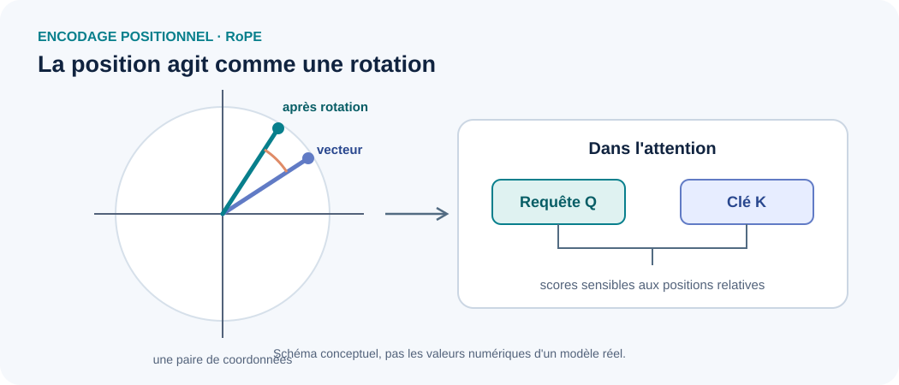

<!--
LLM-LAB-PAGE-MAP v1
id: "fr/rope"
scope: "Approfondit Rotary Position Embedding : représentation des rotations par paires de coordonnées, dépendance du produit scalaire au décalage relatif, conventions d'implémentation et limites d'extrapolation ; ne reprend pas l'introduction générale à l'information positionnelle."
purpose: "Le lecteur doit pouvoir dériver la dépendance au décalage relatif pour une paire de coordonnées, situer les rotations dans le calcul Q/K et identifier les choix d'implémentation et d'évaluation qui conditionnent le comportement à longue séquence."
domain: "architectures-mechanisms"
suggested_route:
  previous: null
  next: null
hierarchy:
  parents: ["fr/positional-encoding"]
  children: []
related: ["fr/queries-keys-values", "fr/scaled-dot-product-attention"]
tags: ["type:deep-dive", "destination:deepen", "topic:rope", "level:advanced", "language:fr", "status:published"]
-->


::: {.chapter-lead}
Cette page est un **approfondissement avancé**. Elle suppose compris le rôle de l'information positionnelle et le calcul général de l'attention. Elle étudie la géométrie de **RoPE** (*Rotary Position Embedding*), qui applique des rotations dépendant de la position aux requêtes et aux clés avant le calcul des scores d'attention.
:::

## Principe géométrique

{fig-alt="RoPE applique des rotations dépendant de la position aux paires de coordonnées des requêtes et des clés. Les angles dépendent de la position et de la fréquence de chaque paire." width=100%}

Le dessin représente une seule paire de coordonnées. En pratique, RoPE agit sur plusieurs paires avec des fréquences différentes. La figure illustre l'opération géométrique, pas les valeurs numériques d'un modèle réel.

Pour une paire de coordonnées $(x_1,x_2)$, une rotation d'angle $\theta$ s'écrit :

$$
R(\theta)=
\begin{pmatrix}
\cos\theta & -\sin\theta\\
\sin\theta & \cos\theta
\end{pmatrix},
\qquad
x'=R(\theta)x.
$$

## Pourquoi le score dépend-il du décalage relatif ?

Considérons une paire de coordonnées et une fréquence fixées. Si $q$ et $k$ sont les composantes d'une requête et d'une clé avant rotation, leurs versions aux positions $m$ et $n$ sont $q_m=R(m\theta)q$ et $k_n=R(n\theta)k$.

Comme une rotation vérifie $R(\alpha)^\top=R(-\alpha)$ et $R(\alpha)R(\beta)=R(\alpha+\beta)$, on obtient :

$$
q_m^\top k_n
= q^\top R(m\theta)^\top R(n\theta)k
= q^\top R((n-m)\theta)k.
$$

Le score dépend donc du décalage $n-m$ pour cette paire et cette fréquence, plutôt que des positions absolues prises séparément. Dans RoPE, ce raisonnement s'applique paire par paire, avec une fréquence propre à chaque paire.

Dans une tête d'attention, les rotations sont appliquées à $Q$ et $K$ **après leurs projections et avant le calcul de $QK^\top$**. Les valeurs $V$ ne sont pas directement tournées par la version standard de RoPE. Voir [requêtes, clés et valeurs](queries-keys-values.qmd) et [attention à produit scalaire](scaled-dot-product-attention.qmd).

## Ce que RoPE apporte — et ce qu'il ne garantit pas

RoPE fournit une manière structurée d'introduire la position dans l'attention. Sa présence ne garantit pas, à elle seule, une extrapolation fiable vers des séquences beaucoup plus longues que celles vues pendant l'entraînement.

Le comportement à grande longueur dépend aussi de la base de fréquences, de la longueur d'entraînement, des méthodes éventuelles de mise à l'échelle, du mécanisme d'attention et des données. Il faut identifier la variante exacte avant de comparer deux modèles.

## Idées reçues

- **« RoPE ajoute simplement un vecteur de position aux embeddings. »** Non : dans sa forme courante, RoPE fait tourner des paires de coordonnées des requêtes et des clés.
- **« RoPE garantit les longues fenêtres de contexte. »** Non : les performances au-delà de la longueur d'entraînement dépendent de plusieurs choix et doivent être évaluées.
- **« RoPE tourne aussi les valeurs $V$. »** Dans la version standard, l'opération agit sur $Q$ et $K$, puis l'attention agrège les valeurs selon les poids calculés.

## Vérifications d'implémentation

Vérifier les dimensions, l'ordre des paires de coordonnées, les positions utilisées, la précision numérique et le comportement sur plusieurs longueurs. Une erreur d'indexation peut produire des tenseurs de forme correcte tout en encodant les mauvaises positions. Les tests doivent comparer les résultats à une référence connue et contrôler les scores d'attention.

## Références

- [Su et al. (2021), *RoFormer: Enhanced Transformer with Rotary Position Embedding*](https://arxiv.org/abs/2104.09864) — formulation originale de RoPE.
- [Hugging Face Transformers — documentation](https://huggingface.co/docs/transformers/) — les conventions d'implémentation varient selon les architectures.

::: {.language-switch}
**Langue :** [Français](rope.qmd) · [English](../en/rope.qmd)
:::
