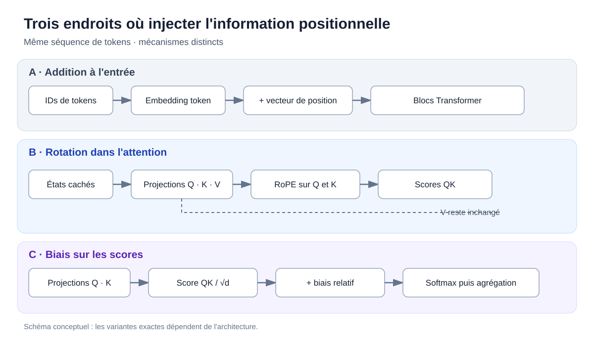
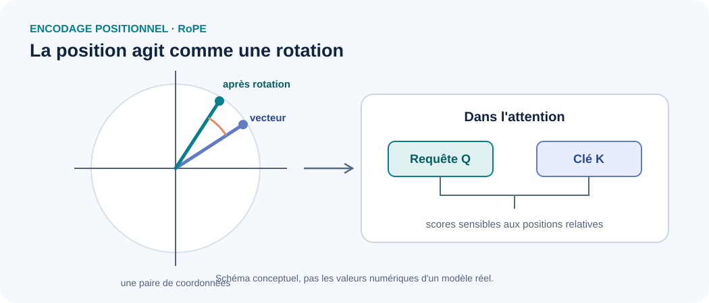

<!--
LLM-LAB-PAGE-MAP v1
id: "fr/rope"
scope: "Approfondit Rotary Position Embedding : représentation des rotations par paires de coordonnées, dépendance du produit scalaire au décalage relatif, conventions d'implémentation et limites d'extrapolation ; ne reprend pas l'introduction générale à l'information positionnelle."
purpose: "Le lecteur doit pouvoir dériver la dépendance au décalage relatif pour une paire de coordonnées, situer les rotations dans le calcul Q/K et identifier les choix d'implémentation et d'évaluation qui conditionnent le comportement à longue séquence."
domain: "architectures-mechanisms"
suggested_route:
  previous: null
  next: null
hierarchy:
  parents: ["fr/positional-encoding"]
  children: []
related: ["fr/queries-keys-values", "fr/scaled-dot-product-attention", "fr/causal-masking", "fr/rope-exercises"]
tags: ["type:deep-dive", "destination:deepen", "topic:rope", "level:advanced", "language:fr", "status:published"]
-->


::: {.chapter-lead}
Cette page est un **approfondissement avancé**. Elle suppose compris le rôle de l'information positionnelle et le calcul général de l'attention. Elle étudie la géométrie de **RoPE** (*Rotary Position Embedding*), qui applique des rotations dépendant de la position aux requêtes et aux clés avant le calcul des scores d'attention.
:::

## Trois points d'injection de l'information positionnelle

Le contraste le plus utile à garder en tête n'est pas seulement « absolu contre relatif » : les mécanismes interviennent à des endroits différents du calcul.

{fig-alt="Trois voies : le vecteur de position est additionné à l'embedding token avant les blocs ; RoPE transforme Q et K après projection tandis que V reste inchangé ; un biais relatif est ajouté au score QK avant softmax." width=100%}

- **Addition à l'entrée :** le signal positionnel modifie la représentation avant le premier bloc.
- **RoPE :** le signal agit dans l'attention, sur les requêtes et les clés avant le produit scalaire.
- **Biais relatif :** le signal modifie les scores d'attention avant softmax.

Ces voies sont des familles de mécanismes, pas trois opérations nécessairement exclusives dans toute architecture.

## Principe géométrique

{fig-alt="RoPE applique des rotations dépendant de la position aux paires de coordonnées des requêtes et des clés. Les angles dépendent de la position et de la fréquence de chaque paire." width=100%}

Le dessin représente une seule paire de coordonnées. En pratique, RoPE agit sur plusieurs paires avec des fréquences différentes. La figure illustre l'opération géométrique, pas les valeurs numériques d'un modèle réel.

Pour une paire de coordonnées $(x_1,x_2)$, une rotation d'angle $\theta$ s'écrit :

$$
R(\theta)=
\begin{pmatrix}
\cos\theta & -\sin\theta\\
\sin\theta & \cos\theta
\end{pmatrix},
\qquad
x'=R(\theta)x.
$$

## Pourquoi le score dépend-il du décalage relatif ?

Considérons une paire de coordonnées et une fréquence fixées. Si $q$ et $k$ sont les composantes d'une requête et d'une clé avant rotation, leurs versions aux positions $m$ et $n$ sont $q_m=R(m\theta)q$ et $k_n=R(n\theta)k$.

Comme une rotation vérifie $R(\alpha)^\top=R(-\alpha)$ et $R(\alpha)R(\beta)=R(\alpha+\beta)$, on obtient :

$$
q_m^\top k_n
= q^\top R(m\theta)^\top R(n\theta)k
= q^\top R((n-m)\theta)k.
$$

Le score dépend donc du décalage $n-m$ pour cette paire et cette fréquence, plutôt que des positions absolues prises séparément. Dans RoPE, ce raisonnement s'applique paire par paire, avec une fréquence propre à chaque paire.

Dans une tête d'attention, les rotations sont appliquées à $Q$ et $K$ **après leurs projections et avant le calcul de $QK^\top$**. Les valeurs $V$ ne sont pas directement tournées par la version standard de RoPE. Voir [requêtes, clés et valeurs](queries-keys-values.qmd) et [attention à produit scalaire](scaled-dot-product-attention.qmd).



<link rel="stylesheet" href="../styles/rope-pair-explorer.css">



<link rel="stylesheet" href="../styles/rope-attention-pipeline.css">



<link rel="stylesheet" href="../styles/rope-pair-layout.css">



<link rel="stylesheet" href="../styles/rope-frequency-explorer.css">



<link rel="stylesheet" href="../styles/rope-memory-ledger.css">



<link rel="stylesheet" href="../styles/nope-prefix-experiment.css">

## Couches hybrides RoPE/NoPE : opération locale et états hérités

Une couche qui omet RoPE ne reçoit pas une représentation vide ou réinitialisée : elle reçoit les états cachés contextualisés de la couche précédente. Des couches antérieures peuvent avoir rendu disponibles des distinctions positionnelles et contextuelles, sans qu'un schéma d'architecture puisse garantir qu'elles seront conservées ou utilisées.



<link rel="stylesheet" href="../styles/hybrid-rope-nope.css">

## Biais relatif : ajouter un terme positionnel avant softmax

Un score d'attention peut être décomposé en un terme de contenu et un terme de position relative, par exemple \(s_{ij}=q_i^\top k_j/\sqrt{d_k}+b(h_i,j-i)\). La fonction exacte dépend de l'architecture. Dans T5, le biais est un scalaire appris par bucket de distance ; dans ALiBi, une pente fixe propre à la tête produit une pénalité linéaire. Un biais conditionné par la requête, comme le mécanisme Inkling décrit par Raschka, est encore une autre paramétrisation. Ces biais agissent sur les scores avant softmax ; ils ne sont pas des rotations RoPE.



<link rel="stylesheet" href="../styles/relative-bias-decomposition.css">

## Ce que RoPE apporte — et ce qu'il ne garantit pas

RoPE fournit une manière structurée d'introduire la position dans l'attention. Sa présence ne garantit pas, à elle seule, une extrapolation fiable vers des séquences beaucoup plus longues que celles vues pendant l'entraînement.

Le comportement à grande longueur dépend aussi de la base de fréquences, de la longueur d'entraînement, des méthodes éventuelles de mise à l'échelle, du mécanisme d'attention et des données. Il faut identifier la variante exacte avant de comparer deux modèles.

## Idées reçues

- **« RoPE ajoute simplement un vecteur de position aux embeddings. »** Non : dans sa forme courante, RoPE fait tourner des paires de coordonnées des requêtes et des clés.
- **« RoPE garantit les longues fenêtres de contexte. »** Non : les performances au-delà de la longueur d'entraînement dépendent de plusieurs choix et doivent être évaluées.
- **« RoPE tourne aussi les valeurs $V$. »** Dans la version standard, l'opération agit sur $Q$ et $K$, puis l'attention agrège les valeurs selon les poids calculés.

## Vérifications d'implémentation

Vérifier les dimensions, l'ordre des paires de coordonnées, les positions utilisées, la précision numérique et le comportement sur plusieurs longueurs. Une erreur d'indexation peut produire des tenseurs de forme correcte tout en encodant les mauvaises positions. Les tests doivent comparer les résultats à une référence connue et contrôler les scores d'attention.

## Variantes architecturales et mécanismes voisins

RoPE complet fait tourner toutes les paires de coordonnées de Q et K. Les architectures récentes peuvent modifier la fraction de dimensions tournée ou les couches qui appliquent RoPE. D'autres mécanismes relatifs, présentés dans la section précédente, modifient directement les scores ; ce ne sont pas des variantes de RoPE.

- **Partial RoPE** ne fait tourner qu'un sous-ensemble des dimensions de chaque tête. Cela réduit la largeur des tables sinus/cosinus, mais pas la dimension des clés et valeurs du cache KV. L'exemple MiniMax-M3 discuté par Raschka utilise 64 dimensions rotatives sur 128.
- **NoPE** omet toute transformation positionnelle explicite dans une couche, tout en conservant le masque causal. Les préfixes visibles emboîtés peuvent fournir un signal d'ordre implicite, mais pas une coordonnée absolue ou une distance relative explicite. Les résultats de généralisation en longueur dépendent des tâches et du régime d'entraînement.
- **Couches hybrides RoPE/NoPE** appliquent RoPE dans certaines couches et l'omettent dans d'autres. SmolLM3 est un exemple décrit dans l'article ; vérifier le motif exact dans la configuration de la version étudiée.

Ces mécanismes ne sont pas interchangeables. Les exemples sont des instantanés datés, pas une taxonomie exhaustive.

## Fréquences et conventions d'implémentation

Pour une tête de dimension paire d, la fréquence inverse standard de la paire i est omega_i = b^(-2i/d), et l'angle à la position m vaut m * omega_i. Les tables cosinus/sinus sont généralement pré-calculées puis diffusées sur batch et têtes. Attention à la base : l'exemple classique utilise souvent 10 000, tandis que la configuration Qwen3 du notebook Raschka utilise theta = 1 000 000.

~~~python
def rope_params(head_dim, positions, base=10_000):
    assert head_dim % 2 == 0
    indices = torch.arange(0, head_dim, 2, device=positions.device)
    inv_freq = base ** (-indices.float() / head_dim)
    angles = positions.float()[:, None] * inv_freq[None, :]
    return angles.cos(), angles.sin()
~~~

**Interleaved** associe les coordonnées adjacentes ; **split-half** associe les deux moitiés du vecteur. Les deux conventions sont équivalentes après permutation cohérente des caractéristiques, mais ne doivent pas être mélangées. RoPE standard s'applique à Q et K après projection, pas à V.

### Tests utiles

- Vérifier les formes des tables cosinus/sinus et leur diffusion.
- Vérifier que seules les dimensions rotatives changent en Partial RoPE.
- Comparer les conventions après permutation explicite.
- Décaler toutes les positions de la même constante et vérifier l'invariance des scores QK pour des Q/K fixes.
- Tester les positions de préremplissage et de décodage incrémental avec cache KV.

Pour une implémentation complète de Qwen3 en PyTorch, voir le [tutoriel et dépôt de Raschka](https://github.com/rasbt/LLMs-from-scratch) ; le code externe n'est pas recopié ici.

[Questions et exercices sur RoPE](exercises/rope.qmd).

## Références

- [Su et al. (2021), *RoFormer: Enhanced Transformer with Rotary Position Embedding*](https://arxiv.org/abs/2104.09864) — formulation originale de RoPE.
- [Shaw et al. (2018), *Self-Attention with Relative Position Representations*](https://aclanthology.org/N18-2074/) — représentations relatives dans les clés et les valeurs.
- [Raffel et al. (2020), *Exploring the Limits of Transfer Learning with a Unified Text-to-Text Transformer*](https://arxiv.org/abs/1910.10683) — biais relatif appris par buckets de T5.
- [Press et al. (2022), *Train Short, Test Long: Attention with Linear Biases Enables Input Length Extrapolation*](https://arxiv.org/abs/2108.12409) — biais linéaire ALiBi.
- [Hugging Face Transformers — documentation](https://huggingface.co/docs/transformers/) — les conventions d'implémentation varient selon les architectures.

**Notion canonique :** [Encodage positionnel](positional-encoding.qmd). Cette page approfondit un mécanisme particulier ; elle ne remplace pas l'introduction générale à l'information positionnelle.

::: {.language-switch}
**Langue :** [Français](rope.qmd) · [English](../en/rope.qmd)
:::
