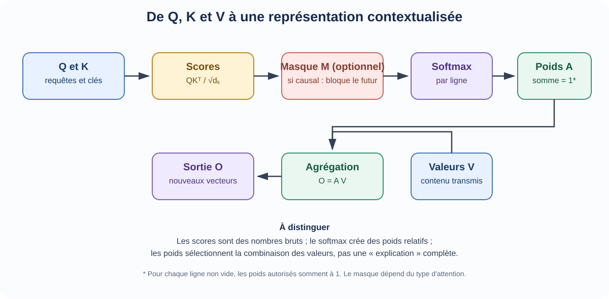

<!--
LLM-LAB-PAGE-MAP v1
id: "fr/scaled-dot-product-attention"
scope: "Décompose le calcul d’attention à produit scalaire : scores QKᵀ, mise à l’échelle par la dimension des clés, normalisation softmax et combinaison pondérée des valeurs ; la justification du facteur d’échelle est développée dans l’approfondissement dédié, le masque causal est traité séparément et l’architecture multi-tête n’est abordée qu’en complément."
purpose: "Le lecteur doit pouvoir suivre les étapes du calcul d’attention, expliquer le rôle de la mise à l’échelle et interpréter les poids comme une distribution de pondération conditionnée par les scores et le masque."
suggested_route:
  previous: "fr/queries-keys-values"
  next: "fr/causal-masking"
hierarchy:
  parents: ["fr/transformer"]
  children: ["fr/causal-masking", "fr/attention-score-scaling"]
related: ["fr/queries-keys-values"]
tags: ["type:concept-lesson", "destination:understand", "topic:scaled-dot-product-attention", "level:core", "language:fr", "status:published"]
-->

::: {.chapter-lead}
L'attention à produit scalaire compare les requêtes aux clés pour calculer des scores, puis transforme ces scores en poids qui servent à combiner les valeurs. Le softmax normalise les poids sur les positions accessibles ; il ne prouve ni pertinence sémantique ni causalité.
:::

  Concept vérifié
  Python · à exécuter localement
  Architecture : Attention standard

  <a class="step-item" href="text-data.qmd">1. Texte</a>
  →
  <a class="step-item" href="embedding-space.qmd">2. Embeddings</a>
  →
  3. Attention à produit scalaire
  →
  <a class="step-item" href="logits.qmd">4. Logits</a>
  →
  <a class="step-item" href="cross-entropy.qmd">5. Perte & Entraînement</a>

::: {.callout-tip title="L'idée à retenir en une minute"}
L'attention n'est pas une opération unique : elle enchaîne **scores → mise à l'échelle → masque éventuel → softmax → agrégation**. Les scores comparent Q et K ; les poids sont normalisés ligne par ligne ; la sortie est une combinaison des V.

**Première lecture :** suivez les quatre étapes et refaites l'exemple avec une requête et deux clés. Vérifiez séparément la forme de chaque matrice : les scores sont de taille $T\times T$, la sortie de taille $T\times d_v$.

**Pour approfondir :** la dérivation du facteur d'échelle — pourquoi diviser par $\sqrt{d_k}$ et ce que cet argument ne garantit pas — est développée dans [Pourquoi mettre les scores à l'échelle ?](attention-score-scaling.qmd) ; la modification des positions accessibles avant le softmax est le rôle du [masque causal](causal-masking.qmd).
:::

## Calcul en quatre étapes

Pour une tête, $Q,K\in\mathbb{R}^{T\times d_k}$ et $V\in\mathbb{R}^{T\times d_v}$.

1. **Scores :** $S=QK^\top$, de forme $T\times T$.
2. **Mise à l'échelle :** $S/\sqrt{d_k}$.
3. **Normalisation :** $A=\operatorname{softmax}(S/\sqrt{d_k}+M)$, ligne par ligne.
4. **Agrégation :** $O=AV$, de forme $T\times d_v$.

Ainsi,

$$
O=\operatorname{softmax}\left(\frac{QK^\top}{\sqrt{d_k}}+M\right)V.
$$

Ici, $M$ désigne un masque additif strict : $M_{ij}=0$ pour un couple requête-clé autorisé et $M_{ij}=-\infty$ pour un couple interdit. Si aucun masque n'est nécessaire, on omet $M$ (ce qui revient à utiliser une matrice nulle). Le masque agit sur les scores **avant** le softmax : c'est le seul point où il peut modifier les positions accessibles à la normalisation. Quelles positions interdire — la contrainte causale — et comment traiter une ligne entièrement masquée sont définis dans le [masque causal](causal-masking.qmd), prochaine étape du parcours.

## Exemple numérique détaillé

Considérons une requête et deux clés accessibles, sans masque :

$$
q=(1,0),\quad k_1=(1,0),\quad k_2=(0,1),\quad
v_1=(10,0),\quad v_2=(0,20).
$$

Ici, $d_k=2$. Les scores bruts sont $qk_1^\top=1$ et $qk_2^\top=0$. Après mise à l'échelle, ils valent $(1/\sqrt{2},0)\approx(0{,}707,0)$. Le softmax donne des poids approximatifs $(0{,}67,0{,}33)$, dont la somme vaut un. La sortie est la somme pondérée des valeurs :

$$
o\approx0{,}67(10,0)+0{,}33(0,20)=(6{,}7,6{,}6).
$$

Cet exemple distingue les rôles : la requête et les clés déterminent les poids ; les valeurs déterminent ce qui est combiné. Les poids sont relatifs aux clés accessibles dans cette ligne ; ils ne mesurent pas la pertinence sémantique.

{fig-alt="Les requêtes et les clés produisent des scores. Après mise à l'échelle et application éventuelle du masque, le softmax crée des poids qui combinent les valeurs." width=100%}

Le schéma montre aussi pourquoi trois objets ne doivent pas être confondus : **scores** (compatibilités brutes), **poids** (normalisés relativement aux positions accessibles) et **sorties** (combinaisons pondérées des valeurs). Dans une attention non causale, le masque peut être absent ou exprimer une autre contrainte. La normalisation du softmax ne transforme pas les poids en mesure universelle de pertinence sémantique.

::: {.callout-note collapse="true" title="Deux points de vue complémentaires : passage de messages et combinaison convexe"}
**Passage de messages.** On peut voir chaque position comme un nœud qui envoie un message : son vecteur de valeur $v_j$. Une requête à la position $i$ attribue des poids aux positions accessibles ; la sortie est le mélange pondéré qu'elle reçoit. L'auto-attention peut ainsi être comprise comme un mécanisme de passage de messages dépendant du contenu : les valeurs sont les messages, tandis que les scores requête-clé déterminent leurs poids de routage. C'est une analogie du calcul, pas l'affirmation que le modèle utilise un graphe fixe.

**Géométrie convexe.** Si au moins une clé est accessible, les poids du softmax ligne par ligne vérifient $\alpha_{ij}\geq 0$ et $\sum_j\alpha_{ij}=1$. Par conséquent,
$$
o_i=\sum_j\alpha_{ij}v_j
$$
est une combinaison convexe des vecteurs de valeurs accessibles : avant toute projection de sortie ou addition résiduelle ultérieure, $o_i$ appartient à leur enveloppe convexe. Cette propriété donne une interprétation géométrique précise de la somme pondérée. Elle ne signifie pas que la représentation finale du bloc Transformer doit rester dans cette enveloppe convexe.

Cette perspective est adaptée du [tutoriel Q/K/V de Brenndoerfer](https://mbrenndoerfer.com/writing/query-key-value-attention-mechanism) ; la propriété découle directement de la positivité et de la normalisation des poids softmax.
:::

## Origine et rôle

La formulation est présentée dans [Vaswani et al. (2017), *Attention Is All You Need*](https://arxiv.org/abs/1706.03762), qui compare l'attention additive et l'attention par produit scalaire et introduit le facteur de mise à l'échelle. Elle permet des calculs matriciels efficaces et s'intègre naturellement aux mécanismes multi-têtes.

## Idées reçues et contre-exemples

- **« Le softmax mesure la similarité absolue. »** Non : il produit une distribution relative aux scores d'une ligne. Ajouter une constante à tous les scores d'une ligne ne change pas les poids.
- **« Un poids de 0,8 signifie 80 % de pertinence sémantique. »** Non : c'est une fraction de poids dans cette agrégation, conditionnée par les autres scores et les projections apprises.

Piège fréquent : « Un poids d'attention de 0,95 prouve que ce token est la cause principale de la réponse »

<strong>Réfutation rigoureuse :</strong> Le poids $\alpha_{ij}$ est obtenu par softmax à partir du score $q_i^\top k_j/\sqrt{d_k}$ : il exprime une pondération relative parmi les positions accessibles, pas une causalité. Avant la projection de sortie, la contribution directe de la position $j$ à l'agrégation est $\alpha_{ij}v_j$ ; sa norme vaut $\alpha_{ij}\lVert v_j\rVert$. Un poids élevé ne garantit donc même pas un terme agrégé de grande norme. Et ce terme n'est pas l'effet sur la prédiction finale : la projection de sortie, les connexions résiduelles, la normalisation et le MLP transforment encore le signal. Établir une importance causale exige une analyse interventionnelle adaptée, pas la seule lecture des poids.

- **« Le facteur d'échelle est une constante empirique sans justification. »** Non : il découle d'un raisonnement sur l'échelle des produits scalaires ; les hypothèses sont simplificatrices, mais le facteur répond à un problème numérique précis. La dérivation complète et la simulation numérique sont développées dans [Pourquoi mettre les scores à l'échelle ?](attention-score-scaling.qmd).

## Liens avec les autres concepts

- La dérivation du facteur d'échelle et la simulation numérique de variance sont développées dans [Pourquoi mettre les scores à l'échelle ?](attention-score-scaling.qmd).
- Les entrées $Q,K,V$ sont détaillées dans [requêtes, clés et valeurs](queries-keys-values.qmd).
- L'exclusion des tokens futurs est définie dans le [masque causal](causal-masking.qmd).
- La fonction softmax est liée aux [probabilités](probabilites.qmd), mais une distribution normalisée n'est pas nécessairement calibrée.
- La [synthèse Transformer](transformer.qmd) remet le calcul dans le flux du modèle.

::: {.self-check}
## Vérifier sa compréhension

[Exercices approfondis sur ce thème](exercises.qmd#attention).

1. Une ligne de scores vaut $(2,0)$ et la dimension des clés est $d_k=4$. Calculez les poids softmax après mise à l’échelle.

Afficher le raisonnement

On divise d’abord les scores par $\sqrt{4}=2$, ce qui donne $(1,0)$. Le softmax vaut environ $(0{,}731,0{,}269)$. La mise à l’échelle précède la normalisation ; les poids restent relatifs aux seuls scores de cette ligne. La variante où une position est interdite par un masque causal est traitée dans l’auto-vérification du [masque causal](causal-masking.qmd).

:::

::: {.callout-note collapse="true" title="Implémentation et vérification (approfondissement)"}
Les dimensions des entrées et des sorties sont aussi importantes que la formule : voir [Tenseurs](tensors.qmd).

L'implémentation de référence actuelle en NumPy, dans `src/llm_lab/foundations/attention.py` (`scaled_dot_product_attention`), traite **une seule tête sans dimension de batch** : Q est de forme `(T_q, d_k)`, K de forme `(T_k, d_k)` et V de forme `(T_k, d_v)`. Les longueurs de requêtes et de clés peuvent différer, tout comme les dimensions des clés et des valeurs.

Cette leçon utilise un **masque additif strict** (0 pour les positions autorisées et `-inf` pour les positions interdites). La fonction de référence accepte aussi des biais additifs finis ; cette capacité de l'API n'est pas nécessaire pour l'introduction au masque causal. Si une ligne est entièrement masquée, l'implémentation renvoie volontairement des poids et une sortie nuls. Une telle ligne ne constitue pas une distribution de probabilité ; les lignes comportant au moins une clé accessible sont normalisées à une somme égale à un sur ces clés.

La suite `tests/unit/test_attention.py` vérifie la préservation des formes, l'agrégation pondérée, le comportement du masque, les invariants de normalisation et plusieurs cas numériques limites. Les dimensions des entrées et des sorties comptent autant que la formule : voir [Tenseurs](tensors.qmd).

- [Implémentation de référence](https://github.com/JM-Brun/llm-lab/tree/main/src/llm_lab/foundations/attention.py)
- [Tests unitaires](https://github.com/JM-Brun/llm-lab/tree/main/tests/unit/test_attention.py)
- [État actuel de l'implémentation et de sa validation](https://github.com/JM-Brun/llm-lab/blob/main/docs/project-status.md)
- [Critères de vérification prévus](https://github.com/JM-Brun/llm-lab/blob/main/docs/roadmap.md#deferred--causal-attention-implementation)
:::

  <a class="route-nav-card" href="queries-keys-values.qmd">
    ← Étape précédente
    Requêtes, clés et valeurs (Q, K, V)
  </a>
  <a class="route-nav-card" href="causal-masking.qmd">
    Étape suivante →
    Masque causal
  </a>

::: {.language-switch}
**Langue :** [Français](scaled-dot-product-attention.qmd) · [English](../en/scaled-dot-product-attention.qmd)
:::
