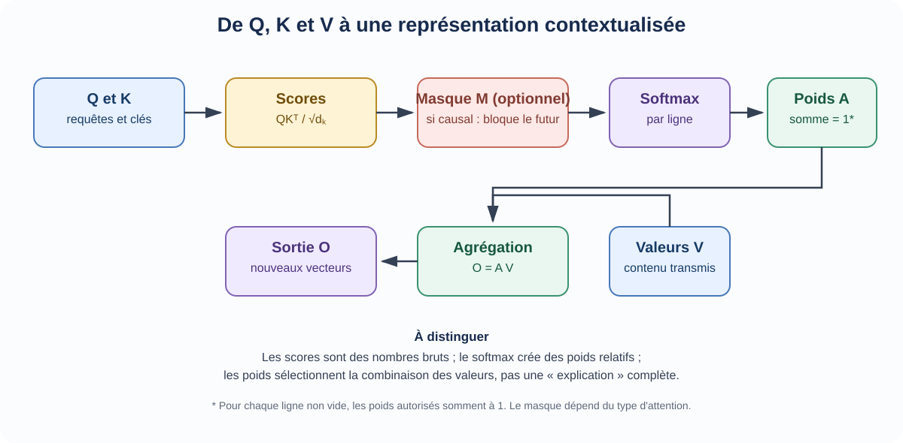
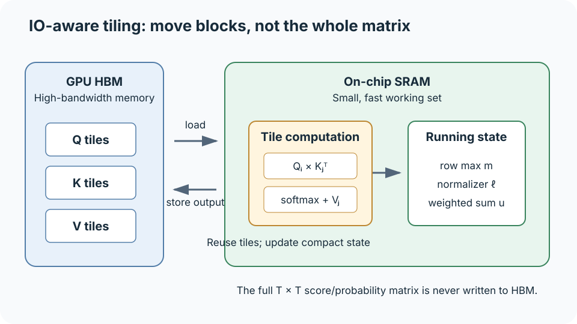
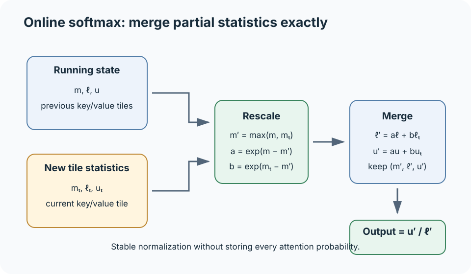
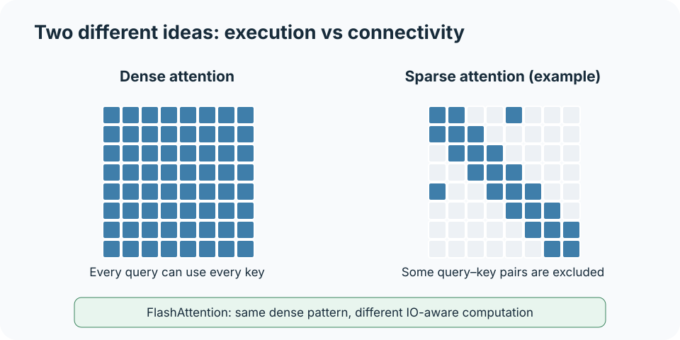

<!--
LLM-LAB-PAGE-MAP v1
id: "fr/scaled-dot-product-attention"
summary: "Déroule le calcul d’attention de bout en bout : compatibilité entre Q et K, mise à l’échelle, normalisation des scores et agrégation pondérée de V."
scope: "Suit le calcul d’une ligne d’attention, de la comparaison Q–K aux valeurs pondérées."
purpose: "Expliquer et reconstruire le calcul d’une ligne d’attention — scores, mise à l’échelle, masque, softmax et agrégation — et justifier les dimensions et la normalisation des intermédiaires."
suggested_route:
  previous: "fr/queries-keys-values"
  next: "fr/causal-masking"
hierarchy:
  parents: ["fr/transformer"]
  children: ["fr/causal-masking", "fr/attention-score-scaling"]
related: ["fr/queries-keys-values", "fr/scaled-dot-product-attention-exercises"]
revision_support:
  status: integrated_sufficient
  evidence:
    - anchor: revision-summary
      note: "Le rappel ordonne scores QKᵀ, mise à l'échelle, masque éventuel, softmax et agrégation de V ; les exercices vérifient les étapes et les limites d'interprétation des poids."
tags: ["type:concept-lesson", "destination:understand", "topic:scaled-dot-product-attention", "level:core", "language:fr", "status:published"]
-->



::: {.chapter-lead}
L'attention à produit scalaire compare les requêtes aux clés pour calculer des scores, puis transforme ces scores en poids qui servent à combiner les valeurs. Le softmax transforme les scores (mis à l'échelle et éventuellement masqués) en poids normalisés sur les positions accessibles ; il ne prouve ni pertinence sémantique ni causalité.
:::

  Concept vérifié
  Architecture : Attention standard

::: {.callout-tip title="L'idée à retenir en une minute" #revision-summary}
L'attention n'est pas une opération unique : elle enchaîne **scores → mise à l'échelle → masque éventuel → softmax → agrégation**. Les scores comparent Q et K ; les poids sont normalisés ligne par ligne ; la sortie est une combinaison des V.

**Première lecture :** suivez le passage des scores aux poids, puis des poids à la sortie. Gardez ces trois objets distincts.

**Pour approfondir :** la dérivation du facteur d'échelle — pourquoi diviser par $\sqrt{d_k}$ et ce que cet argument ne garantit pas — est développée dans [Pourquoi mettre les scores à l'échelle ?](attention-score-scaling.qmd) ; la modification des positions accessibles avant le softmax est le rôle du [masque causal](causal-masking.qmd).
:::

  <a class="step-item" href="queries-keys-values.qmd">Q, K, V</a>
  →
  Scores QKᵀ
  →
  Mise à l’échelle
  →
  <a class="step-item" href="causal-masking.qmd">Masque éventuel</a>
  →
  Softmax par requête
  →
  Somme pondérée de V

## Le calcul d'un seul regard

<figure id="fig-attention-calculation-flow">
  <picture>
    <source media="(max-width: 600px)" srcset="../images/attention-calculation-flow-fr-mobile.svg">
    
  </picture>
  <figcaption>Deux chemins se rejoignent : Q et K déterminent les poids, tandis que V fournit le contenu agrégé. Les scores bruts, les poids normalisés et la sortie sont trois objets différents ; pour chaque ligne non vide, les poids autorisés somment à 1.</figcaption>
</figure>

## Calcul en cinq étapes {#calcul-en-cinq-étapes}

Pour une tête, $Q,K\in\mathbb{R}^{T\times d_k}$ et $V\in\mathbb{R}^{T\times d_v}$, où $T$ désigne ici la longueur de la séquence.

$$
O=\operatorname{softmax}\left(\frac{QK^\top}{\sqrt{d_k}}+M\right)V.
$$

Les scores bruts $S=QK^\top$, les scores mis à l’échelle $S'=S/\sqrt{d_k}$, les scores masqués $S''=S'+M$ et les poids $A=\operatorname{softmax}(S'')$ ont tous la forme $T\times T$, comme le masque facultatif $M$. Avec la convention matricielle par lignes adoptée ici, la ligne $i$ correspond à la requête de la position $i$ et la colonne $j$ à la clé de la position $j$ : le softmax est appliqué sur l’axe des clés, indépendamment pour chaque requête. Pour chaque requête, le [softmax](probabilites.qmd#des-logits-à-une-distribution-catégorielle) divise l’exponentielle du score de chaque clé accessible par la somme des exponentielles sur ces clés. Enfin, $O=AV$ est de forme $T\times d_v$.

Ici, $M$ désigne un masque additif strict : $M_{ij}=0$ pour un couple requête-clé autorisé et $M_{ij}=-\infty$ pour un couple interdit. Si aucun masque n'est nécessaire, on omet $M$ (ce qui revient à utiliser une matrice nulle). Dans ce calcul, le masque additif s’applique aux scores mis à l’échelle **avant** le softmax. La leçon suivante, sur le [masque causal](causal-masking.qmd), explique comment construire ce masque et déduire les positions accessibles.

Dans le fil rouge « C'est une bonne situation, ça, scribe ? », suivez la dernière position du préfixe. Sa requête est comparée aux clés des positions accessibles, puis ses poids servent à combiner les valeurs de ces positions. Cette somme est la sortie de la tête pour cette position. Le [masque causal](causal-masking.qmd) fixe les positions accessibles.

1 — Comparer les requêtes aux clés

Le produit $S=QK^\top$ prend deux matrices $Q$ et $K$ de forme $T\times d_k$ et donne une matrice $S$ de forme $T\times T$. Une ligne contient les scores d'une requête face aux $T$ clés.

2 — Mettre les scores à l'échelle

On divise chaque score par $\sqrt{d_k}$. L'entrée $S$ et la sortie $S'=S/\sqrt{d_k}$ ont toutes deux la forme $T\times T$.

3 — Écarter les clés interdites si un masque s'applique

On additionne les scores mis à l'échelle $S'$ et le masque $M$, deux matrices $T\times T$. Dans la sortie $S''=S'+M$ de même forme, les positions interdites reçoivent $-\infty$.

4 — Transformer les scores d'une requête en poids

On applique $A=\operatorname{softmax}(S'')$ ligne par ligne. L'entrée $S''$ et la sortie $A$ ont la forme $T\times T$. Chaque ligne non vide donne une distribution de probabilité sur les positions accessibles à sa requête.

5 — Combiner les valeurs avec ces poids

Le produit $O=AV$ prend les poids $A$ de forme $T\times T$ et les valeurs $V$ de forme $T\times d_v$. Il donne une sortie $O$ de forme $T\times d_v$, avec une somme pondérée par requête.

## Passer du mécanisme au calcul

Suivez la dernière position du préfixe. Son état d'entrée fournit la requête de cette ligne ; les positions de la séquence fournissent les clés et les valeurs. Le softmax de l'attention pondère ces **positions**. Le [softmax appliqué plus tard aux logits de sortie](exercises/logits.qmd#ex-attention-vocabulary-softmax) normalise les scores des **tokens du vocabulaire**. Dans l'atelier, essayez le cas où la cible suivante figure dans la séquence d'entraînement et où le [masque causal](causal-masking.qmd) bloque son accès.

[Calculer les scores, les poids et la sortie sur la page d’exercices dédiée](exercises/scaled-dot-product-attention.qmd#calcul-complet-scores-poids-sortie).



## Origine et rôle

La formulation est présentée dans [Vaswani et al. (2017), *Attention Is All You Need*](https://arxiv.org/abs/1706.03762), qui compare l'attention additive et l'attention par produit scalaire et introduit le facteur de mise à l'échelle. Elle permet des calculs matriciels efficaces et s'intègre naturellement aux mécanismes multi-têtes.

## Idées reçues et contre-exemples

- **« Le softmax mesure la similarité absolue. »** Non : il produit une distribution relative aux scores d'une ligne. Ajouter une constante à tous les scores d'une ligne ne change pas les poids.
- **« Un poids de 0,8 signifie 80 % de pertinence sémantique. »** Non : c'est une fraction de poids dans cette agrégation, conditionnée par les autres scores et les projections apprises.

Piège fréquent : « Un poids d'attention de 0,95 prouve que ce token est la cause principale de la réponse »

<strong>Réfutation rigoureuse :</strong> Le poids $\alpha_{ij}$ est obtenu par softmax à partir du score $q_i^\top k_j/\sqrt{d_k}$ : il exprime une pondération relative parmi les positions accessibles, pas une causalité. Avant la projection de sortie, la contribution directe de la position $j$ à l'agrégation est $\alpha_{ij}v_j$ ; sa norme vaut $\alpha_{ij}\lVert v_j\rVert$. Un poids élevé ne garantit donc même pas un terme agrégé de grande norme. Et ce terme n'est pas l'effet sur la prédiction finale : la projection de sortie, les connexions résiduelles, la normalisation et le MLP transforment encore le signal. Établir une importance causale exige une analyse interventionnelle adaptée, pas la seule lecture des poids.

- **« Le facteur d'échelle est une constante empirique sans justification. »** Non : il découle d'un raisonnement sur l'échelle des produits scalaires ; les hypothèses sont simplificatrices, mais le facteur répond à un problème numérique précis. La dérivation complète et la simulation numérique sont développées dans [Pourquoi mettre les scores à l'échelle ?](attention-score-scaling.qmd).

### Attention et information mutuelle : une analogie, pas une identité {#attention-information-mutuelle}

L'information mutuelle entre deux variables aléatoires dépend d'une distribution jointe :

$$
I(X;Y)=H(X)-H(X\mid Y)
=\sum_{x,y}p(x,y)\ln\frac{p(x,y)}{p(x)p(y)}.
$$

Elle mesure la réduction d'incertitude sur $X$ apportée par l'observation de $Y$. Les poids d'attention, eux, sont des coefficients de compatibilité normalisés par softmax sur les positions accessibles ; ils dépendent de l'entrée, des requêtes, des clés et du masque, et servent à agréger les vecteurs $V$. Ils ne mesurent donc pas directement, en bits, l'information qu'un token apporte à un autre. Une ligne de poids d'attention n'est donc ni une distribution jointe sur $(X,Y)$, ni un estimateur automatique de $I(X;Y)$.

L'analogie peut aider à poser une question — quelles positions sont utiles au calcul d'une représentation contextualisée ? — mais elle ne constitue pas une équivalence mathématique. Un poids élevé ne quantifie pas « la quantité d'information » fournie par un token et ne démontre pas une dépendance statistique ou une importance causale. Une carte d'attention ne suffit pas à établir une explication causale ou sémantique.

## Liens avec les autres concepts

- La dérivation du facteur d'échelle et la simulation numérique de variance sont développées dans [Pourquoi mettre les scores à l'échelle ?](attention-score-scaling.qmd).
- Les entrées $Q,K,V$ sont détaillées dans [requêtes, clés et valeurs](queries-keys-values.qmd).
- L'exclusion des tokens futurs est définie dans le [masque causal](causal-masking.qmd).
- La fonction softmax est liée aux [probabilités](probabilites.qmd), mais une distribution normalisée n'est pas nécessairement calibrée.
- La [synthèse Transformer](transformer.qmd) remet le calcul dans le flux du modèle.



::: {.language-switch}
**Langue :** [Français](scaled-dot-product-attention.qmd) · [English](../en/scaled-dot-product-attention.qmd)
:::

## Exercices

Les questions et exercices de cette leçon sont regroupés sur sa [page d’exercices dédiée](exercises/scaled-dot-product-attention.qmd).

## Approfondir

:::: {.supplementary-resources}

  Ressources complémentaires
  Approfondir les choix d'implémentation et les optimisations du calcul d'attention.

::: {.learning-resources__content}

### Complément côté Build (facultatif)

Cette page appartient au parcours conceptuel **Théorie / Understand** : elle explique le mécanisme et ses invariants. Pour voir comment la primitive est appelée dans une implémentation multi-têtes, consultez facultativement la [visite guidée du bloc Transformer](transformer-block-walkthrough.qmd), qui appartient au parcours **Build**, indépendant du parcours conceptuel. Les conventions générales sur les axes et les dimensions sont regroupées dans [Tenseurs](tensors.qmd).

### Exécution optimisée (approfondissement facultatif)

La définition mathématique de l'attention ne dicte pas à elle seule la manière dont le GPU exécute le calcul. [FlashAttention](https://arxiv.org/abs/2205.14135) conserve l'attention dense exacte tout en découpant le calcul en blocs et en réduisant les échanges entre mémoire GPU et mémoire rapide sur puce. Il ne faut pas le confondre avec l'attention sparse, qui modifie les positions autorisées. Pour comprendre le mécanisme, ses compromis et les limites des mesures, consultez [la revue pédagogique de FlashAttention](https://github.com/JM-Brun/llm-lab/blob/main/docs/source-reviews/flashattention-io-aware-2026-11.md), puis la [documentation PyTorch SDPA](https://docs.pytorch.org/docs/stable/generated/torch.nn.functional.scaled_dot_product_attention.html) et [le protocole de benchmark reproductible](https://github.com/JM-Brun/llm-lab/blob/main/docs/experiments/flashattention-benchmark-protocol.md). Cette optimisation matérielle est un approfondissement, pas une étape supplémentaire du parcours conceptuel.

#### FlashAttention en images (approfondissement facultatif)

Ces schémas sont des **reconstructions pédagogiques originales** fondées sur l'article FlashAttention et ses travaux de suivi ; ils ne reproduisent pas les figures de la newsletter.

##### 1. Déplacer des blocs plutôt que matérialiser toute la matrice

<figure>
  
  <figcaption>Le gain central est la réduction des transferts HBM↔SRAM et des intermédiaires matérialisés en mémoire globale. La matrice des scores reste conceptuellement dense ; elle n'est simplement pas stockée en entier en HBM.</figcaption>
</figure>

##### 2. Fusionner les statistiques du softmax en ligne

<figure>
  
  <figcaption>La mise à l'échelle par le nouveau maximum permet de fusionner les statistiques partielles de manière numériquement stable. À la fin, la somme pondérée est divisée par le normalisateur.</figcaption>
</figure>

##### 3. Ne pas confondre optimisation IO et sparsité

<figure>
  
  <figcaption>FlashAttention conserve les connexions de l'attention dense exacte (à tolérance flottante près). Une méthode sparse change le motif des connexions et donc le calcul mathématique effectué.</figcaption>
</figure>

:::

::::
