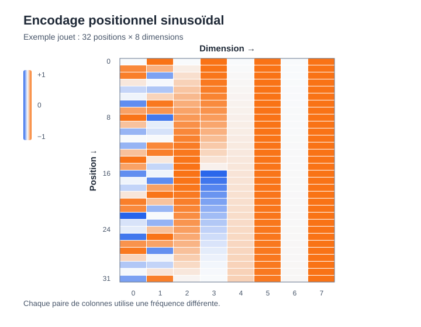

<!--
LLM-LAB-PAGE-MAP v1
id: "fr/sinusoidal-positional-encoding"
summary: "Dérive l’encodage sinusoïdal du Transformer original, interprète ses fréquences et sa géométrie, puis examine ses propriétés et ses limites."
scope: "Approfondit exclusivement l’encodage absolu sinusoïdal fixe de Vaswani et al. : calendrier de fréquences, longueurs d’onde, représentation par paires, propriété de décalage linéaire, similarité positionnelle, implémentation et limites d’extrapolation. Ne reprend pas l’introduction générale à l’information positionnelle ni la dérivation de RoPE."
purpose: "Le lecteur doit pouvoir reconstruire la formule, expliquer le rôle des fréquences multi-échelles, dériver la transformation associée à un décalage fixe, implémenter le signal et distinguer extrapolation mathématique et généralisation du modèle."
domain: "architectures-mechanisms"
suggested_route:
  previous: null
  next: null
hierarchy:
  parents: ["fr/positional-encoding"]
  children: []
related: ["fr/rope", "fr/queries-keys-values", "fr/scaled-dot-product-attention"]
tags: ["type:deep-dive", "destination:deepen", "topic:sinusoidal-positional-encoding", "level:advanced", "language:fr", "status:published"]
-->

::: {.chapter-lead}
L'encodage sinusoïdal transforme un indice de position en un vecteur déterministe composé de sinusoïdes à plusieurs fréquences. Cette page reconstruit la formule du Transformer de 2017, explique pourquoi les fréquences sont réparties logarithmiquement et dérive la propriété qui rend un décalage fixe accessible à une transformation linéaire. Elle examine aussi ce que cette propriété ne garantit pas.
:::

::: {.callout-tip title="L'idée centrale"}
Chaque paire de dimensions suit un cercle à une vitesse différente. Les dimensions rapides varient beaucoup d'un token au suivant ; les dimensions lentes changent progressivement. Leur combinaison forme une signature multi-échelle de la position. Le signal est calculable pour tout indice, mais cela ne garantit pas que le modèle sache généraliser à des contextes plus longs.
:::

## 1. De l'indice à un vecteur

Dans le Transformer original, la position est un entier $p$ (conventionnellement indexé à partir de zéro), et le vecteur positionnel a la même dimension $d_{\text{model}}$ que l'embedding du token. Pour chaque paire de coordonnées, on utilise un sinus et un cosinus :

$$
\begin{aligned}
PE(p,2i) &= \sin\left(\frac{p}{10000^{2i/d_{\text{model}}}}\right),\\
PE(p,2i+1) &= \cos\left(\frac{p}{10000^{2i/d_{\text{model}}}}\right).
\end{aligned}
$$

Posons la fréquence angulaire $\omega_i = 10000^{-2i/d_{\text{model}}}$. Une paire s'écrit alors :

$$
PE_i(p)=
\begin{bmatrix}
\sin(\omega_i p)\\
\cos(\omega_i p)
\end{bmatrix}.
$$

Le vecteur complet concatène $d_{\text{model}}/2$ paires. La formule suppose donc une dimension paire. Les arguments des sinus et cosinus sont en radians.

### Pourquoi une paire sinus-cosinus ?

Le sinus seul ne permet pas de distinguer simplement la phase sur tout le cycle : plusieurs angles ont la même valeur de sinus. Le couple $(\sin\theta,\cos\theta)$ donne un point sur le cercle unité, car $\sin^2\theta+\cos^2\theta=1$. Lorsque la position augmente, ce point tourne autour du cercle.

Pour $p=0$, chaque paire vaut $[0,1]^\top$. Lorsque $p$ augmente, la paire tourne à la vitesse $\omega_i$.

## 2. Pourquoi plusieurs fréquences ?

Le Transformer original choisit des fréquences géométriquement espacées :

$$
\omega_i = 10000^{-2i/d_{\text{model}}}.
$$

L'indice $i$ augmente de deux coordonnées en deux coordonnées. La fréquence diminue donc par un facteur constant entre deux paires successives :

$$
\frac{\omega_{i+1}}{\omega_i}=10000^{-2/d_{\text{model}}}.
$$

La longueur d'onde — le nombre de positions nécessaire pour effectuer un tour complet — est :

$$
\lambda_i=\frac{2\pi}{\omega_i}
=2\pi\,10000^{2i/d_{\text{model}}}.
$$

Les longueurs d'onde sont elles aussi espacées géométriquement. La plus courte vaut $2\pi$ positions. La plus longue est $2\pi\,10000^{1-2/d_{\text{model}}}$, proche de $2\pi\cdot10000$ lorsque la dimension est grande. La formulation de l'article décrit cette plage de manière approximative.

### Exemple numérique : $d_{\text{model}}=8$

Il y a quatre paires, donc quatre échelles temporelles. Les valeurs ci-dessous sont calculées directement à partir de la formule.

| Paire $i$ | Fréquence $\omega_i$ | Longueur d'onde $\lambda_i$ |
|---:|---:|---:|
| 0 | 1 | 6,28 positions |
| 1 | 0,1 | 62,83 positions |
| 2 | 0,01 | 628,32 positions |
| 3 | 0,001 | 6 283,19 positions |

{fig-alt="Carte thermique des valeurs de l'encodage positionnel sinusoïdal pour 32 positions et 8 dimensions. Les motifs varient selon les fréquences des quatre paires de coordonnées." width=100%}

Les premières paires changent rapidement et sont sensibles aux déplacements courts. Les dernières changent lentement et fournissent un repère qui évolue sur une plage plus large. Ce ne sont pas des cases « mot proche » et « mot lointain » apprises séparément : ce sont des composantes périodiques dont le modèle peut apprendre à exploiter les combinaisons.

::: {.callout-note title="Pourquoi un espacement logarithmique ?"}
Un espacement linéaire des fréquences consacrerait beaucoup de dimensions à une partie de la plage et en laisserait peu pour d'autres échelles. Une progression géométrique distribue les fréquences de façon régulière sur une échelle logarithmique : chaque paire ajoute un facteur multiplicatif constant à la longueur d'onde.
:::

## 3. Le décalage fixe devient une transformation linéaire

Pour une paire donnée, notons :

$$
v_i(p)=
\begin{bmatrix}
\sin(\omega_i p)\\
\cos(\omega_i p)
\end{bmatrix}.
$$

Pour un décalage entier $k$, les formules d'addition donnent :

$$
\begin{aligned}
\sin(\omega_i(p+k))
&=\sin(\omega_i p)\cos(\omega_i k)
 +\cos(\omega_i p)\sin(\omega_i k),\\
\cos(\omega_i(p+k))
&=\cos(\omega_i p)\cos(\omega_i k)
 -\sin(\omega_i p)\sin(\omega_i k).
\end{aligned}
$$

En regroupant les deux coordonnées :

$$
v_i(p+k)=
\begin{bmatrix}
\cos(\omega_i k) & \sin(\omega_i k)\\
-\sin(\omega_i k) & \cos(\omega_i k)
\end{bmatrix}
v_i(p)
=R_i(k)v_i(p).
$$

**Pour un décalage $k$ fixé, la matrice $R_i(k)$ ne dépend pas de la position de départ $p$.** Elle dépend seulement du décalage et de la fréquence de la paire.

Pour le vecteur complet, on assemble ces matrices en une matrice par blocs diagonale :

$$
PE(p+k)=R(k)\,PE(p).
$$

Cette identité explique la motivation donnée par Vaswani et al. : un décalage fixe est représentable par une transformation linéaire du vecteur positionnel. Le modèle dispose ainsi d'une structure mathématique exploitable pour relier des positions relatives.

### Attention à l'interprétation

Cette propriété ne signifie pas que le Transformer calcule explicitement une distance entre chaque paire de tokens, ni qu'une tête d'attention apprend automatiquement « regarde trois positions en arrière ». Elle signifie qu'une transformation linéaire commune existe pour chaque décalage donné. Les poids appris doivent encore exploiter cette structure dans le calcul réel.

## 4. Une autre lecture : la similarité dépend du décalage

Pour une paire :

$$
\begin{aligned}
v_i(p)^\top v_i(q)
&=\sin(\omega_i p)\sin(\omega_i q)
 +\cos(\omega_i p)\cos(\omega_i q)\\
&=\cos(\omega_i(p-q)).
\end{aligned}
$$

En sommant les paires :

$$
PE(p)^\top PE(q)
=\sum_i \cos(\omega_i(p-q)).
$$

Le produit scalaire dépend donc du décalage $p-q$, et non des positions absolues prises séparément. Chaque fréquence contribue avec sa propre périodicité : la combinaison produit une fonction de similarité multi-échelle.

Cette quantité est le produit scalaire des **vecteurs positionnels seuls**. Ce n'est pas directement le score d'attention $QK^\top$ d'un Transformer : les embeddings de contenu sont ajoutés au signal positionnel, puis les représentations sont projetées et transformées par les couches du réseau.

## 5. Comment le signal entre-t-il dans le Transformer ?

Dans le Transformer original, le vecteur positionnel est ajouté à l'embedding du token à l'entrée de l'encodeur et du décodeur :

$$
X_0 = E[\text{token IDs}] + PE.
$$

Les deux vecteurs ont la même dimension, ce qui rend l'addition possible. Le signal positionnel n'est pas une seconde séquence de tokens et ne remplace pas le contenu lexical : il modifie la représentation d'entrée en lui ajoutant une information liée à l'emplacement.

Cette méthode est un **encodage absolu ajouté en entrée**. Elle est différente de [RoPE](rope.qmd), qui applique des rotations aux requêtes et aux clés après leurs projections, avant le calcul des scores d'attention.

## 6. Implémenter et vérifier

Voici une implémentation NumPy directe. Les positions sont des entiers non négatifs et la dimension est paire.

\`\`\`python
import numpy as np

def sinusoidal_encoding(max_len: int, d_model: int) -> np.ndarray:
    if d_model <= 0 or d_model % 2:
        raise ValueError("d_model must be a positive even integer")

    positions = np.arange(max_len, dtype=np.float64)[:, None]
    pair_indices = np.arange(0, d_model, 2, dtype=np.float64)
    frequencies = np.exp(-np.log(10_000.0) * pair_indices / d_model)

    angles = positions * frequencies[None, :]
    pe = np.empty((max_len, d_model), dtype=np.float64)
    pe[:, 0::2] = np.sin(angles)
    pe[:, 1::2] = np.cos(angles)
    return pe
\`\`\`

Version PyTorch : le signal est enregistré comme buffer, donc il appartient à l'état du module mais n'est pas un paramètre appris par l'optimiseur.

\`\`\`python
import math
import torch
from torch import nn

class SinusoidalPositionalEncoding(nn.Module):
    def __init__(self, d_model: int, max_len: int = 5000):
        super().__init__()
        if d_model <= 0 or d_model % 2:
            raise ValueError("d_model must be a positive even integer")

        position = torch.arange(max_len, dtype=torch.float32).unsqueeze(1)
        pair_index = torch.arange(0, d_model, 2, dtype=torch.float32)
        frequencies = torch.exp(-math.log(10_000.0) * pair_index / d_model)

        angles = position * frequencies.unsqueeze(0)
        pe = torch.zeros(max_len, d_model)
        pe[:, 0::2] = torch.sin(angles)
        pe[:, 1::2] = torch.cos(angles)
        self.register_buffer("pe", pe.unsqueeze(0))

    def forward(self, x):
        # x: [batch, sequence_length, d_model]
        length = x.size(1)
        if length > self.pe.size(1):
            raise ValueError("sequence exceeds the precomputed max_len")
        return x + self.pe[:, :length].to(dtype=x.dtype)
\`\`\`

Cette version pré-calcule un maximum de positions. La formule mathématique peut produire des positions plus grandes, mais ce module particulier lève volontairement une erreur au-delà de \`max_len\` : il faudrait étendre le buffer ou calculer le signal à la demande. Le cast conserve le type de \`x\`, notamment en précision réduite.

### Test de la propriété de décalage

\`\`\`python
def check_shift_property(d_model=16, p=7, k=5):
    pe = sinusoidal_encoding(p + k + 1, d_model)
    for i in range(d_model // 2):
        omega = 10_000 ** (-2 * i / d_model)
        angle = omega * k
        rotation = np.array([
            [np.cos(angle),  np.sin(angle)],
            [-np.sin(angle), np.cos(angle)],
        ])
        start = pe[p, 2*i:2*i+2]
        shifted = pe[p+k, 2*i:2*i+2]
        np.testing.assert_allclose(rotation @ start, shifted, atol=1e-12)
\`\`\`

Autres propriétés à tester : norme unitaire de chaque paire, valeurs comprises entre -1 et 1, fréquence égale à 1 pour la première paire, déterminisme et absence de paramètres appris. Ces tests vérifient une identité mathématique, pas la capacité d'un modèle entraîné à exploiter cette identité.

## 7. Ce que l'encodage garantit — et ne garantit pas

| Propriété | Ce qu'on peut affirmer | Ce qu'on ne peut pas en déduire |
|---|---|---|
| Déterministe et fixe | Le signal est calculé par une formule, sans paramètres positionnels appris. | Que le modèle n'a aucun autre paramètre lié à la position. |
| Dimension compatible | Il peut être ajouté à un embedding de même dimension. | Que l'addition soit la seule manière d'injecter une position dans les Transformers. |
| Multi-échelle | Les paires couvrent des fréquences et longueurs d'onde différentes. | Que chaque paire corresponde à une distance linguistique précise. |
| Décalage linéaire | Un décalage fixé correspond à une matrice linéaire fixe par paires. | Que le réseau apprenne automatiquement une règle de distance relative. |
| Calcul pour toute position | La formule est définie au-delà des positions vues pendant l'entraînement. | Que les performances du modèle restent bonnes au-delà de sa longueur d'entraînement. |

### Extrapolation : trois niveaux à ne pas confondre

1. **Extrapolation de la formule :** on peut évaluer les sinus et cosinus pour un indice arbitrairement grand.
2. **Extrapolation de la représentation :** les vecteurs calculés restent structurés, mais leurs phases continuent d'évoluer et certaines combinaisons peuvent devenir difficiles à exploiter.
3. **Généralisation du modèle :** les couches et les poids appris doivent effectivement traiter correctement des séquences plus longues. Rien dans la seule formule ne le garantit.

La longueur d'entraînement, les distributions de données, les mécanismes d'attention, la précision numérique et les poids appris influencent les performances à longue séquence. La capacité à calculer un vecteur ne doit donc jamais être présentée comme une preuve de capacité à raisonner sur un contexte plus long.

## 8. Vérifier sa compréhension

::: {.callout-tip title="À vous de jouer"}
1. Si $d_{\text{model}}$ double, combien de paires de fréquences sont utilisées ?
2. Si l'indice de paire $i$ augmente, la longueur d'onde augmente-t-elle ou diminue-t-elle ?
3. Pourquoi la transformation associée au décalage $k$ ne dépend-elle pas de la position initiale $p$ ?
4. Quelle différence y a-t-il entre « calculer le signal à la position 20 000 » et « réussir une tâche avec un contexte de 20 000 tokens » ?
5. Le produit scalaire $PE(p)^\top PE(q)$ est-il un score d'attention appris ?
:::

::: {.callout-note collapse="true" title="Éléments de réponse"}
1. Le nombre de paires passe de $d_{\text{model}}/2$ à $d_{\text{model}}$.
2. Elle augmente : $\lambda_i=2\pi\,10000^{2i/d_{\text{model}}}$.
3. Les identités d'addition expriment les sinus et cosinus de $p+k$ comme une combinaison linéaire de ceux de $p$, avec des coefficients qui ne dépendent que de $k$ et de $\omega_i$.
4. Le premier est une propriété de la formule ; le second dépend du comportement appris du modèle et doit être évalué empiriquement.
5. Non. C'est une similarité entre vecteurs positionnels fixes ; un score d'attention dépend de projections apprises des représentations.
:::

## Références et ressources pédagogiques

- [Vaswani et al. (2017), *Attention Is All You Need*, section 3.5](https://arxiv.org/abs/1706.03762) — source primaire de la formule, de la progression des longueurs d'onde et de la motivation liée aux décalages relatifs.
- [Jay Alammar, *The Illustrated Transformer*](https://jalammar.github.io/illustrated-transformer/) — visualisation pédagogique du signal positionnel dans le Transformer original. L'auteur précise que sa première visualisation concaténait les signaux ; la formule du papier les entrelace dans les dimensions paires et impaires.
- [Harvard NLP, *The Annotated Transformer*](https://nlp.seas.harvard.edu/annotated-transformer/) — relie la formule à une implémentation PyTorch et à l'ajout du signal aux embeddings.
- [Stanford, *Transformers for Signal Prediction*, notes de cours](https://web.stanford.edu/class/ee269/Lecture_Transformers.pdf) — présentation des fréquences logarithmiques et des longueurs d'onde, avec une lecture orientée signaux.
- [Su et al. (2021), *RoFormer: Enhanced Transformer with Rotary Position Embedding*](https://arxiv.org/abs/2104.09864) — comparaison utile entre encodage sinusoïdal absolu ajouté en entrée et rotations dans l'attention.

**Retour au concept :** [Encodage positionnel](positional-encoding.qmd) · **Autre mécanisme :** [RoPE](rope.qmd).

::: {.language-switch}
**Langue :** [Français](sinusoidal-positional-encoding.qmd) · [English](../en/sinusoidal-positional-encoding.qmd)
:::
