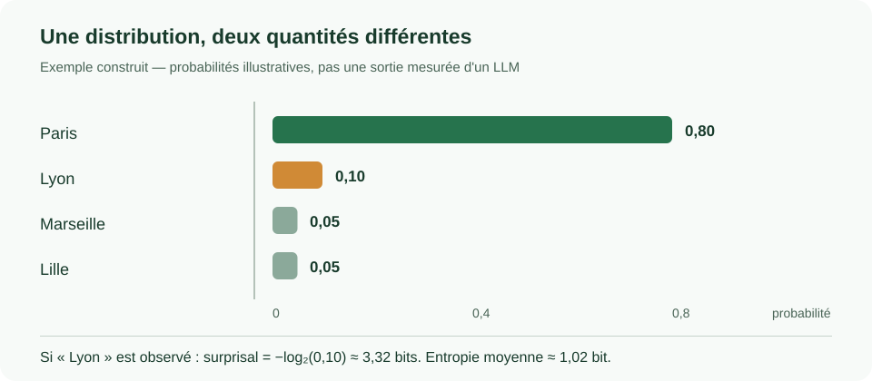

<!--
LLM-LAB-PAGE-MAP v1
id: "fr/surprisal-information-content"
summary: "Explique le surprisal à partir d'une distribution prédictive jouet, puis le relie à l'entropie, aux probabilités conditionnelles et au score d'une séquence."
scope: "Définit I(x)=-log p(x), explique l'additivité pour des événements indépendants et la règle de chaîne pour les séquences dépendantes, puis distingue le surprisal observé de l'entropie prédictive."
purpose: "Calculer le surprisal d'un token observé, distinguer cette valeur de l'entropie prédictive et décomposer le score d'une séquence."
domain: "probabilistic-foundations-training"
suggested_route:
  previous: null
  next: null
hierarchy:
  parents: ["fr/deepen"]
  children: []
related: ["fr/entropy", "fr/vraisemblance", "fr/cross-entropy", "fr/language-modeling-math", "fr/experience-information-theory"]
tags: ["type:deep-dive", "destination:deepen", "topic:surprisal-information-content", "level:overview", "language:fr", "status:published"]
-->

*Calendrier de l’Avent 2026 · Porte 2 · environ 15 minutes*

## Une surprise n'est pas une émotion

Un modèle complète le préfixe « La capitale de la France est… » en répartissant une probabilité entre plusieurs continuations. Supposons qu'il attribue les valeurs suivantes. Elles sont **construites pour l'explication**, et non mesurées sur un modèle réel. Dans cet exemple, chaque étiquette représente exactement un token ; un tokenizer réel peut découper ces chaînes autrement.

| Token candidat | Probabilité prédite |
|---|---:|
| `Paris` | $0{,}80$ |
| `Lyon` | $0{,}10$ |
| `Marseille` | $0{,}05$ |
| `Lille` | $0{,}05$ |

{#fig-surprisal-distribution width=95%}

Supposons que le texte observé continue pourtant par `Lyon`. Le modèle avait attribué à ce token une probabilité de $0{,}10$. Son surprisal vaut :

$$
I(\text{Lyon}\mid c)=-\log_2(0{,}10)\approx 3{,}32\text{ bits}.
$$

Ce nombre décrit **l'issue qui s'est produite**. Il ne décrit pas, à lui seul, l'incertitude moyenne de la distribution avant de connaître l'issue. Cette seconde question est celle de l'entropie, que nous calculerons plus loin.

La théorie de l'information ne mesure ni l'émotion ressentie, ni la vérité d'une phrase, ni sa richesse sémantique. Elle quantifie une propriété probabiliste relativement à une distribution explicitement choisie.

## Mesurer l'information propre d'un événement

Pour un événement $x$ de probabilité $p(x)>0$, on définit son information propre par :

$$
I(x)=-\log_b p(x).
$$

La base $b$ fixe l'unité :

- $b=2$ : bits ;
- $b=e$ : nats ;
- $b=10$ : hartleys.

Avec des logarithmes en base 2 :

| Probabilité de l'événement | Information propre |
|---:|---:|
| $1$ | $0$ bit |
| $1/2$ | $1$ bit |
| $1/4$ | $2$ bits |
| $1/8$ | $3$ bits |
| $1/16$ | $4$ bits |
| $1/100$ | environ $6{,}64$ bits |

Un événement certain apporte zéro bit d'information au sens de cette définition : il ne réduit aucune incertitude sur ce qui va se produire. Un événement de probabilité nulle a un surprisal infini dans le modèle idéal ; en pratique, cela signale souvent qu'un modèle attribue zéro probabilité à une observation qu'il doit pourtant prendre en compte.

## Pourquoi utiliser un logarithme négatif ?

La définition satisfait trois propriétés utiles.

1. **Monotonie inverse :** si la probabilité diminue, l'information propre augmente.
2. **Non-négativité :** pour $p(x)\in(0,1]$, on a $I(x)\geq 0$.
3. **Additivité pour des événements indépendants :** si $X$ et $Y$ sont indépendants,

$$
\begin{aligned}
I(x,y)
&=-\log_2 p(x,y)\\
&=-\log_2\bigl(p(x)p(y)\bigr)\\
&=I(x)+I(y).
\end{aligned}
$$

Cette additivité est une raison centrale du choix logarithmique : les probabilités se multiplient pour des événements indépendants, tandis que leurs informations propres s'additionnent.

Attention : l'additivité simple ci-dessus suppose l'indépendance. Pour des événements dépendants, il faut utiliser des probabilités conditionnelles.

## Des événements aux séquences : la règle de chaîne

Pour deux événements quelconques :

$$
p(x,y)=p(x)\,p(y\mid x).
$$

Leur information propre conjointe devient :

$$
I(x,y)=I(x)+I(y\mid x),
$$

où $I(y\mid x)=-\log_2 p(y\mid x)$ est l'information apportée par $y$ une fois $x$ connu.

La même relation s'étend à une séquence :

$$
p(x_1,\ldots,x_T)
=\prod_{t=1}^{T}p(x_t\mid x_{<t}),
$$

puis, en prenant le logarithme négatif :

$$
I(x_1,\ldots,x_T)
=\sum_{t=1}^{T}-\log_2 p(x_t\mid x_{<t}).
$$

L'information propre d'une séquence est donc la somme des surprisals conditionnels de ses éléments. Il ne faut pas remplacer ces probabilités conditionnelles par des probabilités marginales : le contexte change la prédiction.

### Exemple : trois tokens observés

Supposons qu'un modèle attribue successivement les probabilités conditionnelles suivantes aux tokens réellement observés :

| Position | Probabilité du token observé | Surprisal |
|---:|---:|---:|
| 1 | $1/2$ | $1$ bit |
| 2 | $1/4$ | $2$ bits |
| 3 | $1/8$ | $3$ bits |

La probabilité de la séquence observée est :

$$
p(x_1,x_2,x_3)=\frac12\times\frac14\times\frac18=\frac1{64}.
$$

Son surprisal total vaut donc :

$$
-\log_2(1/64)=6\text{ bits}=1+2+3.
$$

Les six bits décrivent le score de cette séquence sous le modèle considéré. Ils ne sont pas l'entropie de la distribution du modèle.

## Le même événement peut surprendre différemment selon le contexte

Le surprisal n'est pas une propriété attachée au token seul. Il dépend de la probabilité que le modèle lui attribue **dans un contexte donné**.

Considérons le token `Paris` dans deux contextes fictifs. Les valeurs ci-dessous sont choisies pour l'explication ; elles ne proviennent pas d'un modèle réel.

| Contexte | Probabilité prédite de `Paris` | Surprisal |
|---|---:|---:|
| « La capitale de la France est… » | $0{,}80$ | $-\log_2(0{,}80)\approx0{,}32$ bit |
| « La capitale du Japon est… » | $0{,}01$ | $-\log_2(0{,}01)\approx6{,}64$ bits |

Le token est identique, mais l'information propre diffère fortement parce que les distributions conditionnelles diffèrent. On ne peut donc pas attribuer à `Paris` un surprisal unique indépendamment de son contexte.

Cette dépendance explique aussi pourquoi une fréquence globale ne suffit pas à prédire le surprisal local. Un mot courant dans un corpus peut être inattendu après un préfixe particulier ; une forme rare globalement peut être fortement attendue dans une construction spécialisée.

### Calculer l'entropie de notre distribution jouet

Nous pouvons maintenant calculer l'entropie de la distribution du premier exemple. Pour chaque issue, on multiplie son surprisal par sa probabilité, puis on additionne :

| Token | Probabilité | Surprisal | Contribution $p(x)I(x)$ |
|---|---:|---:|---:|
| `Paris` | $0{,}80$ | $0{,}32$ bit | $0{,}26$ bit |
| `Lyon` | $0{,}10$ | $3{,}32$ bits | $0{,}33$ bit |
| `Marseille` | $0{,}05$ | $4{,}32$ bits | $0{,}22$ bit |
| `Lille` | $0{,}05$ | $4{,}32$ bits | $0{,}22$ bit |

Ainsi,

$
H(X\mid c)\approx0{,}26+0{,}33+0{,}22+0{,}22
\approx1{,}02\text{ bits}.
$

L'entropie est inférieure au surprisal de l'issue observée `Lyon` (environ 3,32 bits). Il n'y a aucune contradiction : l'entropie est la moyenne pondérée sur toutes les issues possibles, tandis que le surprisal de Lyon ne concerne qu'une issue particulière. Les contributions des événements rares peuvent être importantes, mais elles sont pondérées par leur faible probabilité.

## Surprisal observé et entropie prédictive : deux questions différentes

Fixons un contexte $c$. Un modèle de langage produit une distribution sur les tokens possibles :

$$
p_\theta(v\mid c),\qquad v\in\mathcal V.
$$

Deux quantités doivent être distinguées.

- **Surprisal du token observé :** si la cible réelle est $y$, alors $-\log p_\theta(y\mid c)$ mesure le score de cet événement particulier.
- **Entropie prédictive :** $H(p_\theta(\cdot\mid c))$ moyenne le surprisal sur tous les tokens possibles selon la distribution prédite.

$$
H_b(X\mid c)
=-\sum_{v\in\mathcal V}p_\theta(v\mid c)
\log_b p_\theta(v\mid c).
$$

Le surprisal est une valeur associée à une issue observée. L'entropie est une espérance avant de savoir quelle issue sera observée. Une cible très improbable peut avoir un surprisal élevé même si la distribution entière a une entropie faible.

Pour approfondir cette distinction, consultez la leçon [Entropie : incertitude sur le prochain token](entropy.qmd). La [vraisemblance](vraisemblance.qmd) formalise le score d'une séquence observée, et l'[entropie croisée](cross-entropy.qmd) relie une distribution cible à une distribution prédite.

## Des logits au surprisal : la chaîne de calcul dans un LLM

Dans un Transformer autorégressif, le contexte est d'abord transformé en représentations internes. La dernière position produit un vecteur de **logits**, c'est-à-dire des scores réels non normalisés, un par token du vocabulaire. La fonction softmax les transforme en probabilités :

$$
p_\theta(v\mid c)=\frac{\exp(z_v)}{\sum_{u\in\mathcal V}\exp(z_u)}.
$$

Le surprisal de la cible observée $y$ est ensuite calculé à partir de sa probabilité :

$$
I_\theta(y\mid c)=-\log_2 p_\theta(y\mid c).
$$

Le chemin conceptuel est donc :

$$
\text{contexte}\rightarrow\text{logits}\rightarrow\text{softmax}\rightarrow
\text{probabilité de la cible}\rightarrow\text{surprisal}.
$$

Les logits ne sont pas des probabilités : ils peuvent être négatifs, positifs ou décalés d'une constante sans changer la distribution softmax. Le surprisal dépend de la probabilité normalisée, pas de la valeur brute du logit prise isolément. Pour la mécanique de calcul des scores, voir [Logits : des scores à la distribution](logits.qmd).

## Comparer des séquences : somme, moyenne et unité de tokenisation

La somme des surprisals conditionnels donne le surprisal total d'une séquence et correspond, au signe près, à sa log-vraisemblance. Mais une séquence plus longue accumule généralement davantage de contributions. Pour comparer des séquences de longueurs différentes, on examine parfois le surprisal moyen par token :

$$
\overline I(x_{1:T})=\frac{1}{T}\sum_{t=1}^{T}-\log_2 p_\theta(x_t\mid x_{<t}).
$$

Cette moyenne facilite certaines comparaisons, mais elle ne résout pas tout. Deux tokenizers peuvent découper le même texte en nombres et unités différents ; un surprisal moyen « par token » n'est alors pas une mesure directement comparable. Il faut préciser le tokenizer, la normalisation, les positions évaluées et, si nécessaire, rapporter aussi des mesures rapportées au caractère ou à l'octet.

Il faut également distinguer le surprisal d'une séquence, l'entropie croisée moyenne sur un ensemble d'exemples et la perplexité. Ces quantités sont liées, mais répondent à des niveaux de question différents. La page [Entropie croisée](cross-entropy.qmd) détaille l'évaluation moyenne d'un modèle sur des données ; ici, nous avons étudié le coût informationnel d'une observation sous une distribution conditionnelle.

## Ce que le surprisal dit — et ne dit pas — sur un LLM

Dans un modèle autorégressif, le surprisal conditionnel d'un token observé est une contribution locale à la log-vraisemblance négative de la séquence, dans la base logarithmique choisie. Additionner ces contributions donne le score de la séquence, sous réserve des conventions retenues pour les positions évaluées.

Cette lecture est utile pour comprendre :

- pourquoi un token fréquent dans un contexte donné reçoit souvent un surprisal plus faible ;
- pourquoi une continuation inattendue sous le modèle reçoit un surprisal plus élevé ;
- comment les scores locaux s'additionnent le long d'une séquence ;
- pourquoi la tokenisation compte : le texte est découpé en unités différentes selon le tokenizer, et les surprisal « par token » ne sont pas directement comparables sans préciser cette unité.

Mais le surprisal n'est pas une mesure directe de la qualité d'une réponse. Un énoncé faux mais fréquent sous le modèle peut avoir un surprisal faible ; une formulation vraie mais rare peut avoir un surprisal élevé. Il mesure l'adéquation probabiliste à une observation, pas sa véracité.

## Expérimenter

La page [Expérience — Entropie, KL et compression prédictive](experience-information-theory.qmd) permet de manipuler des distributions synthétiques et de vérifier les relations entre entropie, entropie croisée, divergence KL et longueurs de code.

Pour aller plus loin dans la pratique, comparez le surprisal de plusieurs événements sous une même distribution, puis modifiez la distribution sans changer l'événement observé. Vous verrez que le surprisal dépend du modèle probabiliste choisi.

### Trois expériences simples à mener

1. **Modifier la probabilité de la cible.** Gardez le contexte et le token observé fixes, puis faites varier sa probabilité de $0{,}8$ à $0{,}4$, $0{,}1$ et $0{,}01$. Le surprisal doit augmenter à chaque diminution de probabilité.
2. **Modifier le contexte.** Gardez le token cible identique, mais changez le préfixe et donc la distribution conditionnelle. Le surprisal peut changer sans que le token change.
3. **Modifier les probabilités des autres tokens.** Si la probabilité de la cible reste identique, redistribuer le reste de la masse entre les autres candidats ne change pas son surprisal. En revanche, cela peut changer l'entropie totale de la distribution.

Ces expériences séparent trois objets souvent confondus : l'événement observé, le contexte qui conditionne sa probabilité et la distribution complète des issues possibles.

## À retenir

- L'information propre d'un événement est $I(x)=-\log p(x)$.
- Une probabilité plus faible correspond à un surprisal plus élevé.
- L'unité dépend de la base du logarithme : bits en base 2, nats en base $e$.
- Le surprisal d'une séquence se décompose en somme de surprisals conditionnels.
- Le surprisal observé n'est pas l'entropie prédictive.
- Pour un LLM, ces quantités dépendent du contexte, du modèle et de l'unité de tokenisation.

## Sources et prolongements

- [Shannon (1948), *A Mathematical Theory of Communication*](https://doi.org/10.1002/j.1538-7305.1948.tb01338.x) — fondements de l'entropie, de l'incertitude et de la structure statistique des sources ; [version PDF](https://people.math.harvard.edu/~ctm/home/text/others/shannon/entropy/entropy.pdf).
- [Shannon (1948), partie II](https://doi.org/10.1002/j.1538-7305.1948.tb00917.x) — suite du cadre mathématique de la théorie de la communication.

::: {.language-switch}
**Langue :** [Français](surprisal-information-content.qmd) · [English](../en/surprisal-information-content.qmd)
:::
