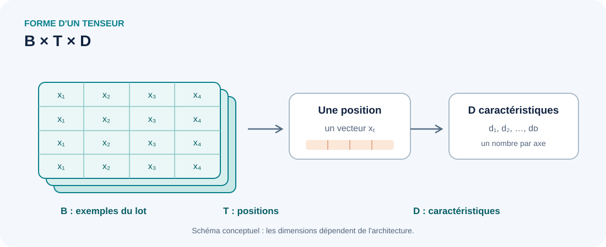

::: {.chapter-lead}
Dans un Transformer, les tenseurs transportent les représentations des tokens, les logits, les masques et les gradients. Lire correctement leurs axes est indispensable : une opération peut s'exécuter sans erreur tout en portant sur le mauvais axe.
:::

{fig-alt="Tenseur de forme B × T × D : B indexe les exemples, T les positions de chaque séquence et D les caractéristiques de chaque position." width=100%}

Pour un lot de textes, chaque position d'une séquence est décrite par un vecteur. Le tenseur d'activations est donc souvent organisé selon les axes batch, positions et caractéristiques.

## Formes courantes dans un LLM

On utilise souvent les conventions suivantes :

- \(B\) : taille du batch ;
- \(T\) : longueur de séquence ;
- \(D\) : dimension cachée ;
- \(V\) : taille du vocabulaire ;
- \(H\) : nombre de têtes d'attention ;
- \(d_h\) : dimension par tête, souvent telle que \(D=H d_h\).

Les activations cachées ont souvent la forme \((B,T,D)\), les logits \((B,T,V)\), et les représentations d'attention multi-tête peuvent prendre la forme \((B,H,T,d_h)\). Ces conventions sont fréquentes mais ne sont pas universelles : il faut lire les contrats des fonctions et vérifier les formes réelles.

| Objet dans le modèle | Forme typique | Interprétation |
|---|---|---|
| Perte moyenne scalaire | `()` | un objectif agrégé |
| Embedding d'un token | `(D,)` | un vecteur de caractéristiques |
| États cachés d'une séquence | `(T,D)` | un vecteur par position |
| États cachés d'un batch | `(B,T,D)` | exemples, positions, caractéristiques |

## Lire les dimensions d'une projection

Supposons que \(X\) ait la forme \((B,T,D)\) et que la matrice de projection \(W\) ait la forme \((D,D')\), où \(D'\) est la dimension de sortie. La projection applique la même transformation à chaque position :

\[
Y=XW,\qquad \operatorname{shape}(Y)=(B,T,D').
\]

Les axes du batch et des positions sont conservés ; le dernier axe passe de \(D\) à \(D'\). Cette notation évite de confondre la dimension de sortie avec \(H\), qui désigne plus loin le nombre de têtes d'attention. Vérifier les formes permet de détecter certaines erreurs, mais ne garantit pas que les axes ont la bonne signification.

## Les axes ont une signification

Une forme donne les tailles des axes, pas leur sémantique. Deux tenseurs de forme \((B,T,D)\) peuvent représenter des objets différents.

- **Projection linéaire :** transforme généralement le dernier axe des caractéristiques, par exemple \((B,T,D)\to(B,T,V)\) pour produire des logits.
- **Softmax :** pour une distribution sur le vocabulaire, la normalisation doit porter sur l'axe \(V\), pas sur l'axe \(T\).
- **Attention :** les scores relient les positions de requête et de clé ; le masque causal doit empêcher l'accès aux positions futures.
- **Perte :** les logits et les labels doivent aligner les positions et le token cible attendu.
- **Réduction :** une moyenne sur les tokens valides n'est pas équivalente à une moyenne sur le batch ou sur toutes les positions avec padding.


## Contre-exemple : softmax sur le mauvais axe

Considérons, pour un seul exemple et deux positions, les logits de trois tokens candidats :

```text
position 0 : [2, 1, 0]
position 1 : [0, 1, 2]
forme       : (B=1, T=2, V=3)
```

Pour chaque position, on veut une distribution sur les **tokens candidats**. La softmax doit donc agir sur l'axe \(V\), le dernier axe dans cette convention :

```python
probs = logits.softmax(dim=-1)  # normalise les 3 tokens, pour chaque position
```

La somme des probabilités sur \(V\) vaut alors 1 à chaque position. En revanche :

```python
wrong = logits.softmax(dim=1)  # normalise les 2 positions, token par token
```

est une opération mathématiquement valide et compatible avec la forme, mais elle répond à une autre question : pour chaque token candidat, elle répartit la masse entre les positions. Les lignes ne sont généralement plus des distributions sur le vocabulaire.

**Invariant de débogage :** si la sortie est censée représenter \(p(\text{token}\mid\text{contexte à cette position})\), vérifier que la somme sur l'axe du vocabulaire vaut 1 pour chaque couple batch-position. Une forme correcte ne suffit pas ; l'invariant dépend de l'interprétation attendue.

## Exemple de lecture des dimensions

Pour \(B=2\), \(T=4\) et \(D=8\), les états cachés ont la forme \((2,4,8)\). Une projection vers un vocabulaire de \(V=1000\) tokens produit des logits de forme \((2,4,1000)\). Le dernier axe correspond aux tokens candidats ; chaque couple batch-position porte ainsi une distribution après softmax sur cet axe.

La compatibilité des formes ne garantit pas que la projection, le masque, le décalage causal ou la réduction soient corrects. Il faut également vérifier le sens des axes et la sémantique des cibles.


## Ouvertures vers d'autres domaines

Les axes ne sont pas de simples indices : ils définissent la question posée aux données. Cette idée se retrouve ailleurs, avec des nuances importantes.

- **Traitement du signal :** un tableau \((T,C)\) peut représenter le temps et les canaux d'un capteur. Réduire sur \(T\) calcule une statistique temporelle ; réduire sur \(C\) combine des canaux. Même opération, sens différent. [NumPy — dimensions et tableaux](https://numpy.org/doc/stable/user/basics.creation.html) présente les bases de cette représentation.
- **Bases de données et analyse tabulaire :** lignes et colonnes ont un schéma sémantique. Permuter deux colonnes sans mettre à jour leur interprétation peut conserver un tableau valide tout en corrompant l'analyse. Les dimensions d'un tenseur jouent un rôle analogue, mais les axes numériques peuvent aussi être réordonnés et diffusés implicitement.
- **Physique et géométrie :** dans un tenseur mathématique au sens strict, les composantes suivent des lois de transformation sous un changement de coordonnées. Un tableau PyTorch de rang élevé n'est pas automatiquement un tel tenseur. Cette distinction devient utile lorsqu'on aborde vecteurs, bases, changements de coordonnées et invariance.
- **Probabilités et théorie de l'information :** une softmax définit une distribution seulement relativement à un ensemble de catégories précis. Dans un LLM, cet ensemble est souvent le vocabulaire ; normaliser sur les positions produit une autre quantité, pas une distribution de tokens.

Ces ponts sont des pistes de lecture, pas des prérequis. Ils peuvent devenir des pages autonomes dans une base de connaissances plus générale ; le parcours LLM Lab doit rester compréhensible sans ces approfondissements.

## Précision terminologique : rang d'un tableau et tenseur mathématique

Dans les bibliothèques de deep learning, le mot « tenseur » désigne couramment un tableau numérique multidimensionnel. En mathématiques et en physique, un tenseur est un objet plus structuré, dont les composantes suivent des règles de transformation précises. Les deux usages sont liés, mais pas strictement équivalents. Ici, le **rang du tableau** désigne le nombre d'axes : un scalaire a le rang 0, un vecteur le rang 1 et une matrice le rang 2. Ce sens diffère du rang d'une matrice en algèbre linéaire.

## Pièges fréquents

- **Indexation :** sélectionner un exemple ou une position de séquence peut supprimer un axe ; vérifier si l'opération suivante attend encore cette dimension.
- **Permutation d'axes :** changer l'ordre des axes change la manière dont les opérations les interprètent.
- **Broadcasting :** une dimension de taille 1 peut être étendue implicitement et masquer une erreur d'alignement.
- **Reshape :** changer la forme ne donne pas automatiquement une nouvelle signification aux valeurs.
- **Masques :** un masque diffusé sur les scores d'attention peut avoir une forme compatible mais autoriser les mauvaises positions.
- **Type numérique :** float32, bfloat16 et d'autres types n'ont pas les mêmes compromis de précision, mémoire et performance.
- **Gradients :** une variable doit être reliée au graphe de calcul pour recevoir un gradient automatique attendu.

## Idées reçues à éviter

- **« Un tenseur doit être un cube. »** Non : dans les API de deep learning, un scalaire, un vecteur, une matrice ou un tableau de dimension supérieure peut être appelé tenseur.
- **« Même forme signifie même signification. »** Non : des axes de même taille peuvent représenter des quantités différentes, et la forme ne code pas leur sémantique.
- **« Des dimensions compatibles prouvent que l'opération est correcte. »** Non : une opération peut s'exécuter en utilisant le mauvais axe, le mauvais alignement de cible ou le mauvais masque.

## Pour poursuivre

- [Requêtes, clés et valeurs](queries-keys-values.qmd).
- [Attention à produit scalaire mise à l'échelle](scaled-dot-product-attention.qmd).
- [Espace des embeddings](embedding-space.qmd).
- [Loss](loss.qmd) et [Gradients](gradients.qmd).
- [Fondations mathématiques](mathematical-foundations.qmd) — chaîne logits → perte → gradients.

## Références

- [PyTorch — Tensors](https://docs.pytorch.org/tutorials/beginner/introyt/tensors_deeper_tutorial.html).
- [PyTorch — Tensor documentation](https://docs.pytorch.org/docs/stable/tensors.html).
- [NumPy — N-dimensional array](https://numpy.org/doc/stable/reference/arrays.ndarray.html).
- [Sebastian Raschka — LLMs from Scratch](https://github.com/rasbt/LLMs-from-scratch) — référence complémentaire orientée implémentation.
- [Visualisation des tenseurs, partie 1](https://www.youtube.com/watch?v=YxXyN2ifK8A) — point de vue mathématique et physique, à distinguer de l'usage plus simple de « tenseur » dans les bibliothèques de deep learning.

::: {.language-switch}
[Français](tensors.qmd) · [English](../en/tensors.qmd)
:::
