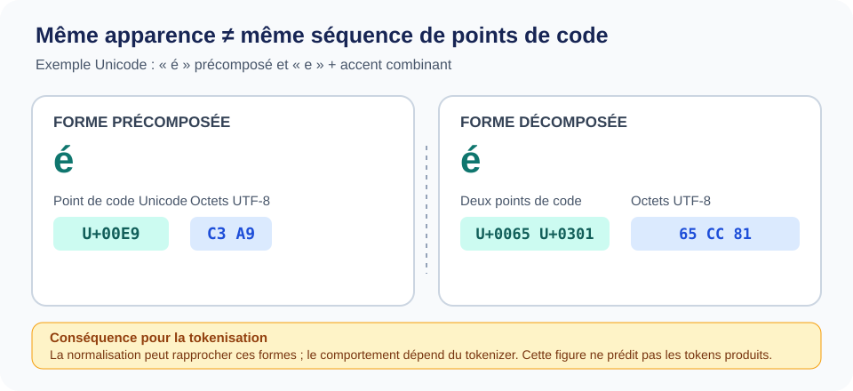
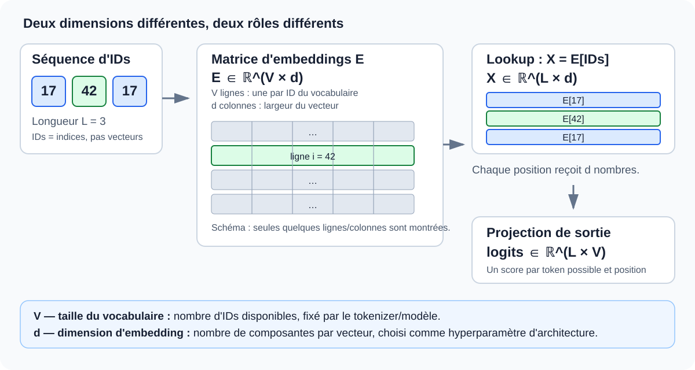

::: {.chapter-lead}
Un modèle de langage reçoit une séquence d'identifiants numériques, pas du texte brut. La tokenisation définit comment le texte est converti en identifiants et comment ceux-ci sont décodés. Elle est distincte du réseau neuronal, mais conditionne son vocabulaire, la longueur des séquences, le coût de calcul et certains comportements observables.
:::

::: {.callout-tip}
**Le fil conducteur :** texte Unicode → tokens → IDs → vecteurs d'embedding → représentations contextualisées. Chaque flèche est une transformation distincte ; ne confondez notamment pas **taille du vocabulaire** ($V$) et **dimension des embeddings** ($d$).
:::

## Objectifs

- Distinguer texte Unicode, octets, tokens, identifiants et embeddings.
- Expliquer pourquoi un découpage par espaces ne suffit pas.
- Décrire l'intuition de BPE et distinguer son apprentissage de l'encodage à l'inférence.
- Choisir des ressources complémentaires : intuition visuelle, code pédagogique et documentation technique.
- Identifier ce que la tokenisation ne permet pas de conclure sur le sens ou les capacités du modèle.

## 1. Du texte à une entrée numérique

Une chaîne Python représente du texte Unicode. Son encodage UTF-8 produit une séquence d'octets. Un tokenizer applique ensuite des règles de découpage et un vocabulaire pour produire des tokens, puis des identifiants entiers.

Le pipeline complet est détaillé dans le schéma « De la chaîne à l'embedding » ci-dessous, qui distingue pré-tokenisation, vocabulaire, tokens, IDs, lookup d'embeddings et représentations contextualisées.

Ce pipeline est conceptuel : les tokenizers varient par leur normalisation, leurs unités de base, leur pré-découpage, leur vocabulaire et leurs tokens spéciaux.

La chaîne `"ChatGPT apprend."` peut être découpée en mots, sous-mots, caractères ou fragments d'octets selon le tokenizer. Il n'existe pas un découpage unique qui serait le découpage linguistique « vrai ». Les identifiants sont des étiquettes discrètes : l'identifiant 314 n'est pas intrinsèquement plus proche en sens de 315. Un identifiant n'est pas un embedding ; le modèle apprend un vecteur associé à chaque entrée de la table d'embeddings.

### Quatre objets à ne pas confondre

- **Unicode** définit un répertoire de caractères et des propriétés associées ; il ne fixe pas la segmentation en tokens.
- **UTF-8** encode les points de code Unicode en octets ; un caractère peut occuper plusieurs octets.
- **Tokenisation** convertit le texte en unités du vocabulaire choisi.
- **Embedding** est un vecteur appris associé à un identifiant, et non une autre forme de cet identifiant.


### Unicode et UTF-8 : une différence invisible qui compte

{fig-alt="Comparaison de é précomposé (U+00E9, octets C3 A9) et de e suivi d'un accent combinant (U+0065 U+0301, octets 65 CC 81). La normalisation peut les rapprocher avant la tokenisation." width=100%}

Cette figure est originale pour LLM Lab. Elle s'appuie sur les règles d'encodage de [UTF-8 (RFC 3629)](https://www.rfc-editor.org/rfc/rfc3629) et sur les formes de normalisation décrites dans le [Unicode Standard Annex #15](https://www.unicode.org/reports/tr15/). Elle illustre l'encodage, pas la sortie d'un tokenizer particulier.

```python
import unicodedata

composed = "é"
decomposed = "e\u0301"

print([f"U+{ord(char):04X}" for char in composed])
# ['U+00E9']
print(composed.encode("utf-8"))
# b'\xc3\xa9'

print([f"U+{ord(char):04X}" for char in decomposed])
# ['U+0065', 'U+0301']
print(decomposed.encode("utf-8"))
# b'e\xcc\x81'

print(unicodedata.normalize("NFC", composed) == unicodedata.normalize("NFC", decomposed))
# True
```

Les deux chaînes peuvent avoir le même rendu visuel, mais leurs séquences Unicode et leurs octets UTF-8 diffèrent avant normalisation. Un tokenizer peut appliquer une normalisation, mais sa politique exacte dépend de son implémentation. **Ne déduisez pas les tokens ni les IDs de cette figure** : vérifiez-les avec le tokenizer et sa version réels.

### Même texte, segmentations possibles différentes

Une chaîne peut produire des fragments et des IDs différents selon le tokenizer. Le tableau est volontairement schématique : il ne prétend pas reproduire la sortie d'un encodeur réel.

| Étape | Tokenizer A | Tokenizer B |
|---|---|---|
| Fragments | `[fragment 1]`, `[fragment 2]`, `[fragment 3]` | `[fragment 1]`, `[fragment 2]` |
| Identifiants | Dépendent du vocabulaire A | Dépendent du vocabulaire B |
| Modèle compatible | Poids entraînés avec A | Poids entraînés avec B |

Cette comparaison illustre seulement que la segmentation et la longueur peuvent changer. Elle ne démontre pas qu'un tokenizer est meilleur, ni que ses fragments correspondent à des unités de sens.


### De la chaîne à l'embedding : les transformations

```{mermaid}
flowchart TD
    A["Texte Unicode"] --> B["Normalisation éventuelle"]
    B --> C["Pré-tokenisation"]
    C --> D["Algorithme + vocabulaire appris"]
    D --> E["Tokens : fragments de texte ou d'octets"]
    E --> F["IDs entiers : indices du vocabulaire"]
    F --> G["Lookup dans la matrice E"]
    G --> H["Vecteurs : E[id]"]
    H --> I["Réseau neuronal : représentations contextualisées"]
```

### Vocabulaire ≠ dimension d'embedding

Le mot **vocabulaire** désigne ici l'ensemble fini des tokens que le tokenizer peut émettre, pas une liste de mots linguistiques. Sa taille, notée $V$, est le nombre d'entrées/IDs du vocabulaire. Un token peut être un mot, un sous-mot, un fragment d'octets, de la ponctuation ou un token spécial.

La **dimension d'embedding**, notée $d$, est le nombre de composantes du vecteur associé à chaque ID. Elle est choisie lors de la conception de l'architecture du modèle ; elle n'est **pas calculée à partir de $V$**. Dans beaucoup de GPT, elle correspond à la largeur cachée du Transformer, mais cette convention dépend de l'architecture.

{fig-alt="Les IDs sélectionnent des lignes dans E de forme V par d. Une séquence de longueur L devient une matrice L par d ; la projection de sortie produit des logits de forme L par V." width=100%}

::: {.callout-note}
**Les dimensions à retenir**

- **$V$** : nombre de tokens/IDs du vocabulaire — lié au tokenizer et à ses choix de conception.
- **$d$** : nombre de composantes par embedding — hyperparamètre de l'architecture.
- **$L$** : nombre de tokens dans une séquence donnée.
- **$B$** : nombre de séquences dans un lot (batch).
:::

Pour une séquence d'IDs $[i_1,\ldots,i_L]$, la matrice d'embeddings est $E\in\mathbb{R}^{V\times d}$ et le lookup sélectionne les lignes correspondantes :

$
X = E_{[i_1,\ldots,i_L]}\in\mathbb{R}^{L\times d}.
$

Avec un lot, la forme devient généralement $[B,L,d]$. **Le lookup ne calcule pas encore le sens en contexte** : il sélectionne les vecteurs appris ; les blocs du Transformer produisent ensuite des représentations contextualisées.

### Comment ces dimensions sont-elles fixées ?

- **$V$ est déterminé par le tokenizer** : corpus et prétraitement, algorithme (par exemple BPE ou unigramme), règles et objectif de taille de vocabulaire, ainsi que le traitement des tokens spéciaux. La taille exacte est un choix de conception et peut différer de la cible demandée selon l'implémentation.
- **$d$ est déterminé par l'architecture** : c'est un hyperparamètre choisi avec la profondeur, le nombre de têtes, le budget de calcul et les objectifs d'entraînement. Il n'existe pas de formule universelle qui déduise $d$ de $V$.
- **Le nombre de paramètres dépend des deux** : la table d'embeddings contient $Vd$ paramètres. Si la projection de sortie possède sa propre matrice de poids, elle ajoute typiquement environ $dV$ paramètres (plus éventuellement un biais). Certains modèles partagent les poids d'entrée et de sortie (*weight tying*) ; il ne faut donc pas additionner automatiquement les deux matrices sans vérifier l'architecture. La taille $V$ utilisée par la matrice doit correspondre aux IDs réellement pris en charge par le modèle, y compris les tokens spéciaux qu'il reconnaît.

::: {.callout-warning}
**Changer le tokenizer n'est pas une simple substitution.** Les IDs ne gardent pas le même sens d'un vocabulaire à l'autre. Les poids de la table d'embeddings et de la projection de sortie ont été appris pour des IDs précis ; changer $V$ ou l'affectation des IDs nécessite une stratégie explicite d'adaptation ou de réentraînement.
:::

Les logits ont une composante par token possible ; la [page sur la cross-entropy](cross-entropy.qmd) explique comment les scores sont comparés à la cible pendant l'entraînement. Pour les dimensions des tenseurs et les opérations par lots, voir [la page sur les tenseurs](tensors.qmd). Pour distinguer l'embedding initial des représentations après attention, voir [l'espace des embeddings](embedding-space.qmd) ; la suite du pipeline est détaillée dans [la page Transformer](transformer.qmd).

### Trois points de vue visuels complémentaires

Le schéma ci-dessus donne une vue d'ensemble du pipeline. Ces ressources externes éclairent des aspects différents, sans reproduire leurs figures dans le dépôt :

- **Algorithme, étape par étape —** [BPE Explainer de Philip Müller et Peter Steinbach](https://philipmueller.dev/bpe-visualization/) : visualisation interactive des paires candidates, des fusions et de l'évolution du vocabulaire. C'est le meilleur complément pour comprendre la mécanique de BPE ; les conventions de la démonstration restent à distinguer de celles d'un tokenizer de production.
- **Pipeline de bout en bout —** [Raschka, *Build a Large Language Model (From Scratch)*, chapitre 2](https://livebook.manning.com/book/build-a-large-language-model-from-scratch/chapter-2) : repérer notamment la figure 2.4 sur le traitement du texte. Elle donne le contexte LLM global, tandis que le schéma local ci-dessus explicite davantage la normalisation, la pré-tokenisation et le lookup dans la matrice d'embeddings.
- **Conséquences multilingues —** [Ahia et al. (2023), PDF, figure 1](https://aclanthology.org/2023.emnlp-main.614.pdf) ([page de l'article](https://aclanthology.org/2023.emnlp-main.614/)) : met côte à côte des exemples anglais et grecs et relie la tokenisation au coût d'usage. Cette figure ouvre une perspective socio-technique que le pipeline seul ne montre pas ; elle illustre un problème, sans résumer à elle seule toutes les analyses de l'article.
- **Unicode et normalisation —** [graphiques officiels de normalisation Unicode](https://www.unicode.org/charts/normalization/) : référence technique utile pour approfondir les différences entre formes normalisées, en complément de la figure originale sur « é » ci-dessus.

Pour une explication orale et codée, la vidéo [Karpathy — *Let's build the GPT Tokenizer*](https://www.youtube.com/watch?v=zduSFxRajkE) parcourt Unicode/UTF-8, BPE, la pré-tokenisation et les tokens spéciaux.

**Droits et provenance :** les figures externes sont citées et liées à leur source, mais ne sont ni copiées ni intégrées localement. La citation d'une illustration ne vaut pas autorisation de la redistribuer ; le dépôt conserve ses propres schémas originaux.

Les identifiants sont des indices de ligne, pas des coordonnées sémantiques : la différence numérique entre deux IDs n'a pas de signification intrinsèque. L'étape positionnelle dépend de l'architecture ; [l'encodage positionnel et RoPE](positional-encoding.qmd) explique la distinction principale.

## 2. Pourquoi le découpage par espaces ne suffit pas

Il gère mal la ponctuation, les contractions, les langues sans espaces entre les mots, les variantes orthographiques, les noms rares et les chaînes techniques. Un vocabulaire contenant chaque mot possible serait immense et resterait fragile face aux formes nouvelles.

Les méthodes sous-mots réutilisent des unités fréquentes tout en représentant des formes moins fréquentes. Mais cette segmentation est une décision d'ingénierie, pas une analyse morphologique parfaite.

## 3. L'intuition de Byte Pair Encoding (BPE)

Dans une version pédagogique simplifiée, BPE part d'unités de base, compte les paires adjacentes, fusionne une paire selon une règle définie et répète l'opération jusqu'à atteindre un critère d'arrêt. Pour voir les fusions et l'évolution du vocabulaire pas à pas, utilisez la [visualisation interactive originale de Müller et Steinbach — BPE Explainer](https://philipmueller.dev/bpe-visualization/). Elle montre les paires fréquentes, les fusions et le vocabulaire qui se construit.

Le pipeline reste simplifié : les tokenizers réels peuvent utiliser un pré-découpage par expressions régulières, travailler au niveau des octets et réserver des tokens spéciaux. Deux tokenizers appelés BPE ne sont donc pas nécessairement compatibles.

Il faut distinguer :

1. **Entraînement du tokenizer** : apprend le vocabulaire, l'ordre des fusions et les règles à partir d'un corpus.
2. **Encodage** : applique le tokenizer déjà appris ; il ne réapprend pas le vocabulaire à chaque requête.

Un tokenizer BPE au niveau des octets peut représenter des entrées textuelles arbitraires grâce à ses unités de base. Tous les tokenizers BPE ne sont toutefois pas byte-level, et le résultat dépend aussi du pré-découpage et du vocabulaire.

```{mermaid}
flowchart LR
    subgraph Train["Apprentissage du tokenizer"]
        A["Corpus"] --> B["Pré-découpage et unités de base"]
        B --> C["Comptage des paires et fusions"]
        C --> D["Vocabulaire + ordre des fusions"]
        D --> E["Tokenizer sauvegardé"]
    end
    subgraph Use["Encodage d'un nouveau texte"]
        F["Nouveau texte"] --> G["Règles déjà apprises"]
        E -. "réutilisé" .-> G
        G --> H["Tokens puis IDs"]
        H --> I["Modèle compatible"]
    end
```

Ce schéma sépare **l'apprentissage du tokenizer** de **l'encodage**. Il ne décrit pas l'entraînement du modèle neuronal, qui est une étape distincte : le modèle apprend ses paramètres à partir de séquences d'IDs et de ses objectifs d'entraînement.


### Exemple concret : fusions BPE sur un petit corpus

Convention pédagogique : les mots sont initialement découpés en caractères, avec un marqueur de fin `</w>`. Le corpus contient une occurrence de `low`, `lower` et `lowest`.

| Mot | Unités initiales |
|---|---|
| `low` | `l · o · w · </w>` |
| `lower` | `l · o · w · e · r · </w>` |
| `lowest` | `l · o · w · e · s · t · </w>` |

À chaque itération, BPE compte les paires adjacentes et fusionne une paire selon sa règle de sélection. Supposons que le départage choisisse d'abord `l + o → lo`, puis `lo + w → low`.

| Étape | `low` | `lower` | `lowest` |
|---|---|---|---|
| 0 | `l · o · w · </w>` | `l · o · w · e · r · </w>` | `l · o · w · e · s · t · </w>` |
| 1 : fusion `l + o` | `lo · w · </w>` | `lo · w · e · r · </w>` | `lo · w · e · s · t · </w>` |
| 2 : fusion `lo + w` | `low · </w>` | `low · e · r · </w>` | `low · e · s · t · </w>` |

**Pour une visualisation pas à pas des fusions**, consultez le [BPE Explainer de Müller et Steinbach](https://philipmueller.dev/bpe-visualization/). L'exemple tabulaire ci-dessus reste la trace locale, reproductible et textuelle utilisée dans ce guide ; la visualisation interactive externe apporte une vue plus riche sans répéter ici un troisième schéma de flux.

C'est un exemple de suivi des fusions, pas une sortie universelle : les fréquences, le pré-découpage, le traitement des fins de mots et le départage influencent l'ordre réel. D'autres fusions pourraient ensuite créer `er` ou `est`, mais ce n'est pas garanti. À l'encodage, le tokenizer applique les règles apprises ; il ne recompte pas les fréquences du texte soumis. L'ID est attribué dans le vocabulaire final, il ne constitue pas la fusion elle-même.

## 4. Conséquences pour le modèle

- **Longueur du contexte :** un même texte peut devenir un nombre différent de tokens selon le tokenizer.
- **Coût de calcul :** à architecture donnée, des séquences plus longues augmentent généralement le coût de l'attention et la mémoire.
- **Vocabulaire de sortie :** sa taille détermine notamment la dimension de la distribution des logits.
- **Robustesse :** le texte multilingue, le code, les nombres et les caractères inhabituels peuvent être segmentés différemment.
- **Compatibilité :** les identifiants ne sont interprétables qu'avec le vocabulaire et les règles correspondants. Changer de tokenizer sans adapter les poids n'est pas une substitution neutre.

La tokenisation ne garantit ni compréhension sémantique, ni vérité, ni calibration. Elle définit la représentation discrète sur laquelle le modèle apprend.

## 5. Au-delà de la compression : équité linguistique et évaluation

Le nombre de tokens est une mesure utile de **coût de représentation**, pas une mesure suffisante de qualité. Un tokenizer peut compresser efficacement un corpus global tout en représentant moins efficacement certaines langues, écritures, formes morphologiques ou types de texte. Inversement, réduire le nombre de tokens ne garantit pas à lui seul de meilleures performances en aval.

Les compromis doivent être évalués sur plusieurs axes, sans supposer une relation causale simple :

- **Mesures intrinsèques** : fertilité, longueur en tokens, compression et couverture.
- **Coût système** : contexte consommé, mémoire, latence et débit.
- **Résultats en aval** : qualité par langue et par tâche, sous des budgets comparables.

Pour comparer des tokenizers, contrôlez les textes, les versions, les règles de normalisation et les budgets ; puis vérifiez les performances sur des tâches pertinentes.

Ressources de recherche pour approfondir ce point de vue :

- [Ahia et al. (2023) — *Do All Languages Cost the Same?*](https://aclanthology.org/2023.emnlp-main.614/) : étude des différences de coût de tokenisation entre 22 langues et de leurs conséquences pour les API.
- [Ali et al. (2024) — *Tokenizer Choice For LLM Training: Negligible or Crucial?*](https://aclanthology.org/2024.findings-naacl.247/) : montre pourquoi le choix du tokenizer peut affecter les coûts et les performances, tout en soulignant que les métriques intrinsèques ne prédisent pas toujours les résultats en aval.
- [Wegmann et al. (2025) — *Tokenization is Sensitive to Language Variation*](https://aclanthology.org/2025.findings-acl.572/) : point de vue complémentaire sur les variations linguistiques et le rôle du pré-tokenizer.
- [Arnett et al. (2025) — *Explaining and Mitigating Crosslingual Tokenizer Inequities*](https://proceedings.neurips.cc/paper_files/paper/2025/hash/5b91cefbfa52340af2f16f249572dc76-Abstract-Conference.html) : analyse des écarts de coûts entre langues et de facteurs de conception tels que la taille du vocabulaire et le pré-tokenizer.
- [TokLens (ACL 2026 SRW)](https://aclanthology.org/2026.acl-srw.18/) : toolkit récent de mesures comparatives multilingues. À traiter comme un outil et une étude à examiner, pas comme une preuve qu'une métrique intrinsèque unique suffit.

**Question de lecture critique :** si le tokenizer A utilise 20 % de tokens en moins que B sur un texte, qu'a-t-on démontré ? Seulement une différence de longueur pour ce texte et ces versions. Pour conclure à une meilleure qualité, il faut des mesures supplémentaires et des évaluations adaptées.

## 6. Bibliothèque de ressources commentées

Les ressources sont complémentaires. Une progression efficace consiste à construire l'intuition, lire une implémentation, puis vérifier les détails dans la documentation technique.

### Intuition, visualisations et cours

- [Andrej Karpathy — *Let's build the GPT Tokenizer*](https://www.youtube.com/watch?v=zduSFxRajkE) : vidéo longue et illustrée, d'Unicode/UTF-8 aux fusions BPE, tokens spéciaux et pièges pratiques.
- [Sebastian Raschka — *Build an LLM from Scratch*](https://www.sebastianraschka.com/llms-from-scratch/) : le chapitre 2 situe les tokens dans le pipeline données → embeddings → exemples entrée-cible.
- [Hugging Face — cours sur les tokenizers](https://huggingface.co/learn/llm-course/chapter6/1) : panorama didactique des algorithmes et compromis ; vérifier la version actuelle du cours.

### Visualisations interactives et comparaison

- [Philip Müller & Peter Steinbach — BPE Explainer](https://philipmueller.dev/bpe-visualization/) : visualisation interactive pas à pas, utile pour observer quelles paires sont fusionnées et comment le vocabulaire évolue. À utiliser comme démonstration pédagogique, puis comparer les conventions avec un tokenizer de production.
- [Cornell CS4782 — Interactive Tokenization Visualizer](https://www.cs.cornell.edu/courses/cs4782/2026sp/demos/bytepair/) : comparaison interactive de BPE et WordPiece. Intéressant pour isoler ce qui relève de la famille d'algorithmes, mais ses exemples didactiques ne couvrent pas toutes les variantes industrielles. **Réserve sur l'interface (vérifiée le 29-10-2026) :** le panneau de la fusion sélectionnée affichait « Frequency: undefined », alors que la liste des paires candidates indiquait des fréquences ; ne pas se fier à cette valeur tant que la page n'a pas été corrigée.
- [Hugging Face — BPE, cours en français](https://huggingface.co/learn/llm-course/fr/chapter6/5?fw=tf) : explication structurée de l'entraînement BPE, complétant la visualisation par une formulation plus systématique.
- [Saurav Prateek — visualiser l'encodage BPE avec Hugging Face](https://huggingface.co/blog/SauravP97/bpe-tokenizer-visualize) : exemple de visualisation du chemin de fusion d'un texte. Article communautaire ; vérifier la compatibilité actuelle du code et des dépendances avant de l'exécuter.

### Code pédagogique

- [OpenAI `tiktoken` — module éducatif](https://github.com/openai/tiktoken/blob/main/tiktoken/_educational.py) : version simplifiée de BPE pour inspecter les fusions ; ne pas la prendre pour le chemin optimisé en production.
- [Andrej Karpathy — `minbpe`](https://github.com/karpathy/minbpe) : code compact pour suivre entraînement et encodage ; comparer les conventions avant de conclure à une compatibilité.
- [Sebastian Raschka — BPE from scratch](https://sebastianraschka.com/blog/2025/bpe-from-scratch.html) : notebook explicatif complémentaire.
- [Raschka — dépôt, chapitre 2](https://github.com/rasbt/LLMs-from-scratch/tree/main/ch02) : implémentations et préparation des données textuelles.

### Références techniques et alternatives

- [OpenAI — `tiktoken`](https://github.com/openai/tiktoken) : bibliothèque BPE rapide pour les encodages pris en charge par les modèles OpenAI.
- [Google — SentencePiece](https://github.com/google/sentencepiece) : apprentissage depuis du texte brut ; propose notamment BPE et le modèle unigramme. Ce n'est pas un simple alias de tiktoken.
- [Hugging Face — Tokenizers](https://github.com/huggingface/tokenizers) : implémentations performantes de plusieurs algorithmes.
- [Gage (1994), *A New Algorithm for Data Compression*](https://dl.acm.org/doi/10.5555/177910.177914) : référence historique de la compression par paires d'octets. Les tokenizers modernes de LLM ajoutent des conventions ; le papier historique ne spécifie pas à lui seul tous les détails de GPT BPE.

### Ordre de lecture conseillé

1. Regarder Karpathy pour l'intuition des octets, des fusions et des tokens spéciaux.
2. Lire `minbpe` ou `tiktoken/_educational.py` pour suivre l'algorithme.
3. Comparer avec la documentation de tiktoken, SentencePiece et Hugging Face.
4. Revenir au chapitre 2 de Raschka pour voir comment les identifiants alimentent le reste du pipeline.
5. Tester des textes multilingues, du code, des nombres, des espaces et des caractères Unicode inhabituels.

Cette page référence les ressources sans recopier leurs illustrations. Les dépôts évoluent : leur disponibilité ne valide pas automatiquement chacune de leurs affirmations.

## 7. Mini-laboratoire de comparaison

Utiliser les visualiseurs ci-dessus avec les mêmes chaînes et noter les différences. Ne pas comparer les IDs bruts entre vocabulaires comme s'ils avaient une signification commune.

| Entrée à tester | Question pédagogique | Ce qu'il faut observer |
|---|---|---|
| `Hello world` puis ` Hello world` | L'espace initial compte-t-il ? | Les règles de pré-découpage et les tokens incluant un espace |
| `ChatGPT`, `chatgpt`, `CHATGPT` | La casse change-t-elle le découpage ? | Segmentation et normalisation éventuelle |
| `2026-10-28` et `123456789` | Les chiffres sont-ils toujours un token ? | Le découpage des nombres varie selon les tokenizers et les chaînes |
| `café` et `cafe\u0301` | Deux chaînes visuellement proches sont-elles identiques ? | Unicode composé/décomposé et éventuelle normalisation |
| Une phrase en français, anglais et une langue sans espaces usuels entre mots | Le coût en tokens est-il uniforme ? | Longueur de séquence et dépendance à la langue |
| Un extrait de code | Les noms et symboles sont-ils segmentés intuitivement ? | Tokens partiels, ponctuation et effets sur la longueur |

**Compte rendu minimal :** pour chaque chaîne, noter le tokenizer/version, les tokens visibles, le nombre de tokens et une limite d'interprétation. Le nombre de tokens seul ne mesure ni la qualité linguistique ni la qualité du modèle.

## 8. Contre-exemples et erreurs fréquentes

- **« Un token est un mot. »** Faux : il peut s'agir d'un sous-mot, de ponctuation, d'un fragment avec espace, d'octets ou d'un token spécial.
- **« BPE reconnaît les racines et suffixes. »** Pas nécessairement : il fusionne selon une procédure statistique, sans analyse morphologique garantie.
- **« Deux tokenizers BPE produisent les mêmes identifiants. »** Faux en général : vocabulaire, pré-découpage et règles peuvent différer.
- **« L'identifiant contient du sens. »** Pas en soi : c'est une étiquette discrète ; les vecteurs sont appris.
- **« Une chaîne inconnue ne peut pas être encodée. »** Pas nécessairement : un tokenizer byte-level dispose d'unités de base couvrant les octets, sous réserve de ses règles d'encodage.
- **« Le tokenizer est une couche du Transformer. »** C'est une étape distincte, même si modèle et tokenizer doivent être compatibles.

## Pour approfondir : stratégies de tokenisation

Le guide [Stratégies de tokenisation : granularité, algorithmes et compromis](tokenization-strategies.qmd) compare mots, caractères, octets, sous-mots, BPE, WordPiece et unigramme.

## Pour poursuivre

- [GPT et Transformer : architecture et flux des données](transformer.qmd)
- [Tenseurs](tensors.qmd)
- [Espace des embeddings](embedding-space.qmd)
- [Fondations mathématiques](mathematical-foundations.qmd)
- [Plan de couverture du programme et des sources](https://github.com/JM-Brun/llm-lab/blob/main/docs/full-curriculum-plan.md)

::: {.language-switch}
**Langue :** [Français](text-data.qmd) · [English](../en/text-data.qmd)
:::
