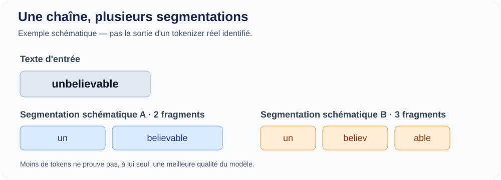

::: {.chapter-lead}
Un modèle de langage reçoit une séquence d'identifiants numériques, pas du texte brut. La tokenisation définit comment le texte est converti en identifiants et comment ceux-ci sont décodés. Elle est distincte du réseau neuronal, mais conditionne son vocabulaire, la longueur des séquences, le coût de calcul et certains comportements observables.
:::

::: {.callout-tip}
**Le fil conducteur :** texte Unicode → tokens → IDs → vecteurs d'embedding → représentations contextualisées. Chaque flèche est une transformation distincte ; ne confondez notamment pas **taille du vocabulaire** ($V$) et **dimension des embeddings** ($d$).
:::

## Objectifs

- Distinguer texte Unicode, octets, tokens, identifiants et embeddings.
- Expliquer pourquoi un découpage par espaces ne suffit pas.
- Décrire les conséquences de la segmentation sur la longueur, le coût et la compatibilité.
- Identifier les pages spécialisées adaptées à un approfondissement technique.
- Identifier ce que la tokenisation ne permet pas de conclure sur le sens ou les capacités du modèle.

## 1. Le parcours, du texte au modèle

Le point de vue utile à ce stade est celui du **pipeline** : quelles transformations un texte traverse-t-il avant d'être traité par le réseau ?

```{mermaid}
flowchart LR
    A["Texte source"] --> B["Prétraitement éventuel"]
    B --> C["Tokeniseur"]
    C --> D["Tokens"]
    D --> E["IDs entiers"]
    E --> F["Lookup dans la table d'embeddings"]
    F --> G["Embeddings des tokens"]
    G --> H["Transformer et mécanisme positionnel"]
    H --> I["Représentations contextualisées"]
```

Le dernier bloc regroupe volontairement le traitement positionnel et le Transformer. Les architectures n'introduisent pas toutes la position de la même manière : des vecteurs positionnels absolus appris peuvent être ajoutés aux embeddings des tokens, tandis que RoPE fait tourner les vecteurs requête et clé dans l'attention. La position n'est donc pas un vecteur supplémentaire universellement ajouté au moment du lookup ; voir [encodage positionnel et RoPE](positional-encoding.qmd).

- **Texte source** : une chaîne pouvant contenir ponctuation, espaces, nombres, code ou plusieurs langues.
- **Prétraitement** : certaines chaînes sont normalisées ou pré-découpées ; ces opérations dépendent du tokeniseur.
- **Tokeniseur** : applique des règles et un vocabulaire appris pour convertir le texte en unités appelées *tokens*.
- **IDs** : chaque token est associé à un entier servant d'indice dans le vocabulaire. Cet entier est une étiquette, pas une mesure de sens.
- **Embeddings** : les IDs sélectionnent des vecteurs appris. Le Transformer les transforme ensuite en représentations dépendant du contexte.

Ce schéma est conceptuel : les tokeniseurs réels diffèrent par leurs unités de base, leur normalisation, leur pré-tokenisation, leur vocabulaire et leurs tokens spéciaux.

::: {.callout-note}
**Deux sens différents du prétraitement.** La préparation du corpus (par exemple filtrer les documents, dédupliquer les quasi-copies et définir les frontières entre entraînement et validation) relève de l'ingénierie des données en amont. La normalisation et la pré-tokenisation relèvent du pipeline du tokenizer et s'appliquent au texte d'entrée. Il ne faut pas confondre ces opérations. De même, l'entraînement du tokenizer apprend un vocabulaire et des règles ; l'encodage d'une nouvelle entrée les réutilise sans réentraîner le tokenizer.
:::


### Le vocabulaire minimal

| Terme | Rôle dans le pipeline |
|---|---|
| **Texte** | Entrée lisible par un humain. |
| **Token** | Unité discrète définie par un tokeniseur : mot, sous-mot, ponctuation, fragment d'octets ou token spécial. |
| **ID** | Entier identifiant un token dans un vocabulaire donné. |
| **Embedding** | Vecteur associé à un ID, utilisé comme représentation numérique initiale. |
| **Représentation contextualisée** | Vecteur après traitement par le réseau, influencé par les autres tokens de la séquence. |

Les détails de bas niveau ne sont pas nécessaires pour suivre ce parcours. Pour comprendre pourquoi deux chaînes visuellement identiques peuvent être encodées différemment, consultez le [complément sur Unicode, UTF-8 et la normalisation](unicode-text.qmd). Pour les algorithmes de segmentation et leurs compromis, consultez la [page dédiée aux stratégies de tokenisation](tokenization-strategies.qmd). Les dimensions des matrices et le rôle exact des embeddings sont détaillés dans [l'espace des embeddings](embedding-space.qmd) et [la page sur les tenseurs](tensors.qmd).

### Un même texte, plusieurs segmentations

Un même texte peut être découpé en un nombre différent de tokens selon le tokenizer. Les fragments et les IDs exacts dépendent de son vocabulaire et de sa configuration ; il n'existe pas de découpage universel à déduire du texte seul.

À retenir : les tokens sont des unités de représentation, pas nécessairement des mots ni des unités de sens. La figure ci-dessous donne un exemple schématique de segmentation ; elle ne prétend pas reproduire la sortie d'un tokenizer réel. Pour une comparaison réelle, il faut indiquer le tokenizer et sa version, puis mesurer la séquence obtenue.

## 2. Pourquoi la tokenisation compte

Le découpage par espaces ne suffit pas : la ponctuation, les contractions, les noms rares, le code et les langues dont l'écriture ne sépare pas systématiquement les mots posent des problèmes différents. Les tokeniseurs découpent donc le texte en unités réutilisables, selon des règles et un vocabulaire propres à chaque modèle.

Cette décision de représentation a plusieurs conséquences :

- **Couverture** : les unités de base permettent-elles de représenter les entrées attendues ?
- **Longueur de séquence** : combien de tokens sont nécessaires pour encoder un même texte ?
- **Coût** : la longueur influence la mémoire et le calcul, mais le nombre de tokens ne suffit pas à comparer le coût total de deux systèmes.
- **Comportement linguistique** : le découpage peut varier selon la langue, l'orthographe, les nombres et le domaine.
- **Compatibilité** : les IDs n'ont de sens que dans le vocabulaire associé ; le tokenizer et les poids du modèle doivent correspondre.

La segmentation n'est ni une analyse linguistique parfaite, ni une mesure du sens. Une segmentation plus courte n'implique pas à elle seule un meilleur modèle.

{fig-alt="Le mot anglais unbelievable est représenté par deux fragments dans une segmentation illustrative, puis par trois fragments dans une autre. Ces découpages ne sont pas des sorties réelles d’un tokenizer identifié." fig-cap="Une chaîne peut avoir plusieurs segmentations possibles. La figure est illustrative : elle ne reproduit pas la sortie d’un tokenizer réel ni une mesure expérimentale." width=100%}

Cette figure illustre la dépendance du découpage aux règles et au vocabulaire du tokenizer ; elle ne démontre pas qu’une segmentation est meilleure. Pour une comparaison empirique, utilisez les mêmes textes, consignez le tokenizer et sa version, puis rapportez les mesures par langue et type de texte. Voir [Ahia et al. (2023)](https://aclanthology.org/2023.emnlp-main.614/) pour une étude des coûts de tokenisation entre langues.

### Évaluer les compromis au-delà du nombre de tokens

Le nombre de tokens est un indicateur de longueur, pas un score global de qualité. Une évaluation rigoureuse distingue l'efficacité de représentation, les performances sur des tâches en aval, les écarts entre langues et la reproductibilité du protocole. Les résultats dépendent du corpus, de la tâche, du modèle et des budgets comparés.

Pour comprendre ces dimensions et examiner les travaux scientifiques associés, consultez **[Évaluer un tokenizer : métriques, performances et équité multilingue](tokenization-strategies.qmd#tokenizer-evaluation)**.

### Pour approfondir les mécanismes

La page principale reste centrée sur le parcours. Les détails techniques sont traités dans des pages dédiées :

- [Stratégies de tokenisation](tokenization-strategies.qmd) : pré-tokenisation, BPE, WordPiece, unigramme, exemples, comparaisons et limites.
Pour une vue visuelle des particularités de la tokenisation, voir [How LLMs See the World](https://blog.bytebytego.com/p/how-llms-see-the-world) de ByteByteGo. Pour une pratique guidée de BPE avec des notebooks, Vizuara propose [Tokenization from Scratch: Building Byte-Pair Encoding by Hand](https://pods.vizuara.ai/courses/build-llm/tokenization-from-scratch-building-byte-pair-encoding-by-han). Ce sont des ressources pédagogiques facultatives, pas des prérequis ni des substituts aux définitions et précautions de ce projet.
- [Unicode, UTF-8 et normalisation](unicode-text.qmd) : points de code, octets et chaînes visuellement identiques.
- [Espace des embeddings](embedding-space.qmd) et [tenseurs](tensors.qmd) : dimensions, tables de poids et formes des représentations.

## 3. Mini-laboratoire de comparaison

Comparer les mêmes chaînes avec au moins deux tokenizers, en s'appuyant sur les exemples et outils présentés dans la [page sur les stratégies de tokenisation](tokenization-strategies.qmd). Noter les différences ; ne pas comparer les IDs bruts entre vocabulaires comme s'ils avaient une signification commune.

| Entrée à tester | Question pédagogique | Ce qu'il faut observer |
|---|---|---|
| `Hello world` puis ` Hello world` | L'espace initial compte-t-il ? | Les règles de pré-découpage et les tokens incluant un espace |
| `ChatGPT`, `chatgpt`, `CHATGPT` | La casse change-t-elle le découpage ? | Segmentation et normalisation éventuelle |
| `2026-10-28` et `123456789` | Les chiffres sont-ils toujours un token ? | Le découpage des nombres varie selon les tokenizers et les chaînes |
| `café` et `cafe\u0301` | Deux chaînes visuellement proches sont-elles identiques ? | Unicode composé/décomposé et éventuelle normalisation |
| Une phrase en français, anglais et une langue sans espaces usuels entre mots | Le coût en tokens est-il uniforme ? | Longueur de séquence et dépendance à la langue |
| Un extrait de code | Les noms et symboles sont-ils segmentés intuitivement ? | Tokens partiels, ponctuation et effets sur la longueur |

**Compte rendu minimal :** pour chaque chaîne, noter le tokenizer/version, les tokens visibles, le nombre de tokens et une limite d'interprétation. Le nombre de tokens seul ne mesure ni la qualité linguistique ni la qualité du modèle.

## 4. Contre-exemples et erreurs fréquentes

- **« Un token est un mot. »** Faux : il peut s'agir d'un sous-mot, de ponctuation, d'un fragment avec espace, d'octets ou d'un token spécial.
- **« BPE reconnaît les racines et suffixes. »** Pas nécessairement : il fusionne selon une procédure statistique, sans analyse morphologique garantie.
- **« Deux tokenizers BPE produisent les mêmes identifiants. »** Faux en général : vocabulaire, pré-découpage et règles peuvent différer.
- **« L'identifiant contient du sens. »** Pas en soi : c'est une étiquette discrète ; les vecteurs sont appris.
- **« Une chaîne inconnue ne peut pas être encodée. »** Pas nécessairement : un tokenizer byte-level dispose d'unités de base couvrant les octets, sous réserve de ses règles d'encodage.
- **« Le tokenizer est une couche du Transformer. »** C'est une étape distincte, même si modèle et tokenizer doivent être compatibles.

## Pour approfondir : stratégies de tokenisation

Le guide [Stratégies de tokenisation : granularité, algorithmes et compromis](tokenization-strategies.qmd) compare mots, caractères, octets, sous-mots, BPE, WordPiece et unigramme.

## Étape suivante

Poursuivez avec [l'espace des embeddings](embedding-space.qmd) pour voir comment les IDs sélectionnent des lignes dans une matrice d'embeddings, comment évoluent les formes des tenseurs et comment les couches suivantes du réseau produisent des représentations contextualisées.

Pour le langage mathématique utilisé dans le modèle, consultez les pages [tenseurs](tensors.qmd) et [fondations mathématiques](mathematical-foundations.qmd). Le [plan complet du programme et de couverture des sources](https://github.com/JM-Brun/llm-lab/blob/main/docs/full-curriculum-plan.md) présente le parcours plus large.

::: {.language-switch}
**Langue :** [Français](text-data.qmd) · [English](../en/text-data.qmd)
:::
