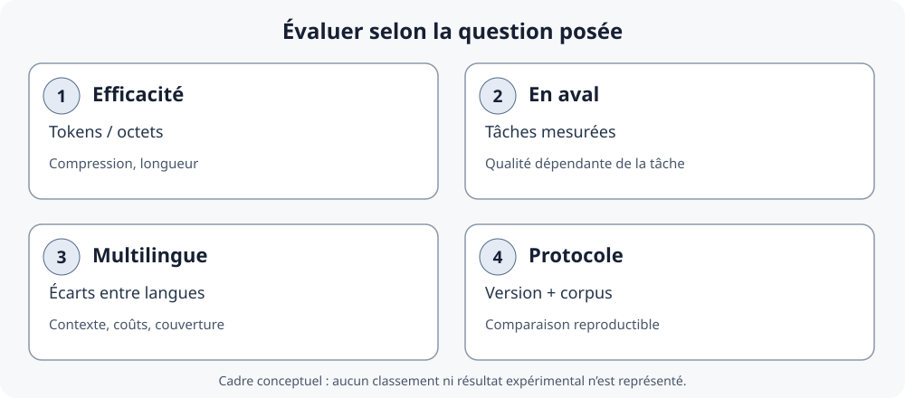

::: {.chapter-lead}
Un tokenizer est un choix de représentation et d'ingénierie. Il doit couvrir les entrées attendues et maîtriser la taille du vocabulaire et le coût en séquence. Aucun découpage — mot, caractère, octet ou sous-mot — n'est optimal sur tous les corpus et toutes les tâches.
:::

## À retenir

- **Granularité** : mot, caractère, octet ou fragment appris.
- **Algorithme** : BPE, WordPiece, unigramme et variantes ne sont pas interchangeables.
- **Pipeline** : normalisation, pré-tokenisation, vocabulaire et tokens spéciaux affectent le résultat.
- **Compatibilité** : les IDs n'ont de sens opérationnel qu'avec le tokenizer et les poids associés.
- **Évaluation** : moins de tokens peut réduire le coût, mais ne prouve pas une meilleure qualité en aval.

## 1. Carte conceptuelle

Le pipeline complet — du texte Unicode aux IDs puis à la lookup dans la matrice d'embeddings — est illustré dans la [page d'introduction](text-data.qmd). Cette page se concentre sur les choix de segmentation et leurs compromis plutôt que de répéter le même schéma.

Pour observer concrètement les fusions BPE, ouvrez la [visualisation interactive originale de Müller et Steinbach — BPE Explainer](https://philipmueller.dev/bpe-visualization/). Elle montre le corpus en cours de segmentation, les paires candidates et la croissance du vocabulaire. La ressource est liée plutôt que copiée : les conditions de réutilisation de ses figures ne sont pas établies ici.

« Token » désigne l'unité discrète produite par le système, pas nécessairement une unité linguistique. Les frontières initiales, les espaces, la normalisation et les tokens spéciaux peuvent changer le résultat autant que le nom de l'algorithme.

## 2. Comparer les granularités

| Approche | Atouts | Limites / risques | Cas d'usage typique |
|---|---|---|---|
| **Mots** | Lisibles ; séquences courtes si le vocabulaire couvre le corpus | Vocabulaire très grand ; mots inconnus ; variantes, flexions et noms rares | Baselines didactiques, corpus fermés |
| **Caractères** | Vocabulaire réduit ; mots inconnus composables | Séquences longues ; points de code, unités de code et graphèmes diffèrent | Modèles spécialisés, détails orthographiques |
| **Octets** | Couverture générale au niveau des octets ; pas de mot hors vocabulaire | Plusieurs octets par caractère ; séquences longues ; régularités plus difficiles à apprendre | Approches byte-level, entrées hétérogènes |
| **Sous-mots appris** | Compromis entre vocabulaire et longueur ; formes rares décomposables si les unités de base les couvrent | Frontières parfois arbitraires ; coût variable selon langues/scripts ; morphologie non garantie | Nombreux LLM modernes |

Ces catégories sont des idéaux-types. Les systèmes réels peuvent combiner pré-tokenisation, sous-mots et représentation byte-level. « Caractère » doit être défini précisément : point de code Unicode, unité de code et graphème ne sont pas interchangeables.

### La taille du vocabulaire est aussi un choix d'architecture et de budget

Un vocabulaire de sous-mots plus grand peut représenter certains textes avec moins de tokens, mais son effet ne se limite pas à la longueur des séquences. Avec une dimension cachée \\(d\\) et un vocabulaire de taille \\(V\\), la matrice d'embeddings d'entrée contient \\(Vd\\) paramètres. Une projection de sortie distincte sur le vocabulaire en contient couramment autant ; ce second terme ne s'applique pas de la même manière lorsque les poids d'entrée et de sortie sont partagés. Augmenter \\(V\\) peut donc accroître le nombre de paramètres et la mémoire, même si les séquences raccourcissent.

Le budget d'entraînement change également le sens de la comparaison :

- **Budget fixe en tokens :** les modèles traitent le même nombre de positions-token, mais ne parcourent pas nécessairement le corpus brut le même nombre de fois.
- **Nombre de passes sur les données fixé (époques) :** les modèles parcourent le même corpus, mais un tokenizer qui produit des séquences plus longues génère davantage de tokens d'entraînement et peut demander plus de calcul.

Takase et al. ont étudié des vocabulaires unigrammes SentencePiece de 5 000 à 500 000 unités en anglais et en japonais, avec un budget fixé en tokens puis un budget fixé en époques. Les vocabulaires plus grands ont obtenu de meilleurs résultats dans ces expériences ; à nombre d'époques fixé, les petits vocabulaires produisaient beaucoup plus de tokens d'entraînement, particulièrement en japonais. Ces résultats concernent les modèles, langues, données et protocoles étudiés : ils ne prouvent pas que le vocabulaire le plus grand est toujours préférable. Voir [Takase et al. (Findings of ACL 2025)](https://aclanthology.org/2025.findings-acl.57/).

**Règle pratique :** choisir la taille du vocabulaire conjointement avec l'architecture du modèle, le mélange de langues, la distribution des données et le budget de calcul. Comparer la qualité du modèle et le coût total du système ; le seul nombre de tokens ne suffit pas.

## 3. Les composants d'un tokenizer

Un tokenizer de production n'est pas seulement un algorithme de segmentation. Les bibliothèques peuvent exposer plusieurs composants, dont les effets doivent être distingués. La [documentation Hugging Face Tokenizers](https://huggingface.co/docs/tokenizers/python/latest/components.html) décrit ces étapes ; [SentencePiece](https://github.com/google/sentencepiece) fournit un autre exemple de conventions et de modèles.

| Composant | Rôle | Question de vérification |
|---|---|---|
| **Normalisation** | Peut transformer le texte avant segmentation (par exemple, selon une règle de casse ou une normalisation Unicode) | Deux chaînes visuellement semblables sont-elles normalisées de la même façon ? |
| **Pré-tokenisation** | Découpe le texte en segments candidats avant l'algorithme de sous-mots | Les espaces, la ponctuation ou les nombres créent-ils des frontières ? |
| **Modèle de tokenisation** | Applique le vocabulaire et les règles de BPE, WordPiece ou unigramme | Quelle unité de base, quel vocabulaire et quelles règles sont utilisés ? |
| **Post-traitement** | Peut ajouter des tokens spéciaux ou préparer les séquences pour le modèle | BOS, EOS, séparateurs ou tokens de tâche sont-ils ajoutés ? |
| **Décodeur** | Convertit les tokens/IDs en texte selon les conventions de l'implémentation | Les espaces, octets et caractères sont-ils reconstruits comme prévu ? |

### Les graphies des tokens spéciaux ne sont pas de simples mots du vocabulaire

Un token spécial est une entrée réservée du vocabulaire, associée à un ID dédié et à un rôle propre au modèle. Par exemple, GPT-2 utilise `<|endoftext|>` comme marqueur de fin de texte. Sa graphie visible ne suffit pas, à elle seule, à déterminer le traitement d'une chaîne d'entrée : le token doit être enregistré dans le tokenizer et l'API décide si une chaîne correspondante est interprétée comme token spécial, rejetée ou traitée comme du texte ordinaire.

Certaines API rendent ce choix explicite au moyen d'une liste d'autorisation. Par exemple, `tiktoken` et `minbpe` de Karpathy exposent des paramètres qui contrôlent les graphies de tokens spéciaux autorisées. Ce comportement dépend de l'implémentation ; ce n'est pas une règle universelle des tokenizers. Dans une application, n'autorisez pas indistinctement tous les tokens spéciaux dans du texte utilisateur non fiable ; les tokens réservés devraient normalement être insérés intentionnellement par une couche de formatage de confiance.

Voir l'[API d'encodage](https://github.com/openai/tiktoken/blob/main/tiktoken/core.py) de `tiktoken` et les [notes de `minbpe` sur les tokens spéciaux](https://github.com/karpathy/minbpe/blob/master/README.md).

Ces étapes ne sont pas toutes présentes de la même façon dans chaque tokenizer. Le nom de l'algorithme ne suffit donc pas à reproduire une segmentation : il faut aussi connaître la configuration et les versions.

### Un même texte, plusieurs pipelines de tokenisation

La sortie visible d'un tokenizer dépend de davantage que son seul algorithme de segmentation. Les exemples suivants proviennent du cours Hugging Face et concernent des checkpoints précis ; ce sont des **sorties de pré-tokenisation**, pas les IDs finaux du modèle.

Pour la normalisation, le cours montre que le normaliseur de `bert-base-uncased` transforme :

```text
Héllò hôw are ü?  →  hello how are u?
```

Pour la pré-tokenisation, considérons exactement l'entrée `Hello, how are  you?` :

| Checkpoint | Sortie du pré-tokeniseur (fragments visibles) | Point à observer |
|---|---|---|
| `bert-base-uncased` | `Hello`, `,`, `how`, `are`, `you`, `?` | Les espaces et la ponctuation créent des frontières ; les espaces répétés ne deviennent pas des fragments distincts. |
| `gpt2` | `Hello`, `,`, `Ġhow`, `Ġare`, `Ġ`, `Ġyou`, `?` | La convention visible `Ġ` marque les espaces ; l'espace répété est conservé dans la sortie du pré-tokeniseur. |
| `t5-small` | `▁Hello,`, `▁how`, `▁are`, `▁you?` | La convention fondée sur SentencePiece utilise `▁` ; ce pré-tokeniseur découpe sur les espaces plutôt que sur la ponctuation et ne conserve pas l'espace répété comme fragment distinct. |

**Important :** le tableau appelle directement le composant de pré-tokenisation ; il n'applique pas le normaliseur présenté plus haut. C'est pourquoi la ligne BERT affiche encore `Hello` avec une majuscule. Un appel complet au tokenizer applique ensemble les étapes configurées.

Ces sorties dépendent des configurations nommées et du pipeline Hugging Face Tokenizers. Les marqueurs `Ġ` et `▁` sont des représentations visibles, pas des caractères à insérer dans n'importe quel texte. Le cours fournit également des offsets dans la chaîne d'origine : ils permettent de relier les fragments tokenisés à leurs segments sources, notamment lorsque la normalisation ou le traitement des espaces transforme le texte.

Cette comparaison montre pourquoi le seul nom d'un algorithme comme BPE ne suffit pas à reproduire une tokenisation. Le normaliseur, le pré-tokeniseur, le modèle, le post-traitement, le décodeur et leurs configurations déterminent ensemble le comportement. Voir la [leçon Hugging Face sur la normalisation et la pré-tokenisation](https://huggingface.co/docs/course/main/chapter6/4) pour les exemples sources.

Une distinction connexe est importante pour la couverture : un tokenizer fondé sur les caractères dont l'alphabet initial omet un caractère peut devoir recourir à un token inconnu. Un BPE au niveau des octets dont le vocabulaire de base contient les 256 valeurs d'octet peut, lui, représenter des octets d'entrée arbitraires. C'est une propriété de cette conception byte-level, pas une garantie de tout tokenizer appelé BPE.

## 4. BPE, WordPiece et unigramme

| Famille | Idée centrale | Limite à retenir |
|---|---|---|
| **BPE** | Fusion itérative de paires adjacentes selon une règle de fréquence/priorité | Les variantes diffèrent par les unités initiales, le pré-découpage, les marqueurs et les conventions |
| **WordPiece** | Sélection d'unités liée à un critère de vraisemblance, puis encodage selon des règles propres à l'implémentation | Ce n'est pas simplement BPE sous un autre nom ; certains systèmes marquent les continuations avec `##` |
| **Unigramme** | Modèle probabiliste sur des sous-mots candidats, souvent réduit par élagage | Le résultat dépend du modèle, des candidats et des conventions |

### En quoi WordPiece diffère de BPE

Dans l'explication courante de l'apprentissage WordPiece, les paires d'unités adjacentes sont classées au moyen d'un score lié à leur cooccurrence relativement à la fréquence de chaque unité prise séparément. Une forme simplifiée est :

\\[\\operatorname{score}(a,b)=\\frac{f(ab)}{f(a)\\,f(b)}\\]

où les fréquences sont estimées sur le corpus d'apprentissage. Ce score favorise une paire dont la fréquence conjointe est élevée relativement à celle de ses composants ; il ne sélectionne donc pas simplement la paire la plus fréquente, comme dans le BPE de base. **Réserve :** la procédure originale d'apprentissage WordPiece de Google n'est pas entièrement spécifiée dans une implémentation publique de référence. Hugging Face présente sa description comme une reconstruction : cette formule est explicative et ne garantit pas que tous les entraîneurs WordPiece l'utilisent exactement.

À l'encodage, les implémentations WordPiece courantes utilisent une recherche gloutonne du **plus long fragment correspondant** au vocabulaire. Dans les tokenizers de type BERT, les fragments de continuation sont conventionnellement préfixés par `##`. Si un mot entier ne peut pas être segmenté selon les règles configurées, un tokenizer tel que BERT peut produire un unique `[UNK]` pour ce mot plutôt que de conserver une segmentation partielle. Ce sont des conventions d'implémentation, pas des propriétés universelles de tout tokenizer WordPiece.

Voir l'[explication WordPiece de Hugging Face](https://huggingface.co/learn/llm-course/fr/chapter6/6) et la [documentation du modèle WordPiece](https://huggingface.co/docs/tokenizers/python/latest/api/reference.html#tokenizers.models.WordPiece).

### En quoi Unigramme diffère des tokenizers fondés sur des fusions

Un tokenizer Unigramme commence avec un vocabulaire candidat relativement large, auquel sont associées des probabilités. L'apprentissage retire progressivement les candidats dont la suppression entraîne la plus faible augmentation de la loss du modèle, afin de réduire le vocabulaire vers la taille visée. Il s'agit d'un élagage dans un modèle probabiliste de segmentation, et non d'une succession de fusions de paires.

À l'encodage, plusieurs segmentations peuvent être possibles. L'algorithme de Viterbi détermine la segmentation de probabilité maximale selon le modèle appris. Cela contraste avec l'application d'un ordre de fusions appris par BPE et avec la recherche gloutonne courante du plus long fragment de WordPiece. Voir l'[explication Unigram de Hugging Face](https://huggingface.co/learn/llm-course/fr/chapter6/7) et [SentencePiece](https://github.com/google/sentencepiece).

**En une phrase :** BPE applique des fusions classées ; WordPiece utilise couramment une segmentation gloutonne par plus long fragment après une construction de vocabulaire liée à la vraisemblance ; Unigramme sélectionne la segmentation complète la plus probable selon un modèle probabiliste appris.

**SentencePiece** est une bibliothèque pouvant entraîner BPE ou unigramme à partir de texte brut ; ce n'est pas un algorithme unique. **Hugging Face Tokenizers** est une bibliothèque de plusieurs modèles et composants. **tiktoken** est une implémentation BPE avec des encodages précis. Ces noms ne se situent donc pas tous au même niveau de comparaison.


### Exemple pas à pas : fusions BPE sur un petit corpus

Cet exemple schématique conserve une trace explicite des fusions. Convention pédagogique : chaque mot est initialement découpé en caractères, suivis du marqueur de fin de mot `</w>`. Le mini-corpus contient une occurrence de `low`, `lower` et `lowest`.

| Mot | Unités initiales |
|---|---|
| `low` | `l · o · w · </w>` |
| `lower` | `l · o · w · e · r · </w>` |
| `lowest` | `l · o · w · e · s · t · </w>` |

Comptons chaque paire adjacente dans le corpus. Chaque mot apparaît une fois ici ; les fréquences sont donc :

| Paire | Fréquence | Paire | Fréquence |
|---|---:|---|---:|
| `l + o` | 3 | `w + e` | 2 |
| `o + w` | 3 | `w + </w>` | 1 |
| `e + r` | 1 | `r + </w>` | 1 |
| `e + s` | 1 | `s + t` | 1 |
| `t + </w>` | 1 | | |

La paire la plus fréquente est ex æquo : `l + o` et `o + w` apparaissent toutes deux trois fois. Supposons que la règle de départage déterministe choisisse `l + o → lo`. On remplace les occurrences non chevauchantes, puis on recompte. La paire `lo + w` apparaît alors trois fois et peut être fusionnée à son tour.

| Étape | `low` | `lower` | `lowest` |
|---|---|---|---|
| 0 | `l · o · w · </w>` | `l · o · w · e · r · </w>` | `l · o · w · e · s · t · </w>` |
| 1 : fusion `l + o` | `lo · w · </w>` | `lo · w · e · r · </w>` | `lo · w · e · s · t · </w>` |
| 2 : fusion `lo + w` | `low · </w>` | `low · e · r · </w>` | `low · e · s · t · </w>` |

Le tableau de fréquences rend visible le choix glouton ; cela ne signifie pas que BPE découvre les morphèmes ou un vocabulaire optimal. Il s'agit d'une convention pédagogique au niveau du mot avec un marqueur de fin, pas d'un tokenizer byte-level de production complet. Les sorties réelles dépendent aussi du pré-découpage, des unités initiales, des fréquences du corpus, des tokens spéciaux et du départage propre à l'implémentation. Pour manipuler les paires candidates, utiliser le [BPE Explainer de Müller et Steinbach](https://philipmueller.dev/bpe-visualization/).

**Précision historique.** L'algorithme de [compression par paires d'octets de Gage (1994)](https://www.derczynski.com/papers/archive/BPE_Gage.pdf) est une méthode générale de compression : il remplace itérativement des paires d'octets adjacents fréquentes par des valeurs d'octet inutilisées et enregistre les substitutions pour la décompression. Le BPE sous-lexical en NLP adapte l'idée de fusion de paires pour construire un vocabulaire de tokens et un ordre de fusion à partir d'unités textuelles. Les unités de base, le pré-découpage, la construction du vocabulaire et la procédure d'encodage diffèrent ; le BPE byte-level de type GPT n'est qu'une conception particulière. Gage constitue donc une référence historique pour l'idée de remplacement de paires, pas une spécification des tokenizers modernes de LLM.

### Apprentissage du tokenizer et encodage à l'inférence

Il faut distinguer deux processus :

1. **Apprentissage du tokenizer** : à partir d'un corpus, construit un vocabulaire et, selon l'algorithme, des règles ou un ordre de fusion.
2. **Encodage d'un nouveau texte** : applique les règles déjà apprises pour produire tokens et IDs ; il ne recompte pas les fréquences et ne réapprend pas le vocabulaire à chaque requête.

```{mermaid}
flowchart LR
    A["Corpus d'apprentissage"] --> B["Pré-découpage et unités de base"]
    B --> C["Apprentissage des fusions / du vocabulaire"]
    C --> D["Tokenizer sauvegardé"]
    E["Nouveau texte"] --> F["Règles apprises"]
    D -. "réutilisé" .-> F
    F --> G["Tokens puis IDs"]
    G --> H["Modèle compatible"]
```

Ce schéma ne décrit pas l'entraînement du réseau neuronal : celui-ci est distinct et apprend ses paramètres à partir de séquences d'IDs. Un tokenizer byte-level peut couvrir les octets d'entrées textuelles arbitraires, mais tous les tokenizers BPE ne sont pas byte-level.


## 5. Exemples qui révèlent les compromis

Un exemple de normalisation Unicode est traité dans [la page d'introduction](text-data.qmd) : `é` précomposé et `e\u0301` peuvent sembler identiques, tout en ayant des séquences de points de code différentes. Le tokenizer peut normaliser ces formes avant de les segmenter ; il faut vérifier sa configuration.


| Entrée | Question à poser | Risque naïf |
|---|---|---|
| `unbelievable`, `unbelievably` | Les fragments réutilisent-ils des sous-chaînes fréquentes ? | Les frontières ne garantissent pas une analyse morphologique |
| `café` et `cafe\u0301` | Quelle normalisation Unicode est appliquée ? | Même apparence, séquences de points de code différentes |
| `2026-10-29`, `123456789` | Comment chiffres et séparateurs sont-ils segmentés ? | Un token n'est pas nécessairement un nombre entier |
| `你好` | Le système dépend-il des espaces entre mots ? | La séparation sur espaces peut ne donner aucune frontière utile |
| `def predict_next(x): return x + 1` | Comment espaces, identifiants et opérateurs sont-ils traités ? | La segmentation peut sembler arbitraire |
| Emoji et symboles rares | Quelle couverture et quelle longueur ? | Couverture ne signifie pas efficacité uniforme |

Ce tableau formule des questions à tester, pas des sorties exactes. Pour documenter un résultat, noter tokenizer/version, chaîne d'entrée, tokens visibles et nombre de tokens.

## 6. Comparaison reproductible

1. Fixer les textes, l'encodage, le nettoyage et le traitement des documents.
2. Enregistrer le tokenizer exact, la version du package, l'identifiant d'encodage et les paramètres.
3. Comparer les tokens visibles et les longueurs ; ne pas comparer des IDs entre vocabulaires comme des valeurs sémantiques communes.
4. Ventiler les résultats par langue, écriture et type de texte, pas seulement par moyenne globale.
5. Contrôler la taille du vocabulaire, les tokens spéciaux, la couverture et la troncature.
6. Évaluer séparément qualité en aval, latence, mémoire, débit et coût.
7. Publier les limites : corpus, versions, normalisation, langues couvertes et incertitudes.

### Petit protocole reproductible en Python

L'exemple suivant inspecte un tokenizer Hugging Face précis. Le premier chargement peut nécessiter un accès réseau ; pour une expérience reproductible, consignez les versions des bibliothèques et figez la révision du modèle plutôt que d'utiliser une référence mobile.

```python
from importlib.metadata import version
from transformers import AutoTokenizer

model_id = "gpt2"
revision = "YOUR_COMMIT_SHA"  # Replace with the exact model commit SHA
tokenizer = AutoTokenizer.from_pretrained(model_id, revision=revision)
text = " Hello world — café"

ids = tokenizer.encode(text, add_special_tokens=False)
tokens = tokenizer.convert_ids_to_tokens(ids)

print("transformers:", version("transformers"))
print("tokenizer:", model_id)
print("tokens:", tokens)
print("IDs:", ids)
print("count:", len(ids))
print("decoded:", tokenizer.decode(ids))
```

Les fragments et IDs affichés appartiennent au tokenizer chargé. Pour comparer deux tokenizers, exécutez le même protocole sur les mêmes textes, consignez leurs versions/révisions et comparez les fragments et le nombre de tokens — pas les valeurs numériques des IDs entre vocabulaires. Le décodage dépend aussi des conventions et des tokens spéciaux.

### Mesurer un tokenizer sans réduire la qualité au nombre de tokens

Les études sur les coûts multilingues n'emploient pas toujours les mêmes métriques ni les mêmes dénominateurs. Il faut donc lire la définition opérationnelle de chaque mesure avant de comparer des résultats. Voir notamment [Ahia et al. (2023)](https://aclanthology.org/2023.emnlp-main.614/) et le travail sur les métriques multilingues [TokLens (ACL 2026 SRW)](https://aclanthology.org/2026.acl-srw.18/).

| Mesure | Interprétation | Limite |
|---|---|---|
| **Nombre de tokens** | Longueur produite pour un texte donné | Dépend du texte, du tokenizer, de sa version et de la normalisation |
| **Fertilité** | Souvent, nombre moyen de sous-tokens par mot de référence | La définition du « mot » et le traitement de la ponctuation peuvent varier ; préciser le dénominateur |
| **Caractères ou octets par token** | Rapport entre la longueur du texte source et le nombre de tokens | Les caractères Unicode, les points de code et les octets UTF-8 sont des unités différentes |
| **Couverture du vocabulaire** | Capacité à représenter les unités d'entrée sans recourir à un token inconnu, selon le système | Couverture complète ne signifie pas segmentation efficace ni bonne qualité en aval |
| **Qualité en aval** | Résultat sur une tâche définie, par langue et type de texte | Nécessite des budgets et des conditions d'évaluation comparables ; ne se déduit pas d'une métrique intrinsèque |

Pour une comparaison équitable, rapportez les métriques par langue et type de texte, et gardez séparés **coût de représentation**, **coût système** et **qualité de la tâche**. Une baisse de longueur est un résultat réel, mais elle ne suffit pas à démontrer une amélioration globale.

## Évaluer un tokenizer : métriques, performances et équité multilingue {#tokenizer-evaluation}

La comparaison des algorithmes ne suffit pas à établir qu'un tokenizer est adapté à un usage. Il faut distinguer plusieurs questions empiriques, qui ne se résument pas à un score unique.

{fig-alt="Quatre dimensions distinctes : compression et longueur de séquence ; résultats sur des tâches en aval ; écarts entre langues et types de texte ; protocole reproductible avec tokenizer, version et corpus identifiés." fig-cap="Cadre de lecture, non résultat expérimental : ces dimensions répondent à des questions différentes et ne se réduisent pas nécessairement à un classement unique." width=100%}

### Quatre dimensions à séparer

- **Efficacité de représentation** : combien de tokens, de caractères ou d'octets représentent le même contenu ? Le dénominateur doit être explicite : caractères Unicode, points de code, graphèmes et octets UTF-8 ne sont pas interchangeables.
- **Performances en aval** : les choix de segmentation peuvent modifier l'apprentissage et les résultats sur une tâche. Il faut mesurer ces résultats sous des conditions comparables, et non les déduire du nombre de tokens.
- **Équité multilingue** : un contenu comparable peut produire des longueurs de séquence différentes selon la langue et le tokenizer. Cela peut affecter le budget de contexte et les coûts d'entraînement ou d'inférence ; cela ne prouve pas, à lui seul, une différence de qualité de génération.
- **Reproductibilité** : documenter tokenizer et révision exacts, prétraitement, corpus, langues, métriques, tâche, budgets et versions logicielles.


#### Figure de recherche externe : la fertilité varie selon la langue

{fig-alt="Six graphiques présentent la fertilité des tokenizers pour l’anglais, le français, l’allemand, l’italien, le polonais et l’espagnol ; la barre rouge représente le tokenizer de l’autrice et les barres grises les alternatives." width=100%}

*Source : Catherine Arnett, [« wHy DoNt YoU jUsT uSe ThE lLaMa ToKeNiZeR?? »](https://huggingface.co/blog/catherinearnett/dangers-of-tokenizer-recycling), 2024. Il s’agit d’une comparaison propre à cette étude, pas d’un classement universel : la fertilité dépend des textes, de la définition du mot et des tokenizers comparés. L’image est intégrée depuis l’article de l’autrice, sans modification ni redistribution dans ce dépôt. Vérification des droits : en attente dans [#156](https://github.com/JM-Brun/llm-lab/issues/156) ; illustration conservée pendant la vérification de l’actif exact.*

### Ce que montrent — et ne montrent pas — les études

Les publications ci-dessous sont complémentaires : elles ne mesurent pas toutes le même objet et ne doivent pas être lues comme un classement direct des tokenizers.

| Travail | Question étudiée | Apport à l'évaluation | Limite d'interprétation |
|---|---|---|---|
| **Goldman et al. (2024)**, [*Unpacking Tokenization: Evaluating Text Compression and its Correlation with Model Performance*](https://aclanthology.org/2024.findings-acl.134/) | La compression est-elle associée aux performances des modèles ? | Analyse empiriquement le lien entre compression du texte et résultats en aval dans les configurations étudiées. | Une corrélation expérimentale n'établit pas une règle causale ou universelle de sélection. |
| **Schmidt et al. (2024)**, [*Tokenization Is More Than Compression*](https://aclanthology.org/2024.emnlp-main.40/) | Peut-on choisir un tokenizer en minimisant seulement la longueur ? | Met en évidence les limites d'une fonction objectif réduite à la compression et invite à considérer d'autres propriétés. | Ne signifie pas que la longueur est inutile : elle répond à une question de coût et de représentation précise. |
| **Arnett et al. (2025)**, [*Explaining and Mitigating Crosslingual Tokenizer Inequities*](https://proceedings.neurips.cc/paper_files/paper/2025/hash/5b91cefbfa52340af2f16f249572dc76-Abstract-Conference.html) | Pourquoi les coûts de tokenisation diffèrent-ils entre langues ? | Étudie les écarts interlinguistiques et des facteurs de conception susceptibles de les atténuer. | Les résultats dépendent des langues, corpus, tokenizers et protocoles considérés. |
| **Chiu (ACL 2026)**, [*TokLens: A Multilingual Lens on Tokenizer Quality for LLMs*](https://aclanthology.org/2026.acl-srw.18/) | Comment comparer les tokenizers sur plusieurs langues et plusieurs dimensions ? | Propose six métriques intrinsèques pour comparer 24 tokenizers sur 15 langues. L'étude ne trouve pas de métrique intrinsèque prédictive des résultats anglais après contrôle de la taille du modèle ; certaines métriques, notamment le taux de rétention en token unique, sont associées aux résultats par langue sur un benchmark multilingue. | Un tableau de métriques intrinsèques ne remplace pas l'évaluation sur les tâches et contraintes de déploiement visées. |

Goldman et al. et Schmidt et al. ne conduisent pas à une opposition simpliste. Le premier étudie des associations empiriques entre compression et résultats en aval ; le second rappelle que la compression ne résume pas toutes les propriétés pertinentes. La conclusion méthodologique est de **mesurer séparément les dimensions qui correspondent à la décision à prendre**.


#### Figure de recherche externe : longueur de représentation et temps d’exécution

{fig-alt="Nuage de points représentant la longueur de tokenisation et le temps d’exécution de RoBERTa pour les langues de FLORES-200, avec une couleur par famille d’écriture." width=80%}

*Source : Petrov, La Malfa, Torr et Bibi, [« Language Model Tokenizers Introduce Unfairness Between Languages »](https://www.adelbibi.com/publication/langugage_unfairness_tokenizers/), NeurIPS 2023. Le graphique illustre une association dans le protocole étudié, pas une loi causale universelle ni une mesure directe de la qualité de génération. La page de l’auteur indique une licence CC BY-NC-ND 4.0 ; la figure est intégrée sans modification et reliée à sa source. Vérification des droits : en attente dans [#156](https://github.com/JM-Brun/llm-lab/issues/156) ; illustration conservée dans l'attente de l'évaluation de l'actif et de l'usage prévus.*

### Construire un protocole de comparaison

Pour comparer deux tokenizers de manière interprétable :

1. Constituer un corpus fixe et documenter sa provenance, ses langues, ses domaines et ses règles de nettoyage.
2. Figer les tokenizers exacts : nom, révision, vocabulaire, configuration, versions de bibliothèques et tokens spéciaux.
3. Rapporter plusieurs mesures intrinsèques avec leur définition : tokens par texte, caractères ou octets par token, fertilité si le dénominateur « mot » est défini, couverture et troncature.
4. Ventiler les résultats par langue, script et type de texte ; une moyenne globale peut masquer des écarts importants.
5. Évaluer séparément les tâches en aval, avec les mêmes données, budgets de calcul/contexte et protocoles d'entraînement ou d'inférence lorsque la comparaison le permet.
6. Rapporter les coûts système pertinents : latence, débit, mémoire et coût financier. Une séquence plus courte n'implique pas mécaniquement un système plus rapide.
7. Publier les incertitudes, les limites et les cas où les résultats ne sont pas comparables.

**Règle de lecture :** le nombre de tokens mesure une longueur sous un tokenizer donné ; il ne mesure directement ni la qualité linguistique, ni la qualité du modèle, ni le coût système complet.

### Ressources et travaux connexes

- [Ahia et al. (2023), *Do All Languages Cost the Same?*](https://aclanthology.org/2023.emnlp-main.614/) — étude antérieure des coûts de tokenisation entre langues.
- [Wegmann et al. (2025), *Tokenization is Sensitive to Language Variation*](https://aclanthology.org/2025.findings-acl.572/) — variation linguistique et rôle du pré-tokenizer.
- [TokLens — dépôt et ressources](https://aclanthology.org/2026.acl-srw.18/) — à utiliser comme outil/méthode à examiner, en vérifiant ses métriques et son protocole.
- [Catherine Arnett (2024), article communautaire sur la réutilisation des tokenizers](https://huggingface.co/blog/catherinearnett/dangers-of-tokenizer-recycling) — observations de praticienne sur le réemploi des tokenizers et la pré-tokenisation ; ne remplace pas des résultats de recherche contrôlés.

### Ressources visuelles recommandées

1. [Philip Müller & Peter Steinbach — BPE Explainer](https://philipmueller.dev/bpe-visualization/) : manipulation interactive des fusions, meilleure première intuition.
2. [Hugging Face — cours BPE en français](https://huggingface.co/learn/llm-course/fr/chapter6/5?fw=tf) : présentation structurée de l'entraînement.
3. [Cornell CS4782 — Tokenization Visualizer](https://www.cs.cornell.edu/courses/cs4782/2026sp/demos/bytepair/) : comparaison pédagogique BPE/WordPiece. **Réserve sur l'interface (vérifiée le 29-10-2026) :** le panneau de la fusion sélectionnée affichait « Frequency: undefined », alors que la liste des paires candidates indiquait des fréquences. Ne pas se fier à cette valeur tant que la page n'a pas été corrigée.
4. [Andrej Karpathy — Let's build the GPT Tokenizer](https://www.youtube.com/watch?v=zduSFxRajkE) : Unicode, UTF-8, BPE, espaces et tokens spéciaux.
5. [Hugging Face — visualiser l'encodage BPE](https://huggingface.co/blog/SauravP97/bpe-tokenizer-visualize) : visualisation complémentaire, article communautaire dont le code doit être vérifié avant exécution.

#### Repères temporels utiles dans la vidéo de Karpathy

La vidéo est longue ; ces chapitres permettent de sélectionner les passages pertinents :

- [14:56 — points de code Unicode et chaînes](https://www.youtube.com/watch?v=zduSFxRajkE&t=896s), puis [18:15 — encodages UTF et octets](https://www.youtube.com/watch?v=zduSFxRajkE&t=1095s).
- [23:50 — intuition de BPE](https://www.youtube.com/watch?v=zduSFxRajkE&t=1430s) et [28:35 — comptage et fusion des paires fréquentes](https://www.youtube.com/watch?v=zduSFxRajkE&t=1715s).
- [39:20 — tokenizer comme étape distincte du pipeline](https://www.youtube.com/watch?v=zduSFxRajkE&t=2360s), [42:47 — décodage](https://www.youtube.com/watch?v=zduSFxRajkE&t=2567s) et [48:21 — encodage](https://www.youtube.com/watch?v=zduSFxRajkE&t=2901s).
- [57:36 — pré-tokenisation par expressions régulières](https://www.youtube.com/watch?v=zduSFxRajkE&t=3456s) et [1:11:38 — différences entre les expressions GPT-2 et GPT-4](https://www.youtube.com/watch?v=zduSFxRajkE&t=4298s).
- [1:18:15 — tokens spéciaux et gestion par les API](https://www.youtube.com/watch?v=zduSFxRajkE&t=4695s).
- [1:28:42 — SentencePiece](https://www.youtube.com/watch?v=zduSFxRajkE&t=5322s) ; [1:49:58 — tokenisation multimodale](https://www.youtube.com/watch?v=zduSFxRajkE&t=6598s) constitue un prolongement facultatif, au-delà de cette séquence sur les tokens textuels.

Ces repères facilitent la navigation ; ils ne remplacent pas la vérification des détails d'implémentation dans la documentation et le code source des tokenizers concernés.

La page combine des schémas originaux du projet, des illustrations externes sélectionnées et des ressources liées. La provenance et les droits de réutilisation des actifs intégrés sont suivis dans [l'audit transversal des illustrations](https://github.com/JM-Brun/llm-lab/issues/156).


### Ordre de lecture conseillé

1. Regarder la vidéo de Karpathy pour construire l'intuition sur les octets, les fusions et les tokens spéciaux.
2. Lire le [BPE Explainer](https://philipmueller.dev/bpe-visualization/) et suivre les fusions sur un petit exemple.
3. Lire `minbpe` ou le [module éducatif de tiktoken](https://github.com/openai/tiktoken/blob/main/tiktoken/_educational.py) pour inspecter le code.
4. Comparer avec la documentation de tiktoken, SentencePiece et Hugging Face pour distinguer les conventions.
5. Revenir au [chapitre 2 de Raschka](https://github.com/rasbt/LLMs-from-scratch/tree/main/ch02) pour relier les IDs au pipeline des embeddings et aux exemples entrée-cible.
6. Tester des textes multilingues, du code, des nombres, des espaces initiaux et des formes Unicode inhabituelles.

### Illustration externe du pipeline

{fig-alt="Pipeline de tokenisation : normalisation, pré-tokenisation, modèle de tokenisation et post-traitement." width=100%}

Cette illustration publiée provient du [cours Hugging Face, « Building a tokenizer, block by block »](https://huggingface.co/docs/course/chapter6/8). Elle complète le schéma conceptuel de la [page d'introduction](text-data.qmd) avec les composants d'un tokenizer. L'image est chargée depuis les ressources documentaires publiques du cours, sans copie locale ; la citation ne constitue pas à elle seule une autorisation de réutilisation. Vérification des droits : en attente dans [#156](https://github.com/JM-Brun/llm-lab/issues/156) ; illustration conservée pendant la vérification de l'actif exact.

### Références de recherche complémentaires

- [Ali et al. (2024), *Tokenizer Choice For LLM Training: Negligible or Crucial?*](https://aclanthology.org/2024.findings-naacl.247/) : examine les effets du choix du tokenizer sur les coûts et les performances, en rappelant que les métriques intrinsèques ne prédisent pas toujours les résultats en aval.
- [Wegmann et al. (2025), *Tokenization is Sensitive to Language Variation*](https://aclanthology.org/2025.findings-acl.572/) : analyse les variations linguistiques et le rôle du pré-tokenizer.
- [Arnett et al. (2025), *Explaining and Mitigating Crosslingual Tokenizer Inequities*](https://proceedings.neurips.cc/paper_files/paper/2025/hash/5b91cefbfa52340af2f16f249572dc76-Abstract-Conference.html) : étudie les écarts de coût entre langues et des facteurs de conception tels que la taille du vocabulaire et le pré-tokenizer.
- [Ahia et al. (2023), *Do All Languages Cost the Same?*](https://aclanthology.org/2023.emnlp-main.614/) : compare le coût de tokenisation entre 22 langues et discute ses implications pour les API.
- [TokLens (ACL 2026 SRW)](https://aclanthology.org/2026.acl-srw.18/) : outil de mesure comparative multilingue à examiner comme méthode et logiciel, pas comme preuve qu'une seule métrique intrinsèque suffit.
- [Petrov et al. (2023), *Language Model Tokenizers Introduce Unfairness Between Languages*](https://www.adelbibi.com/publication/langugage_unfairness_tokenizers/) : étudie les écarts de longueur de tokenisation et de temps d'exécution entre langues ; consulter l'article pour le protocole expérimental.

### Code pédagogique et références historiques

- [Sebastian Raschka — *Build a Large Language Model (From Scratch)*, chapitre 2](https://livebook.manning.com/book/build-a-large-language-model-from-scratch/chapter-2) : lecture guidée du traitement du texte dans le pipeline LLM.
- [Hugging Face — cours sur les tokenizers](https://huggingface.co/learn/llm-course/chapter6/1) : introduction au chapitre consacré aux tokenizers ; les URL et le contenu du cours peuvent évoluer.


- [OpenAI `tiktoken` — module éducatif](https://github.com/openai/tiktoken/blob/main/tiktoken/_educational.py) : implémentation simplifiée de BPE pour inspecter les fusions ; elle n'est pas le chemin optimisé de production.
- [Andrej Karpathy — `minbpe`](https://github.com/karpathy/minbpe) : code compact pour suivre apprentissage et encodage ; comparer les conventions avant de conclure à la compatibilité.
- [Sebastian Raschka — BPE from scratch](https://sebastianraschka.com/blog/2025/bpe-from-scratch.html) : notebook explicatif.
- [Raschka — dépôt, chapitre 2](https://github.com/rasbt/LLMs-from-scratch/tree/main/ch02) : implémentations et préparation des données textuelles.
- [Gage (1994), *A New Algorithm for Data Compression*](https://dl.acm.org/doi/10.5555/177910.177914) : référence historique de la compression par paires d'octets. Les tokenizers modernes de LLM ajoutent des conventions que ce papier ne spécifie pas à lui seul.


## 7. Contre-exemples

- **Moins de tokens = meilleur modèle.** Non : cela démontre d'abord une différence de longueur, pas de qualité.
- **BPE découvre les morphèmes.** Non : aucune garantie d'analyse linguistique.
- **Le vocabulaire est le tokenizer.** Non : pré-tokenisation, règles de fusion, normalisation et tokens spéciaux comptent aussi.
- **SentencePiece = unigramme.** Non : il peut entraîner plusieurs familles, dont BPE.
- **Les IDs se transfèrent entre modèles.** Non en général : un même ID peut désigner des fragments différents.
- **Byte-level = indépendant de la langue.** Non : la couverture ne garantit ni coût ni qualité uniformes.

## Pour poursuivre

- [Vue d'ensemble et exemple BPE](text-data.qmd)
- [Exemples d'entraînement, fenêtres et cibles décalées](training-examples.qmd)
- [Espace des embeddings](embedding-space.qmd)
- [Hugging Face Tokenizers](https://huggingface.co/docs/tokenizers/index)
- [SentencePiece](https://github.com/google/sentencepiece)
- [tiktoken](https://github.com/openai/tiktoken)

::: {.language-switch}
**Langue :** [Français](tokenization-strategies.qmd) · [English](../en/tokenization-strategies.qmd)
:::
