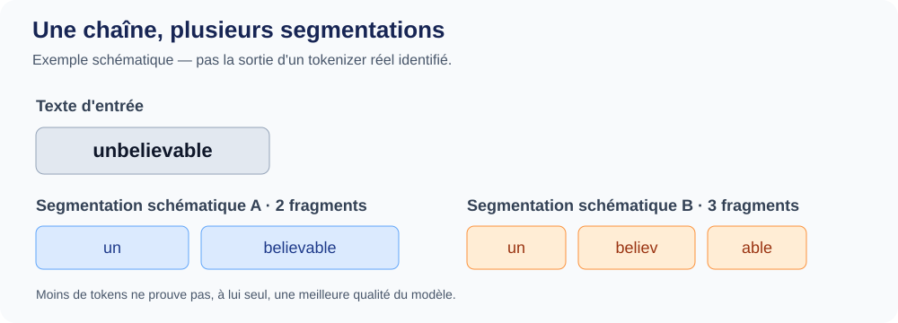

<!--
LLM-LAB-PAGE-MAP v1
id: "fr/tokenizer-design-evaluation"
scope: "Évalue le compromis entre longueur de représentation, taille du vocabulaire, coûts d’entraînement et d’inférence, et qualité en aval ; compare les budgets et métriques avec leurs dénominateurs, puis construit un protocole et une décision sous contraintes. Les résultats empiriques multilingues détaillés restent dans l’approfondissement dédié."
purpose: "Évaluer un choix de tokenizer en reliant taille du vocabulaire, longueur, coûts et usages ; construire une comparaison reproductible sans confondre métriques intrinsèques et qualité en aval."
domain: "text-tokenization"
suggested_route:
  previous: null
  next: null
hierarchy:
  parents: ["fr/tokenization-and-tokenizers"]
  children: ["fr/tokenizer-multilingual-evaluation"]
related: ["fr/tokenization-strategies", "fr/text-data", "fr/unicode-text", "fr/exercises-text-data"]
tags: ["type:deep-dive", "destination:deepen", "topic:tokenizer-design-evaluation", "level:advanced", "language:fr", "status:published"]
-->


<!--
Editorial model: docs/advent-calendar-pilots/first-three-days-pedagogical-models.md#porte-03--le-tokenizer-ingenieur-de-compression
Tracking issue: https://github.com/JM-Brun/llm-lab/issues/1667
This is authoring metadata; it is intentionally not rendered to readers.
-->

::: {.callout-note title="Une décision qui semble évidente — jusqu'à ce qu'on regarde le système"}
Imaginons deux équipes qui préparent un modèle de langage à partir du même corpus. Elles comparent deux tokenizers : le premier transforme les textes en séquences plus courtes. À première vue, le choix paraît évident : moins de tokens, c'est moins de positions à traiter et davantage de texte représentable dans un contexte de taille fixe.

Mais le second tokenizer peut avoir un vocabulaire plus petit. Or la taille du vocabulaire intervient aussi dans les paramètres d'embedding et, selon l'architecture, dans la projection de sortie. Et une moyenne globale peut masquer qu'une langue ou un type de texte est beaucoup moins bien représenté qu'un autre.

**Alors lequel choisir ?** Il faut comparer les mêmes textes, préciser ce que l'on appelle « plus court », mesurer les coûts du modèle et vérifier les performances sur les tâches visées. La compression est un indice utile, pas un verdict.

Cette page suit ce problème : comprendre les mécanismes qui produisent les segmentations, mesurer leurs effets, puis construire une comparaison dont les conclusions restent dans les limites du protocole.
:::

::: {.chapter-lead}
Un tokenizer doit découper le même texte en unités que le modèle pourra traiter. Des unités plus longues réduisent souvent le nombre de positions à traiter, mais elles agrandissent le vocabulaire et peuvent augmenter d'autres coûts. Le bon choix n'est donc pas celui qui produit le moins de tokens à tout prix : c'est celui qui équilibre représentation, ressources de calcul et qualité sur les usages visés.
:::

*Calendrier de l’Avent 2026 · Porte 3 · environ 15 minutes*

::: {.callout-note .learning-outcomes collapse="true" title="Objectifs d’apprentissage"}
À l’issue de cette page, vous pourrez :
- expliquer comment la taille du vocabulaire interagit avec les paramètres et les budgets d'entraînement ;
- construire un protocole de comparaison reproductible ;
- distinguer longueur de représentation, coût système et qualité en aval ;
- interpréter avec prudence les métriques et études sur les écarts multilingues.
:::

## Un même texte, trois segmentations

Prenons deux occurrences du même mot : **unbelievable unbelievable**. Pour isoler l'effet du découpage, comparons trois segmentations schématiques. Elles sont construites pour l'explication : elles ne prétendent reproduire aucun tokenizer de production.

| Découpage | Séquence produite pour les deux occurrences | Positions-token | Unités distinctes dans ce mini-vocabulaire |
|---|---|---:|---:|
| Caractères | `u n b e l i e v a b l e` × 2 | 24 | 8 |
| Sous-mots A | `un · believable` × 2 | 4 | 2 |
| Sous-mots B | `un · believ · able` × 2 | 6 | 3 |

{fig-alt="Le texte unbelievable est découpé en un + believable dans la segmentation A, et en un + believ + able dans la segmentation B." fig-cap="À texte source identique, le nombre de positions dépend du vocabulaire et de la stratégie de segmentation." width=95%}

Le découpage en caractères utilise peu d'entrées différentes, mais produit une séquence longue. Les sous-mots raccourcissent la séquence en ajoutant des unités au vocabulaire. Cet exemple ne mesure ni une compression en bits ni la qualité d'un modèle : il rend visible un compromis de représentation.

Dans un Transformer, moins de positions peut réduire le coût de traitement de la séquence, notamment celui de l'attention. En revanche, un vocabulaire plus grand augmente la taille des tables d'embeddings et, selon l'architecture, celle de la projection de sortie. **Réduire le nombre de tokens ne rend donc pas automatiquement le système moins coûteux.**

La question de conception devient : quelle segmentation donne un bon compromis pour les langues, les textes, l'architecture et le budget visés ? Pour y répondre, il faut regarder les mécanismes qui produisent les segments, puis mesurer leurs effets au-delà du seul nombre de tokens.

## 1. Taille du vocabulaire : architecture et budget

Un vocabulaire de sous-mots plus grand peut représenter certains textes avec moins de tokens, mais son effet ne se limite pas à la longueur des séquences. Avec une dimension cachée $d$ et un vocabulaire de taille $V$, la matrice d'embeddings d'entrée contient $Vd$ paramètres. Une projection de sortie distincte sur le vocabulaire peut ajouter $Vd$ paramètres ; lorsque les poids d'entrée et de sortie sont partagés, ce doublon de paramètres disparaît. En revanche, le calcul de la projection sur le vocabulaire reste nécessaire. Augmenter $V$ peut donc accroître le nombre de paramètres et la mémoire, même si les séquences raccourcissent.

Le budget d'entraînement change également le sens de la comparaison :

- **Budget fixe en tokens :** les modèles traitent le même nombre de positions-token, mais ne parcourent pas nécessairement le corpus brut le même nombre de fois.
- **Nombre de passes sur les données fixé (époques) :** les modèles parcourent le même corpus, mais un tokenizer qui produit des séquences plus longues génère davantage de tokens d'entraînement et peut demander plus de calcul.

Takase et al. ont étudié des vocabulaires unigrammes SentencePiece de 5 000 à 500 000 unités en anglais et en japonais, avec un budget fixé en tokens puis un budget fixé en époques. Les vocabulaires plus grands ont obtenu de meilleurs résultats dans ces expériences ; à nombre d'époques fixé, les petits vocabulaires produisaient beaucoup plus de tokens d'entraînement, particulièrement en japonais. Ces résultats concernent les modèles, langues, données et protocoles étudiés : ils ne prouvent pas que le vocabulaire le plus grand est toujours préférable. Voir [Takase et al. (Findings of ACL 2025)](https://aclanthology.org/2025.findings-acl.57/).

**Règle pratique :** choisir la taille du vocabulaire conjointement avec l'architecture du modèle, le mélange de langues, la distribution des données et le budget de calcul. Comparer la qualité du modèle et le coût total du système ; le seul nombre de tokens ne suffit pas.

## 2. Coût système : séquences, vocabulaire et calcul

Imaginons un assistant destiné à traiter des documents en plusieurs langues, avec une fenêtre de contexte limitée et une contrainte de latence. Le tokenizer qui produit le moins de tokens en moyenne n'est pas nécessairement le meilleur choix : il faut savoir quel coût diminue, quel coût augmente et pour quels utilisateurs.

Le compromis devient concret lorsqu'on met en regard la longueur des séquences et le coût dépendant du vocabulaire. Considérons deux tokenizers fictifs appliqués au même ensemble de textes et associés à la même dimension cachée $d$ :

### Exemple chiffré : moins de positions, vocabulaire plus grand

| | Tokenizer A | Tokenizer B |
|---|---:|---:|
| Taille du vocabulaire | $V$ | $4V$ |
| Longueur moyenne d'une séquence | 120 positions | 80 positions |
| Paramètres de la table d'embeddings d'entrée | $Vd$ | $4Vd$ |
| Calcul de la projection de sortie (logits, par séquence d'entraînement) | $\propto 120Vd$ | $\propto 80 \times 4Vd = 320Vd$ |
| Paires de positions à scorer dans l'attention dense (par tête et par couche) | $120^2$ | $80^2$ |

Ces nombres sont **un exemple construit**, pas les résultats d'un benchmark. Ils isolent plusieurs termes. B réduit la longueur moyenne d'un tiers. Pour une attention dense standard, le nombre de paires de positions passe de $120^2$ à $80^2$, soit un rapport de $4/9$ ; ce ratio concerne les paires de positions, pas le coût total du Transformer. Mais la table d'embeddings de B contient quatre fois plus de paramètres.

Le calcul des logits introduit un compromis supplémentaire. En entraînement causal standard, la projection de sortie est appliquée à chaque position pour produire une distribution sur le vocabulaire. À dimension cachée fixée, son coût est de l'ordre de $T V d$ : $120Vd$ pour A, contre $80 \times 4Vd = 320Vd$ pour B, soit $8/3$ fois plus. Ce calcul ne disparaît pas lorsque les poids d'entrée et de sortie sont liés : le partage évite de stocker deux matrices distinctes, mais la projection doit toujours être calculée. En génération, les logits sont généralement calculés à la dernière position seulement ; le coût de cette projection par token généré reste proportionnel à $Vd$.

On ne peut donc pas conclure que B est globalement moins cher. Le coût total dépend aussi de la dimension cachée, des couches, du partage des poids, de l'implémentation de l'attention, du débit matériel et du nombre de tokens traités pendant l'entraînement. Le tableau sert à repérer les termes qui changent, pas à additionner des coûts incomparables.

#### Quel budget tient-on constant ?

La comparaison change selon la contrainte expérimentale :

- À **nombre de tokens d'entraînement identique**, les deux modèles voient le même nombre de positions, mais pas nécessairement le même nombre de passages sur le corpus brut.
- À **nombre d'époques identique**, ils parcourent le même corpus, mais B peut produire moins de positions à traiter.
- À **budget de calcul identique**, le nombre de mises à jour, de tokens vus et la quantité de texte consommée peuvent différer.

Une étude qui annonce simplement « mêmes données » ne suffit donc pas à établir une comparaison équitable. Il faut préciser ce qui est fixé : texte brut, tokens, étapes d'optimisation, FLOPs, temps ou budget financier.

## 3. Qualité : ce que les métriques permettent de conclure

Une représentation plus courte est une mesure intrinsèque utile, mais elle ne dit pas à elle seule si le modèle réussit mieux la tâche. Il faut distinguer les métriques de segmentation, les coûts du système et la qualité en aval.

### Mesurer la représentation sans confondre longueur et qualité

Les études sur les coûts multilingues n'emploient pas toujours les mêmes métriques ni les mêmes dénominateurs. Il faut donc lire la définition opérationnelle de chaque mesure avant de comparer des résultats. Voir notamment [Ahia et al. (2023)](https://aclanthology.org/2023.emnlp-main.614/) et le travail sur les métriques multilingues [TokLens (ACL 2026 SRW)](https://aclanthology.org/2026.acl-srw.18/).

| Mesure | Interprétation | Limite |
|---|---|---|
| **Nombre de tokens** | Longueur produite pour un texte donné | Dépend du texte, du tokenizer, de sa version et de la normalisation |
| **Fertilité** | Souvent, nombre moyen de sous-tokens par mot de référence | La définition du « mot » et le traitement de la ponctuation peuvent varier ; préciser le dénominateur |
| **Caractères ou octets par token** | Rapport entre la longueur du texte source et le nombre de tokens | Les caractères Unicode, les points de code et les octets UTF-8 sont des unités différentes |
| **Couverture du vocabulaire** | Capacité à représenter les unités d'entrée sans recourir à un token inconnu, selon le système | Couverture complète ne signifie pas segmentation efficace ni bonne qualité en aval |
| **Qualité en aval** | Résultat sur une tâche définie, par langue et type de texte | Nécessite des budgets et des conditions d'évaluation comparables ; ne se déduit pas d'une métrique intrinsèque |

Pour une comparaison équitable, rapportez les métriques par langue et type de texte, et gardez séparés **coût de représentation**, **coût système** et **qualité de la tâche**. Une baisse de longueur est un résultat réel, mais elle ne suffit pas à démontrer une amélioration globale.

## 4. Comparer et décider sous contraintes

Une comparaison défendable commence par fixer ce qui doit rester identique et par rendre l'expérience reproductible :

1. Fixer les textes, l'encodage, le nettoyage et le traitement des documents.
2. Enregistrer le tokenizer exact, la version du package, l'identifiant d'encodage et les paramètres.
3. Comparer les tokens visibles et les longueurs ; ne pas comparer des IDs entre vocabulaires comme des valeurs sémantiques communes.
4. Ventiler les résultats par langue, écriture et type de texte, pas seulement par moyenne globale.
5. Contrôler la taille du vocabulaire, les tokens spéciaux, la couverture et la troncature.
6. Évaluer séparément qualité en aval, latence, mémoire, débit et coût.
7. Publier les limites : corpus, versions, normalisation, langues couvertes et incertitudes.

### Reproduire une inspection sur un tokenizer réel

Pour exécuter la trace Python, fixer la révision du tokenizer et consigner les versions des bibliothèques. Le code détaillé est dans la page de pratique [Exercices — Données textuelles](exercises-text-data.qmd#tokenizer-huggingface-probe).

### Construire une décision défendable

Un choix de tokenizer doit expliciter les contraintes prioritaires et les compromis acceptés :

| Contrainte dominante | Mesures à examiner en priorité | Vérification indispensable |
|---|---|---|
| Fenêtre de contexte limitée | Tokens par document et par langue | Le contenu utile reste-t-il dans la fenêtre après prétraitement ? |
| Mémoire du modèle | Taille du vocabulaire, embeddings et tête de sortie | Les poids d'entrée et de sortie sont-ils partagés ? |
| Latence et débit | Longueur des séquences, temps de tokenisation et temps du modèle | Mesurer sur le matériel et le batch réellement visés |
| Service multilingue | Métriques ventilées par langue et type de texte | Ne pas laisser la moyenne globale masquer les écarts |
| Qualité d'une tâche | Scores en aval, par tâche et langue | Comparer à budgets et protocoles comparables |

La bonne décision n'est donc pas « choisir le tokenizer qui compresse le mieux », mais **choisir celui dont les compromis correspondent au système et aux usages visés**, puis vérifier empiriquement que ces compromis tiennent.

## Approfondissement : mécanismes et évaluation

Les mécanismes d'apprentissage et d'encodage de WordPiece et Unigramme sont décrits dans [la page sur les stratégies de tokenisation](tokenization-strategies.qmd#mecanismes-wordpiece-unigramme). Les résultats empiriques détaillés, les figures et les ressources de recherche sont regroupés dans [l'évaluation multilingue des tokenizers](tokenizer-multilingual-evaluation.qmd).

## S'exercer

L'inspection reproductible d'un tokenizer réel et les exercices associés à la chaîne texte → tokens → identifiants sont regroupés dans la page dédiée [Exercices — Données textuelles](exercises-text-data.qmd#tokenizer-huggingface-probe). Cette page de pratique peut évoluer sans alourdir le récit.

## Pour aller plus loin

- [Évaluation multilingue des tokenizers](tokenizer-multilingual-evaluation.qmd).
- [Stratégies de tokenisation](tokenization-strategies.qmd) pour les mécanismes de segmentation.
- [Données textuelles](text-data.qmd) pour le pipeline en amont.

::: {.language-switch}
**Langue :** [Français](tokenizer-design-evaluation.qmd) · [English](../en/tokenizer-design-evaluation.qmd)
:::
