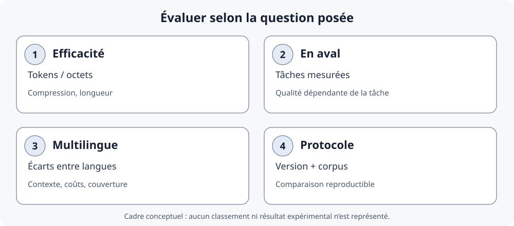

<!--
LLM-LAB-PAGE-MAP v1
id: "fr/tokenizer-evaluation"
scope: "Présente les protocoles de comparaison des tokenizers, les métriques, les limites des résultats empiriques et les ressources de recherche et pédagogiques ; la définition des stratégies reste dans la leçon conceptuelle."
purpose: "Le lecteur doit pouvoir choisir des mesures adaptées à une question, documenter une comparaison reproductible et distinguer longueur de représentation, coût système et qualité en aval."
suggested_route:
  previous: null
  next: null
hierarchy:
  parents: ["fr/tokenization-strategies"]
  children: []
related: ["fr/evaluation-experimentale"]
tags: ["type:deep-dive", "destination:deepen", "topic:tokenizer-evaluation", "level:advanced", "language:fr", "status:published"]
-->

::: {.chapter-lead}
Cette page facultative approfondit une question liée aux [stratégies de tokenisation](tokenization-strategies.qmd) : comment comparer des tokenizers sans confondre longueur, coûts et qualité ? Les observations et études citées dépendent de leurs corpus, langues, modèles et protocoles. Pour la méthode générale, voir aussi [Évaluation expérimentale](evaluation-experimentale.qmd).
:::

## Comparaison reproductible

1. Fixer les textes, l'encodage, le nettoyage et le traitement des documents.
2. Enregistrer le tokenizer exact, la version du package, l'identifiant d'encodage et les paramètres.
3. Comparer les tokens visibles et les longueurs ; ne pas comparer des IDs entre vocabulaires comme des valeurs sémantiques communes.
4. Ventiler les résultats par langue, écriture et type de texte, pas seulement par moyenne globale.
5. Contrôler la taille du vocabulaire, les tokens spéciaux, la couverture et la troncature.
6. Évaluer séparément qualité en aval, latence, mémoire, débit et coût.
7. Publier les limites : corpus, versions, normalisation, langues couvertes et incertitudes.

### Petit protocole reproductible en Python

L'exemple suivant inspecte un tokenizer Hugging Face précis. Le premier chargement peut nécessiter un accès réseau ; pour une expérience reproductible, consignez les versions des bibliothèques et figez la révision du modèle plutôt que d'utiliser une référence mobile.

```python
from importlib.metadata import version
from transformers import AutoTokenizer

model_id = "gpt2"
revision = "YOUR_COMMIT_SHA"  # Replace with the exact model commit SHA
tokenizer = AutoTokenizer.from_pretrained(model_id, revision=revision)
text = " Hello world — café"

ids = tokenizer.encode(text, add_special_tokens=False)
tokens = tokenizer.convert_ids_to_tokens(ids)

print("transformers:", version("transformers"))
print("tokenizer:", model_id)
print("tokens:", tokens)
print("IDs:", ids)
print("count:", len(ids))
print("decoded:", tokenizer.decode(ids))
```

Les fragments et IDs affichés appartiennent au tokenizer chargé. Pour comparer deux tokenizers, exécutez le même protocole sur les mêmes textes, consignez leurs versions/révisions et comparez les fragments et le nombre de tokens — pas les valeurs numériques des IDs entre vocabulaires. Le décodage dépend aussi des conventions et des tokens spéciaux.

### Mesurer un tokenizer sans réduire la qualité au nombre de tokens

Les études sur les coûts multilingues n'emploient pas toujours les mêmes métriques ni les mêmes dénominateurs. Il faut donc lire la définition opérationnelle de chaque mesure avant de comparer des résultats. Voir notamment [Ahia et al. (2023)](https://aclanthology.org/2023.emnlp-main.614/) et le travail sur les métriques multilingues [TokLens (ACL 2026 SRW)](https://aclanthology.org/2026.acl-srw.18/).

| Mesure | Interprétation | Limite |
|---|---|---|
| **Nombre de tokens** | Longueur produite pour un texte donné | Dépend du texte, du tokenizer, de sa version et de la normalisation |
| **Fertilité** | Souvent, nombre moyen de sous-tokens par mot de référence | La définition du « mot » et le traitement de la ponctuation peuvent varier ; préciser le dénominateur |
| **Caractères ou octets par token** | Rapport entre la longueur du texte source et le nombre de tokens | Les caractères Unicode, les points de code et les octets UTF-8 sont des unités différentes |
| **Couverture du vocabulaire** | Capacité à représenter les unités d'entrée sans recourir à un token inconnu, selon le système | Couverture complète ne signifie pas segmentation efficace ni bonne qualité en aval |
| **Qualité en aval** | Résultat sur une tâche définie, par langue et type de texte | Nécessite des budgets et des conditions d'évaluation comparables ; ne se déduit pas d'une métrique intrinsèque |

Pour une comparaison équitable, rapportez les métriques par langue et type de texte, et gardez séparés **coût de représentation**, **coût système** et **qualité de la tâche**. Une baisse de longueur est un résultat réel, mais elle ne suffit pas à démontrer une amélioration globale.

## Évaluer un tokenizer : métriques, performances et équité multilingue {#tokenizer-evaluation}

La comparaison des algorithmes ne suffit pas à établir qu'un tokenizer est adapté à un usage. Il faut distinguer plusieurs questions empiriques, qui ne se résument pas à un score unique.

{fig-alt="Quatre dimensions distinctes : compression et longueur de séquence ; résultats sur des tâches en aval ; écarts entre langues et types de texte ; protocole reproductible avec tokenizer, version et corpus identifiés." fig-cap="Cadre de lecture, non résultat expérimental : ces dimensions répondent à des questions différentes et ne se réduisent pas nécessairement à un classement unique." width=100%}

### Quatre dimensions à séparer

- **Efficacité de représentation** : combien de tokens, de caractères ou d'octets représentent le même contenu ? Le dénominateur doit être explicite : caractères Unicode, points de code, graphèmes et octets UTF-8 ne sont pas interchangeables.
- **Performances en aval** : les choix de segmentation peuvent modifier l'apprentissage et les résultats sur une tâche. Il faut mesurer ces résultats sous des conditions comparables, et non les déduire du nombre de tokens.
- **Équité multilingue** : un contenu comparable peut produire des longueurs de séquence différentes selon la langue et le tokenizer. Cela peut affecter le budget de contexte et les coûts d'entraînement ou d'inférence ; cela ne prouve pas, à lui seul, une différence de qualité de génération.
- **Reproductibilité** : documenter tokenizer et révision exacts, prétraitement, corpus, langues, métriques, tâche, budgets et versions logicielles.


#### Figure de recherche externe : la fertilité varie selon la langue

{fig-alt="Six graphiques présentent la fertilité des tokenizers pour l’anglais, le français, l’allemand, l’italien, le polonais et l’espagnol ; la barre rouge représente le tokenizer de l’autrice et les barres grises les alternatives." width=100%}

*Source : Catherine Arnett, [« wHy DoNt YoU jUsT uSe ThE lLaMa ToKeNiZeR?? »](https://huggingface.co/blog/catherinearnett/dangers-of-tokenizer-recycling), 2024. Il s’agit d’une comparaison propre à cette étude, pas d’un classement universel : la fertilité dépend des textes, de la définition du mot et des tokenizers comparés. L’image est intégrée depuis l’article de l’autrice, sans modification ni redistribution dans ce dépôt. Vérification des droits : en attente dans [#156](https://github.com/JM-Brun/llm-lab/issues/156) ; illustration conservée pendant la vérification de l’actif exact.*

### Ce que montrent — et ne montrent pas — les études

Les publications ci-dessous sont complémentaires : elles ne mesurent pas toutes le même objet et ne doivent pas être lues comme un classement direct des tokenizers.

| Travail | Question étudiée | Apport à l'évaluation | Limite d'interprétation |
|---|---|---|---|
| **Goldman et al. (2024)**, [*Unpacking Tokenization: Evaluating Text Compression and its Correlation with Model Performance*](https://aclanthology.org/2024.findings-acl.134/) | La compression est-elle associée aux performances des modèles ? | Analyse empiriquement le lien entre compression du texte et résultats en aval dans les configurations étudiées. | Une corrélation expérimentale n'établit pas une règle causale ou universelle de sélection. |
| **Schmidt et al. (2024)**, [*Tokenization Is More Than Compression*](https://aclanthology.org/2024.emnlp-main.40/) | Peut-on choisir un tokenizer en minimisant seulement la longueur ? | Met en évidence les limites d'une fonction objectif réduite à la compression et invite à considérer d'autres propriétés. | Ne signifie pas que la longueur est inutile : elle répond à une question de coût et de représentation précise. |
| **Arnett et al. (2025)**, [*Explaining and Mitigating Crosslingual Tokenizer Inequities*](https://proceedings.neurips.cc/paper_files/paper/2025/hash/5b91cefbfa52340af2f16f249572dc76-Abstract-Conference.html) | Pourquoi les coûts de tokenisation diffèrent-ils entre langues ? | Étudie les écarts interlinguistiques et des facteurs de conception susceptibles de les atténuer. | Les résultats dépendent des langues, corpus, tokenizers et protocoles considérés. |
| **Chiu (ACL 2026)**, [*TokLens: A Multilingual Lens on Tokenizer Quality for LLMs*](https://aclanthology.org/2026.acl-srw.18/) | Comment comparer les tokenizers sur plusieurs langues et plusieurs dimensions ? | Propose six métriques intrinsèques pour comparer 24 tokenizers sur 15 langues. L'étude ne trouve pas de métrique intrinsèque prédictive des résultats anglais après contrôle de la taille du modèle ; certaines métriques, notamment le taux de rétention en token unique, sont associées aux résultats par langue sur un benchmark multilingue. | Un tableau de métriques intrinsèques ne remplace pas l'évaluation sur les tâches et contraintes de déploiement visées. |

Goldman et al. et Schmidt et al. ne conduisent pas à une opposition simpliste. Le premier étudie des associations empiriques entre compression et résultats en aval ; le second rappelle que la compression ne résume pas toutes les propriétés pertinentes. La conclusion méthodologique est de **mesurer séparément les dimensions qui correspondent à la décision à prendre**.


#### Figure de recherche externe : longueur de représentation et temps d’exécution

{fig-alt="Nuage de points représentant la longueur de tokenisation et le temps d’exécution de RoBERTa pour les langues de FLORES-200, avec une couleur par famille d’écriture." width=80%}

*Source : Petrov, La Malfa, Torr et Bibi, [« Language Model Tokenizers Introduce Unfairness Between Languages »](https://www.adelbibi.com/publication/langugage_unfairness_tokenizers/), NeurIPS 2023. Le graphique illustre une association dans le protocole étudié, pas une loi causale universelle ni une mesure directe de la qualité de génération. La page de l’auteur indique une licence CC BY-NC-ND 4.0 ; la figure est intégrée sans modification et reliée à sa source. Vérification des droits : en attente dans [#156](https://github.com/JM-Brun/llm-lab/issues/156) ; illustration conservée dans l'attente de l'évaluation de l'actif et de l'usage prévus.*

### Construire un protocole de comparaison

Pour comparer deux tokenizers de manière interprétable :

1. Constituer un corpus fixe et documenter sa provenance, ses langues, ses domaines et ses règles de nettoyage.
2. Figer les tokenizers exacts : nom, révision, vocabulaire, configuration, versions de bibliothèques et tokens spéciaux.
3. Rapporter plusieurs mesures intrinsèques avec leur définition : tokens par texte, caractères ou octets par token, fertilité si le dénominateur « mot » est défini, couverture et troncature.
4. Ventiler les résultats par langue, script et type de texte ; une moyenne globale peut masquer des écarts importants.
5. Évaluer séparément les tâches en aval, avec les mêmes données, budgets de calcul/contexte et protocoles d'entraînement ou d'inférence lorsque la comparaison le permet.
6. Rapporter les coûts système pertinents : latence, débit, mémoire et coût financier. Une séquence plus courte n'implique pas mécaniquement un système plus rapide.
7. Publier les incertitudes, les limites et les cas où les résultats ne sont pas comparables.

**Règle de lecture :** le nombre de tokens mesure une longueur sous un tokenizer donné ; il ne mesure directement ni la qualité linguistique, ni la qualité du modèle, ni le coût système complet.

### Ressources et travaux connexes

- [Ahia et al. (2023), *Do All Languages Cost the Same?*](https://aclanthology.org/2023.emnlp-main.614/) — étude antérieure des coûts de tokenisation entre langues.
- [Wegmann et al. (2025), *Tokenization is Sensitive to Language Variation*](https://aclanthology.org/2025.findings-acl.572/) — variation linguistique et rôle du pré-tokenizer.
- [TokLens — dépôt et ressources](https://aclanthology.org/2026.acl-srw.18/) — à utiliser comme outil/méthode à examiner, en vérifiant ses métriques et son protocole.
- [Catherine Arnett (2024), article communautaire sur la réutilisation des tokenizers](https://huggingface.co/blog/catherinearnett/dangers-of-tokenizer-recycling) — observations de praticienne sur le réemploi des tokenizers et la pré-tokenisation ; ne remplace pas des résultats de recherche contrôlés.

### Ressources visuelles recommandées

1. [Philip Müller & Peter Steinbach — BPE Explainer](https://philipmueller.dev/bpe-visualization/) : manipulation interactive des fusions, meilleure première intuition.
2. [Hugging Face — cours BPE en français](https://huggingface.co/learn/llm-course/fr/chapter6/5?fw=tf) : présentation structurée de l'entraînement.
3. [Cornell CS4782 — Tokenization Visualizer](https://www.cs.cornell.edu/courses/cs4782/2026sp/demos/bytepair/) : comparaison pédagogique BPE/WordPiece. **Réserve sur l'interface (vérifiée le 29-10-2026) :** le panneau de la fusion sélectionnée affichait « Frequency: undefined », alors que la liste des paires candidates indiquait des fréquences. Ne pas se fier à cette valeur tant que la page n'a pas été corrigée.
4. [Andrej Karpathy — Let's build the GPT Tokenizer](https://www.youtube.com/watch?v=zduSFxRajkE) : Unicode, UTF-8, BPE, espaces et tokens spéciaux.
5. [Hugging Face — visualiser l'encodage BPE](https://huggingface.co/blog/SauravP97/bpe-tokenizer-visualize) : visualisation communautaire facultative. **Réserve issue de l'audit du code (30-10-2026) :** l'implémentation inspectée rejoue la liste des fusions du modèle sur les caractères Unicode bruts ; elle ne reproduit pas le prétraitement du tokenizer ni sa conversion byte-level. Le graphe doit donc être lu comme un schéma des opérations de fusion, et non comme une trace fidèle des frontières de tokens de GPT-2. Les métadonnées du paquet ne déclarent pas non plus les dépendances d'exécution, alors que le README cite `graphviz` et `transformers` ; examiner et figer les dépendances avant installation.

#### Repères temporels utiles dans la vidéo de Karpathy

La vidéo est longue ; ces chapitres permettent de sélectionner les passages pertinents :

- [14:56 — points de code Unicode et chaînes](https://www.youtube.com/watch?v=zduSFxRajkE&t=896s), puis [18:15 — encodages UTF et octets](https://www.youtube.com/watch?v=zduSFxRajkE&t=1095s).
- [23:50 — intuition de BPE](https://www.youtube.com/watch?v=zduSFxRajkE&t=1430s) et [28:35 — comptage et fusion des paires fréquentes](https://www.youtube.com/watch?v=zduSFxRajkE&t=1715s).
- [39:20 — tokenizer comme étape distincte du pipeline](https://www.youtube.com/watch?v=zduSFxRajkE&t=2360s), [42:47 — décodage](https://www.youtube.com/watch?v=zduSFxRajkE&t=2567s) et [48:21 — encodage](https://www.youtube.com/watch?v=zduSFxRajkE&t=2901s).
- [57:36 — pré-tokenisation par expressions régulières](https://www.youtube.com/watch?v=zduSFxRajkE&t=3456s) et [1:11:38 — différences entre les expressions GPT-2 et GPT-4](https://www.youtube.com/watch?v=zduSFxRajkE&t=4298s).
- [1:18:15 — tokens spéciaux et gestion par les API](https://www.youtube.com/watch?v=zduSFxRajkE&t=4695s).
- [1:28:42 — SentencePiece](https://www.youtube.com/watch?v=zduSFxRajkE&t=5322s) ; [1:49:58 — tokenisation multimodale](https://www.youtube.com/watch?v=zduSFxRajkE&t=6598s) constitue un prolongement facultatif, au-delà de cette séquence sur les tokens textuels.

Ces repères facilitent la navigation ; ils ne remplacent pas la vérification des détails d'implémentation dans la documentation et le code source des tokenizers concernés.

La page combine des schémas originaux du projet, des illustrations externes sélectionnées et des ressources liées. La provenance et les droits de réutilisation des actifs intégrés sont suivis dans [l'audit transversal des illustrations](https://github.com/JM-Brun/llm-lab/issues/156).


### Ordre de lecture conseillé

1. Regarder la vidéo de Karpathy pour construire l'intuition sur les octets, les fusions et les tokens spéciaux.
2. Lire le [BPE Explainer](https://philipmueller.dev/bpe-visualization/) et suivre les fusions sur un petit exemple.
3. Lire `minbpe` ou le [module éducatif de tiktoken](https://github.com/openai/tiktoken/blob/main/tiktoken/_educational.py) pour inspecter le code.
4. Comparer avec la documentation de tiktoken, SentencePiece et Hugging Face pour distinguer les conventions.
5. Revenir au [chapitre 2 de Raschka](https://github.com/rasbt/LLMs-from-scratch/tree/main/ch02) pour relier les IDs au pipeline des embeddings et aux exemples entrée-cible.
6. Tester des textes multilingues, du code, des nombres, des espaces initiaux et des formes Unicode inhabituelles.

### Illustration externe du pipeline

{fig-alt="Pipeline de tokenisation : normalisation, pré-tokenisation, modèle de tokenisation et post-traitement." width=100%}

Cette illustration publiée provient du [cours Hugging Face, « Building a tokenizer, block by block »](https://huggingface.co/docs/course/chapter6/8). Elle complète le schéma conceptuel de la [page d'introduction](text-data.qmd) avec les composants d'un tokenizer. L'image est chargée depuis les ressources documentaires publiques du cours, sans copie locale ; la citation ne constitue pas à elle seule une autorisation de réutilisation. Vérification des droits : en attente dans [#156](https://github.com/JM-Brun/llm-lab/issues/156) ; illustration conservée pendant la vérification de l'actif exact.

### Références de recherche complémentaires

- [Ali et al. (2024), *Tokenizer Choice For LLM Training: Negligible or Crucial?*](https://aclanthology.org/2024.findings-naacl.247/) : examine les effets du choix du tokenizer sur les coûts et les performances, en rappelant que les métriques intrinsèques ne prédisent pas toujours les résultats en aval.
- [Wegmann et al. (2025), *Tokenization is Sensitive to Language Variation*](https://aclanthology.org/2025.findings-acl.572/) : analyse les variations linguistiques et le rôle du pré-tokenizer.
- [Arnett et al. (2025), *Explaining and Mitigating Crosslingual Tokenizer Inequities*](https://proceedings.neurips.cc/paper_files/paper/2025/hash/5b91cefbfa52340af2f16f249572dc76-Abstract-Conference.html) : étudie les écarts de coût entre langues et des facteurs de conception tels que la taille du vocabulaire et le pré-tokenizer.
- [Ahia et al. (2023), *Do All Languages Cost the Same?*](https://aclanthology.org/2023.emnlp-main.614/) : compare le coût de tokenisation entre 22 langues et discute ses implications pour les API.
- [TokLens (ACL 2026 SRW)](https://aclanthology.org/2026.acl-srw.18/) : outil de mesure comparative multilingue à examiner comme méthode et logiciel, pas comme preuve qu'une seule métrique intrinsèque suffit.
- [Petrov et al. (2023), *Language Model Tokenizers Introduce Unfairness Between Languages*](https://www.adelbibi.com/publication/langugage_unfairness_tokenizers/) : étudie les écarts de longueur de tokenisation et de temps d'exécution entre langues ; consulter l'article pour le protocole expérimental.

### Code pédagogique et références historiques

- [Sebastian Raschka — *Build a Large Language Model (From Scratch)*, chapitre 2](https://livebook.manning.com/book/build-a-large-language-model-from-scratch/chapter-2) : lecture guidée du traitement du texte dans le pipeline LLM.
- [Hugging Face — cours sur les tokenizers](https://huggingface.co/learn/llm-course/chapter6/1) : introduction au chapitre consacré aux tokenizers ; les URL et le contenu du cours peuvent évoluer.


- [OpenAI `tiktoken` — module éducatif](https://github.com/openai/tiktoken/blob/main/tiktoken/_educational.py) : implémentation simplifiée de BPE pour inspecter les fusions ; elle n'est pas le chemin optimisé de production.
- [Andrej Karpathy — `minbpe`](https://github.com/karpathy/minbpe) : code compact pour suivre apprentissage et encodage ; comparer les conventions avant de conclure à la compatibilité.
- [Sebastian Raschka — BPE from scratch](https://sebastianraschka.com/blog/2025/bpe-from-scratch.html) : notebook explicatif. **Réserve sur l'implémentation (audit du code, 30-10-2026) :** le chemin d'entraînement personnalisé depuis zéro utilise des symboles caractères/chaînes et un découpage simplifié sur les espaces et retours à la ligne ; il ne reproduit pas le pipeline GPT-2 complet fondé sur les octets UTF-8. Le chemin distinct de chargement de GPT-2 utilise le vocabulaire pré-entraîné et les rangs de fusion, avec des tests sur un ensemble limité de cas `tiktoken`. Ces tests ne démontrent pas une compatibilité exhaustive. Voir le [notebook complet](https://github.com/rasbt/LLMs-from-scratch/blob/main/ch02/05_bpe-from-scratch/bpe-from-scratch.ipynb), le [notebook simplifié](https://github.com/rasbt/LLMs-from-scratch/blob/main/ch02/05_bpe-from-scratch/bpe-from-scratch-simple.ipynb) et les [tests](https://github.com/rasbt/LLMs-from-scratch/blob/main/ch02/05_bpe-from-scratch/tests.py).
- [Raschka — dépôt, chapitre 2](https://github.com/rasbt/LLMs-from-scratch/tree/main/ch02) : implémentations et préparation des données textuelles.
- [Gage (1994), *A New Algorithm for Data Compression*](https://dl.acm.org/doi/10.5555/177910.177914) : référence historique de la compression par paires d'octets. Les tokenizers modernes de LLM ajoutent des conventions que ce papier ne spécifie pas à lui seul.


[Retour aux stratégies de tokenisation](tokenization-strategies.qmd) · [Poursuivre vers les embeddings](embedding-space.qmd)

::: {.language-switch}
**Langue :** [Français](tokenizer-evaluation.qmd) · [English](../en/tokenizer-evaluation.qmd)
:::
