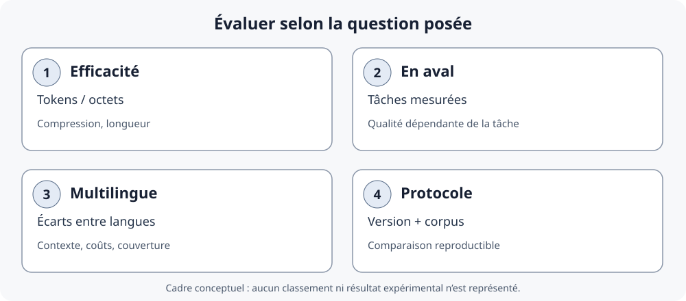

<!--
LLM-LAB-PAGE-MAP v1
id: "fr/tokenizer-multilingual-evaluation"
summary: "Analyse les dimensions empiriques de l'évaluation des tokenizers, les métriques multilingues, les études comparatives et leurs limites."
scope: "Détaille les métriques de représentation, les résultats de recherche sur les performances en aval, les écarts interlinguistiques, les protocoles expérimentaux et les ressources de recherche."
purpose: "Interpréter une comparaison de tokenizers en tenant compte des dénominateurs, des tâches, des corpus, des budgets et des limites causales."
domain: "text-tokenization"
suggested_route:
  previous: "fr/tokenizer-design-evaluation"
  next: null
hierarchy:
  parents: ["fr/tokenizer-design-evaluation"]
  children: []
related: ["fr/tokenization-strategies", "fr/text-data", "fr/scaling-laws"]
tags: ["type:deep-dive", "destination:deepen", "topic:tokenization", "level:advanced", "language:fr", "status:published"]
-->



::: {.chapter-lead}
La page du calendrier présente le compromis de conception et un protocole de première comparaison. Cet approfondissement examine ce que les études mesurent réellement : longueur de représentation, performances en aval, écarts entre langues et reproductibilité.
:::

**Retour à la page principale :** [Le tokenizer, ingénieur de compression](tokenizer-design-evaluation.qmd).

## Dimensions d'évaluation {#tokenizer-evaluation}

La comparaison des algorithmes ne suffit pas à établir qu'un tokenizer est adapté à un usage. Il faut distinguer plusieurs questions empiriques, qui ne se résument pas à un score unique.

{fig-alt="Quatre dimensions distinctes : compression et longueur de séquence ; résultats sur des tâches en aval ; écarts entre langues et types de texte ; protocole reproductible avec tokenizer, version et corpus identifiés." fig-cap="Cadre de lecture, non résultat expérimental : ces dimensions répondent à des questions différentes et ne se réduisent pas nécessairement à un classement unique." width=100%}

### Quatre dimensions à séparer

- **Efficacité de représentation** : combien de tokens, de caractères ou d'octets représentent le même contenu ? Le dénominateur doit être explicite : caractères Unicode, points de code, graphèmes et octets UTF-8 ne sont pas interchangeables.
- **Performances en aval** : les choix de segmentation peuvent modifier l'apprentissage et les résultats sur une tâche. Il faut mesurer ces résultats sous des conditions comparables, et non les déduire du nombre de tokens.
- **Équité multilingue** : un contenu comparable peut produire des longueurs de séquence différentes selon la langue et le tokenizer. Cela peut affecter le budget de contexte et les coûts d'entraînement ou d'inférence ; cela ne prouve pas, à lui seul, une différence de qualité de génération.
- **Reproductibilité** : documenter tokenizer et révision exacts, prétraitement, corpus, langues, métriques, tâche, budgets et versions logicielles.

#### Figure de recherche externe : la fertilité varie selon la langue

{fig-alt="Six graphiques présentent la fertilité des tokenizers pour l’anglais, le français, l’allemand, l’italien, le polonais et l’espagnol ; la barre rouge représente le tokenizer de l’autrice et les barres grises les alternatives." width=100%}

*Source : Catherine Arnett, [« wHy DoNt YoU jUsT uSe ThE lLaMa ToKeNiZeR?? »](https://huggingface.co/blog/catherinearnett/dangers-of-tokenizer-recycling), 2024. Il s’agit d’une comparaison propre à cette étude, pas d’un classement universel : la fertilité dépend des textes, de la définition du mot et des tokenizers comparés. L’image est intégrée depuis l’article de l’autrice, sans modification ni redistribution dans ce dépôt. Vérification des droits : en attente dans [#156](https://github.com/JM-Brun/llm-lab/issues/156) ; illustration conservée pendant la vérification de l’actif exact.*

### Ce que montrent — et ne montrent pas — les études

Les publications ci-dessous sont complémentaires : elles ne mesurent pas toutes le même objet et ne doivent pas être lues comme un classement direct des tokenizers.

| Travail | Question étudiée | Apport à l'évaluation | Limite d'interprétation |
|---|---|---|---|
| **Goldman et al. (2024)**, [*Unpacking Tokenization: Evaluating Text Compression and its Correlation with Model Performance*](https://aclanthology.org/2024.findings-acl.134/) | La compression est-elle associée aux performances des modèles ? | Analyse empiriquement le lien entre compression du texte et résultats en aval dans les configurations étudiées. | Une corrélation expérimentale n'établit pas une règle causale ou universelle de sélection. |
| **Schmidt et al. (2024)**, [*Tokenization Is More Than Compression*](https://aclanthology.org/2024.emnlp-main.40/) | Peut-on choisir un tokenizer en minimisant seulement la longueur ? | Met en évidence les limites d'une fonction objectif réduite à la compression et invite à considérer d'autres propriétés. | Ne signifie pas que la longueur est inutile : elle répond à une question de coût et de représentation précise. |
| **Ali et al. (2024)**, [*Tokenizer Choice For LLM Training: Negligible or Crucial?*](https://aclanthology.org/2024.findings-naacl.247/) | Le choix du tokenizer modifie-t-il les performances et le coût d'entraînement d'un décodeur ? | Entraîne des modèles décodeurs de 2,6B paramètres avec 24 configurations de tokenizer sur des corpus comparables, anglais seul et cinq langues ; les effets en aval varient selon la tâche, la langue, la bibliothèque/l'algorithme et la taille du vocabulaire. | Cinq langues européennes en écriture latine, évaluation zero-shot, une seule graine et aucune recherche d'hyperparamètres par tokenizer ; les 68 % rapportés correspondent à un cas de coût d'entraînement en allemand, pas à une pénalité universelle d'inférence. |
| **Wegmann et al. (2025)**, [*Tokenization is Sensitive to Language Variation*](https://aclanthology.org/2025.findings-acl.572/) | Comment les composants du tokenizer interagissent-ils avec la variation intralinguistique et les objectifs des tâches ? | Des expériences contrôlées avec BERT-base/BPE font varier corpus d'entraînement, pré-tokenizer et taille du vocabulaire sur des variations lexicales, orthographiques, syntaxiques, dialectales et de registre ; le pré-tokenizer a l'effet agrégé le plus important dans les tâches étudiées. | Expériences de classification avec un encodeur anglais, pas une mesure de parité multilingue ni de génération par décodeur ; les effets dépendent des tâches et les écarts agrégés restent modestes. |
| **Arnett et al. (2025)**, [*Explaining and Mitigating Crosslingual Tokenizer Inequities*](https://proceedings.neurips.cc/paper_files/paper/2025/hash/5b91cefbfa52340af2f16f249572dc76-Abstract-Conference.html) | Pourquoi les coûts de tokenisation diffèrent-ils entre langues, même avec un entraînement monolingue comparable ? | Entraîne environ 7 000 tokenizers BPE/Unigram monolingues sur 97 langues ; distingue les écarts *crosslingual* entre tokenizers monolingues des effets *multilingual* d'un tokenizer partagé. Des tailles de vocabulaire propres à chaque langue et les fusions SuperBPE à travers les espaces réduisent la variation des premiums dans le protocole de compression étudié. | Le CTC est la mesure du nombre de tokens à l'échelle du corpus, calculée sur les textes parallèles FLORES-200 ; le *token premium* exprime les différences relatives de nombre de tokens entre langues pour des contenus appariés. Ni l'un ni l'autre ne correspond à la parité TokLens, qui compare les taux tokens/caractère sur des corpus natifs distincts. Aucun LLM n'est entraîné, donc la qualité en aval n'est pas établie. L'intervention couvre sept langues et FLORES est traduit depuis l'anglais. |
| **Chiu (ACL 2026)**, [*TokLens: A Multilingual Lens on Tokenizer Quality for LLMs*](https://aclanthology.org/2026.acl-srw.18/) | Comment comparer les tokenizers sur plusieurs langues et plusieurs dimensions ? | Définit six métriques intrinsèques et évalue 24 tokenizers sur 15 langues. L'analyse des benchmarks anglais couvre 22 modèles (deux tokenizers supplémentaires ne servent qu'aux mesures intrinsèques) ; l'analyse MMLU-ProX couvre 7 modèles × 11 langues (77 observations modèle-langue). Aucune corrélation entre métrique et benchmark anglais ne résiste au contrôle de la taille des modèles et à la correction de Bonferroni sur 77 comparaisons ; STRR, caractères par token et parité sont associés aux résultats par langue sur MMLU-ProX. | Ces échantillons sont distincts : il ne s'agit pas de 24 configurations modèle/tokenizer. Les associations MMLU-ProX sont observationnelles et partiellement confondues par la composition des données de pré-entraînement ; elles n'établissent pas d'effet causal du tokenizer. La fertilité et la STRR fondées sur les espaces ne représentent pas la segmentation des mots en chinois, japonais et thaï. |

**TokLens : lire les six métriques intrinsèques avec leurs dénominateurs.** La fertilité correspond au nombre de tokens par unité délimitée par des espaces (proxy d'un mot) ; les caractères par token et les octets UTF-8 par token utilisent des unités de longueur différentes ; la longueur de séquence normalisée correspond aux tokens par caractère ; le taux de rétention en un seul token (*single-token retention rate*, STRR) est la proportion d'unités séparées par des espaces conservées en un seul token ; enfin, la parité interlinguistique compare le taux tokens/caractère d'une langue à celui de l'anglais. La fertilité et la STRR ne mesurent donc pas la segmentation des mots linguistiques en chinois, japonais ou thaï. Les nombres de caractères ne représentent pas non plus une quantité d'information équivalente entre écritures. La parité TokLens est calculée sur des corpus natifs avec un budget fixe de caractères ; elle ne correspond ni au *token premium* d'Arnett sur des textes parallèles au contenu apparié, ni au protocole de compression CTC fondé sur FLORES.

Goldman et al. et Schmidt et al. ne conduisent pas à une opposition simpliste. Le premier étudie des associations empiriques entre compression et résultats en aval ; le second rappelle que la compression ne résume pas toutes les propriétés pertinentes. TokLens apporte un résultat complémentaire : les relations observées diffèrent entre benchmarks anglais et multilingues. Son analyse MMLU-ProX couvre 7 modèles et 11 langues ; les associations rapportées restent corrélationnelles et partiellement confondues par la composition des données de pré-entraînement. Le résultat nul sur les benchmarks anglais peut refléter un décalage entre métriques et benchmarks ainsi qu'une faible variation des métriques de tokenisation en anglais ; il ne prouve pas que la tokenisation soit sans effet. La conclusion méthodologique est de **mesurer séparément les dimensions qui correspondent à la décision à prendre**.

#### Figure de recherche externe : longueur de représentation et temps d’exécution

{fig-alt="Nuage de points représentant la longueur de tokenisation et le temps d’exécution de RoBERTa pour les langues de FLORES-200, avec une couleur par famille d’écriture." width=80%}

*Source : Petrov, La Malfa, Torr et Bibi, [« Language Model Tokenizers Introduce Unfairness Between Languages »](https://www.adelbibi.com/publication/langugage_unfairness_tokenizers/), NeurIPS 2023. Le graphique illustre une association dans le protocole étudié, pas une loi causale universelle ni une mesure directe de la qualité de génération. La page de l’auteur indique une licence [CC BY-NC-ND 4.0](https://creativecommons.org/licenses/by-nc-nd/4.0/) ; la figure est intégrée sans modification et reliée à sa source. Vérification des droits : en attente dans [#156](https://github.com/JM-Brun/llm-lab/issues/156) ; illustration conservée dans l'attente de l'évaluation de l'actif et de l'usage prévus.*

### Construire un protocole de comparaison

Pour comparer deux tokenizers de manière interprétable :

1. Constituer un corpus fixe et documenter sa provenance, ses langues, ses domaines et ses règles de nettoyage.
2. Figer les tokenizers exacts : nom, révision, vocabulaire, configuration, versions de bibliothèques et tokens spéciaux.
3. Rapporter plusieurs mesures intrinsèques avec leur définition : tokens par texte, caractères ou octets par token, fertilité si le dénominateur « mot » est défini, couverture et troncature.
4. Ventiler les résultats par langue, script et type de texte ; une moyenne globale peut masquer des écarts importants.
5. Évaluer séparément les tâches en aval, avec les mêmes données, budgets de calcul/contexte et protocoles d'entraînement ou d'inférence lorsque la comparaison le permet.
6. Rapporter les coûts système pertinents : latence, débit, mémoire et coût financier. Une séquence plus courte n'implique pas mécaniquement un système plus rapide.
7. Publier les incertitudes, les limites et les cas où les résultats ne sont pas comparables.

**Règle de lecture :** le nombre de tokens mesure une longueur sous un tokenizer donné ; il ne mesure directement ni la qualité linguistique, ni la qualité du modèle, ni le coût système complet.

### Ressources et travaux connexes

- [Ahia et al. (2023), *Do All Languages Cost the Same?*](https://aclanthology.org/2023.emnlp-main.614/) — étude antérieure des coûts de tokenisation entre langues.
- [Wegmann et al. (2025), *Tokenization is Sensitive to Language Variation*](https://aclanthology.org/2025.findings-acl.572/) — variation linguistique et rôle du pré-tokenizer.
- [TokLens — dépôt et ressources](https://aclanthology.org/2026.acl-srw.18/) — à utiliser comme outil/méthode à examiner, en vérifiant ses métriques et son protocole.
- [Catherine Arnett (2024), article communautaire sur la réutilisation des tokenizers](https://huggingface.co/blog/catherinearnett/dangers-of-tokenizer-recycling) — observations de praticienne sur le réemploi des tokenizers et la pré-tokenisation ; ne remplace pas des résultats de recherche contrôlés.

### Ressources visuelles recommandées

1. [Philip Müller & Peter Steinbach — BPE Explainer](https://philipmueller.dev/bpe-visualization/) : manipulation interactive des fusions, meilleure première intuition.
2. [Hugging Face — cours BPE en français](https://huggingface.co/learn/llm-course/fr/chapter6/5?fw=tf) : présentation structurée de l'entraînement.
3. [Cornell CS4782 — Tokenization Visualizer](https://www.cs.cornell.edu/courses/cs4782/2026sp/demos/bytepair/) : comparaison pédagogique BPE/WordPiece. **Réserve sur l'interface (vérifiée le 29-10-2026) :** le panneau de la fusion sélectionnée affichait « Frequency: undefined », alors que la liste des paires candidates indiquait des fréquences. Ne pas se fier à cette valeur tant que la page n'a pas été corrigée.
4. [Andrej Karpathy — Let's build the GPT Tokenizer](https://www.youtube.com/watch?v=zduSFxRajkE) : Unicode, UTF-8, BPE, espaces et tokens spéciaux.
5. [Hugging Face — visualiser l'encodage BPE](https://huggingface.co/blog/SauravP97/bpe-tokenizer-visualize) : visualisation communautaire facultative. **Réserve issue de l'audit du code (30-10-2026) :** l'implémentation inspectée rejoue la liste des fusions du modèle sur les caractères Unicode bruts ; elle ne reproduit pas le prétraitement du tokenizer ni sa conversion byte-level. Le graphe doit donc être lu comme un schéma des opérations de fusion, et non comme une trace fidèle des frontières de tokens de GPT-2. Les métadonnées du paquet ne déclarent pas non plus les dépendances d'exécution, alors que le README cite `graphviz` et `transformers` ; examiner et figer les dépendances avant installation.

#### Repères temporels utiles dans la vidéo de Karpathy

La vidéo est longue ; ces chapitres permettent de sélectionner les passages pertinents :

- [14:56 — points de code Unicode et chaînes](https://www.youtube.com/watch?v=zduSFxRajkE&t=896s), puis [18:15 — encodages UTF et octets](https://www.youtube.com/watch?v=zduSFxRajkE&t=1095s).
- [23:50 — intuition de BPE](https://www.youtube.com/watch?v=zduSFxRajkE&t=1430s) et [28:35 — comptage et fusion des paires fréquentes](https://www.youtube.com/watch?v=zduSFxRajkE&t=1715s).
- [39:20 — tokenizer comme étape distincte du pipeline](https://www.youtube.com/watch?v=zduSFxRajkE&t=2360s), [42:47 — décodage](https://www.youtube.com/watch?v=zduSFxRajkE&t=2567s) et [48:21 — encodage](https://www.youtube.com/watch?v=zduSFxRajkE&t=2901s).
- [57:36 — pré-tokenisation par expressions régulières](https://www.youtube.com/watch?v=zduSFxRajkE&t=3456s) et [1:11:38 — différences entre les expressions GPT-2 et GPT-4](https://www.youtube.com/watch?v=zduSFxRajkE&t=4298s).
- [1:18:15 — tokens spéciaux et gestion par les API](https://www.youtube.com/watch?v=zduSFxRajkE&t=4695s).
- [1:28:42 — SentencePiece](https://www.youtube.com/watch?v=zduSFxRajkE&t=5322s) ; [1:49:58 — tokenisation multimodale](https://www.youtube.com/watch?v=zduSFxRajkE&t=6598s) constitue un prolongement facultatif, au-delà de cette séquence sur les tokens textuels.

Ces repères facilitent la navigation ; ils ne remplacent pas la vérification des détails d'implémentation dans la documentation et le code source des tokenizers concernés.

La page combine des schémas originaux du projet, des illustrations externes sélectionnées et des ressources liées. La provenance et les droits de réutilisation des actifs intégrés sont suivis dans [l'audit transversal des illustrations](https://github.com/JM-Brun/llm-lab/issues/156).

### Ordre de lecture conseillé

1. Regarder la vidéo de Karpathy pour construire l'intuition sur les octets, les fusions et les tokens spéciaux.
2. Lire le [BPE Explainer](https://philipmueller.dev/bpe-visualization/) et suivre les fusions sur un petit exemple.
3. Lire `minbpe` ou le [module éducatif de tiktoken](https://github.com/openai/tiktoken/blob/main/tiktoken/_educational.py) pour inspecter le code.
4. Comparer avec la documentation de tiktoken, SentencePiece et Hugging Face pour distinguer les conventions.
5. Revenir au [chapitre 2 de Raschka](https://github.com/rasbt/LLMs-from-scratch/tree/main/ch02) pour relier les IDs au pipeline des embeddings et aux exemples entrée-cible.
6. Tester des textes multilingues, du code, des nombres, des espaces initiaux et des formes Unicode inhabituelles.

### Illustration externe du pipeline

{fig-alt="Pipeline de tokenisation : normalisation, pré-tokenisation, modèle de tokenisation et post-traitement." width=100%}

Cette illustration publiée provient du [cours Hugging Face, « Building a tokenizer, block by block »](https://huggingface.co/docs/course/chapter6/8). Elle complète le schéma conceptuel de la [page d'introduction](text-data.qmd) avec les composants d'un tokenizer. L'image est chargée depuis les ressources documentaires publiques du cours, sans copie locale ; la citation ne constitue pas à elle seule une autorisation de réutilisation. Vérification des droits : en attente dans [#156](https://github.com/JM-Brun/llm-lab/issues/156) ; illustration conservée pendant la vérification de l'actif exact.

### Références de recherche complémentaires

- [Ali et al. (2024), *Tokenizer Choice For LLM Training: Negligible or Crucial?*](https://aclanthology.org/2024.findings-naacl.247/) : examine les effets du choix du tokenizer sur les coûts et les performances, en rappelant que les métriques intrinsèques ne prédisent pas toujours les résultats en aval.
- [Wegmann et al. (2025), *Tokenization is Sensitive to Language Variation*](https://aclanthology.org/2025.findings-acl.572/) : analyse les variations linguistiques et le rôle du pré-tokenizer.
- [Arnett et al. (2025), *Explaining and Mitigating Crosslingual Tokenizer Inequities*](https://proceedings.neurips.cc/paper_files/paper/2025/hash/5b91cefbfa52340af2f16f249572dc76-Abstract-Conference.html) : étudie les écarts de coût entre langues et des facteurs de conception tels que la taille du vocabulaire et le pré-tokenizer.
- [Ahia et al. (2023), *Do All Languages Cost the Same?*](https://aclanthology.org/2023.emnlp-main.614/) : compare le coût de tokenisation entre 22 langues et discute ses implications pour les API.
- [TokLens (ACL 2026 SRW)](https://aclanthology.org/2026.acl-srw.18/) : outil de mesure comparative multilingue à examiner comme méthode et logiciel, pas comme preuve qu'une seule métrique intrinsèque suffit.
- [Petrov et al. (2023), *Language Model Tokenizers Introduce Unfairness Between Languages*](https://www.adelbibi.com/publication/langugage_unfairness_tokenizers/) : étudie les écarts de longueur de tokenisation et de temps d'exécution entre langues ; consulter l'article pour le protocole expérimental.

### Code pédagogique et références historiques

- [Sebastian Raschka — *Build a Large Language Model (From Scratch)*, chapitre 2](https://livebook.manning.com/book/build-a-large-language-model-from-scratch/chapter-2) : lecture guidée du traitement du texte dans le pipeline LLM.
- [Hugging Face — cours sur les tokenizers](https://huggingface.co/learn/llm-course/chapter6/1) : introduction au chapitre consacré aux tokenizers ; les URL et le contenu du cours peuvent évoluer.

- [OpenAI `tiktoken` — module éducatif](https://github.com/openai/tiktoken/blob/main/tiktoken/_educational.py) : implémentation simplifiée de BPE pour inspecter les fusions ; elle n'est pas le chemin optimisé de production.
- [Andrej Karpathy — `minbpe`](https://github.com/karpathy/minbpe) : code compact pour suivre apprentissage et encodage ; comparer les conventions avant de conclure à la compatibilité.
- [Sebastian Raschka — BPE from scratch](https://sebastianraschka.com/blog/2025/bpe-from-scratch.html) : notebook explicatif. **Réserve sur l'implémentation (audit du code, 30-10-2026) :** le chemin d'entraînement personnalisé depuis zéro utilise des symboles caractères/chaînes et un découpage simplifié sur les espaces et retours à la ligne ; il ne reproduit pas le pipeline GPT-2 complet fondé sur les octets UTF-8. Le chemin distinct de chargement de GPT-2 utilise le vocabulaire pré-entraîné et les rangs de fusion, avec des tests sur un ensemble limité de cas `tiktoken`. Ces tests ne démontrent pas une compatibilité exhaustive. Voir le [notebook complet](https://github.com/rasbt/LLMs-from-scratch/blob/main/ch02/05_bpe-from-scratch/bpe-from-scratch.ipynb), le [notebook simplifié](https://github.com/rasbt/LLMs-from-scratch/blob/main/ch02/05_bpe-from-scratch/bpe-from-scratch-simple.ipynb) et les [tests](https://github.com/rasbt/LLMs-from-scratch/blob/main/ch02/05_bpe-from-scratch/tests.py).
- [Raschka — dépôt, chapitre 2](https://github.com/rasbt/LLMs-from-scratch/tree/main/ch02) : implémentations et préparation des données textuelles.
- [Gage (1994), *A New Algorithm for Data Compression*](https://dl.acm.org/doi/10.5555/177910.177914) : référence historique de la compression par paires d'octets. Les tokenizers modernes de LLM ajoutent des conventions que ce papier ne spécifie pas à lui seul.

::: {.language-switch}
**Langue :** [Français](tokenizer-multilingual-evaluation.qmd) · [English](../en/tokenizer-multilingual-evaluation.qmd)
:::
