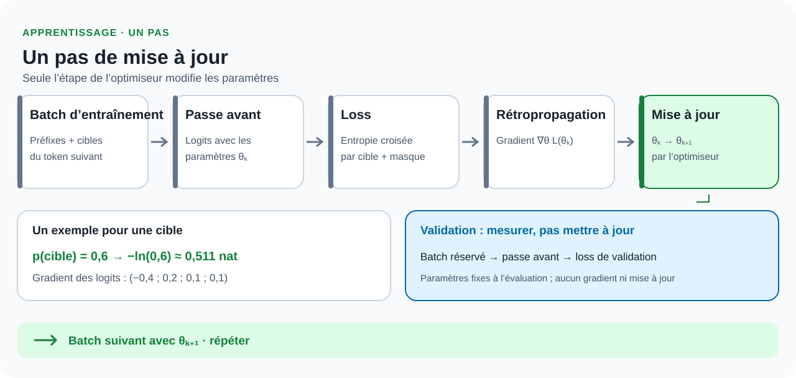
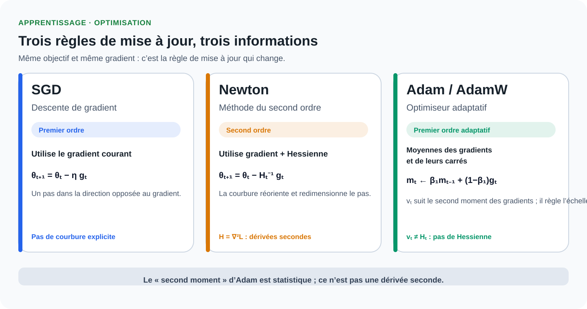

<!--
LLM-LAB-PAGE-MAP v1
id: "fr/training-loop"
summary: "Montre comment des pas de gradient répétés transforment un modèle initialisé au hasard en modèle entraîné, ce qu'un optimiseur ajoute au gradient et pourquoi la loss de validation est mesurée sur des données réservées."
scope: "Assemble les calculs en pas d’entraînement répétés et distingue l’optimisation sur le lot du suivi sur données réservées."
purpose: "Ordonner les opérations d’une itération et interpréter un écart entre les courbes d’entraînement et de validation."
suggested_route:
  previous: "fr/gradients"
  next: null
hierarchy:
  parents: []
  children: ["fr/post-training"]
related: ["fr/loss", "fr/gradients", "fr/scaling-laws", "fr/build-path", "fr/evaluation-experimentale"]
revision_support:
  status: integrated_sufficient
  evidence:
    - anchor: revision-summary
      note: "Le rappel distingue passe avant, loss, gradient, mise à jour effective et mesure indépendante sur validation ; les questions corrigées, les calculs SGD et l'exercice intégrateur sont regroupés dans la [page d'exercices dédiée](exercises/training-loop.qmd)."
tags: ["type:concept-lesson", "destination:understand", "topic:training-loop", "level:core", "language:fr", "status:published"]
-->



::: {.chapter-lead}
L'entraînement répète un même cycle : prédire, mesurer la loss, calculer le gradient, mettre à jour les paramètres. Son objectif est d'améliorer l'ajustement aux données d'entraînement ; cela ne garantit pas une baisse à chaque pas ni une meilleure performance sur un texte jamais vu, qui se mesure séparément sur des données réservées.
:::

::: {.callout-tip title="L'idée à retenir en une minute" #revision-summary}
Un **pas d'entraînement** prend un batch de préfixes observés et de cibles, exécute la passe avant, calcule la [loss](loss.qmd), obtient le [gradient](gradients.qmd), puis laisse un **optimiseur** transformer ce gradient en mise à jour des paramètres. L'**entraînement** est ce pas répété sur de nombreux batchs. Seule la mise à jour modifie les paramètres.

Une seconde mesure accompagne l'entraînement : la même loss calculée sur des données de **validation** qui ne produisent jamais de mise à jour. La loss d'entraînement dit dans quelle mesure le modèle s'ajuste à ce sur quoi il est ajusté ; la loss de validation estime si cet ajustement se transfère.
:::

<div class="pipeline-stepper" role="group" aria-label="Opérations d'un pas d'entraînement">
  <span class="step-item">1. Batch</span>
  <span class="step-arrow" aria-hidden="true">→</span>
  <span class="step-item">2. Passe avant et loss</span>
  <span class="step-arrow" aria-hidden="true">→</span>
  <span class="step-item">3. Gradient</span>
  <span class="step-arrow" aria-hidden="true">→</span>
  <span class="step-item active">4. Mise à jour</span>
  <span class="step-arrow" aria-hidden="true">→</span>
  <span class="step-item">5. Répéter, et mesurer sur la validation</span>
</div>

<figure id="fig-training-loop-update">
  <picture>
    <source media="(max-width: 600px)" srcset="../images/training-loop-visual-fr-mobile.svg">
    
  </picture>
  <figcaption>Un batch d'entraînement ne modifie les paramètres qu'à l'étape de mise à jour de l'optimiseur. La validation mesure le modèle courant sur des données réservées ; elle ne met pas le modèle à jour. L'exemple de probabilité cible reprend les mêmes valeurs illustratives que le calcul ci-dessous.</figcaption>
</figure>

## Un pas, puis beaucoup

Pour un batch de préfixes observés avec leurs cibles du token suivant (voir le [teacher forcing](loss.qmd#préfixe-observé-et-teacher-forcing)), une itération effectue :

1. **Passe avant.** Avec les paramètres courants $\theta_k$, calculer les logits de chaque position cible valide.
2. **Loss.** Agréger l'[entropie croisée](cross-entropy.qmd) par position en la loss du batch $\mathcal{L}(\theta_k)$ définie dans [Loss](loss.qmd).
3. **Gradient.** La rétropropagation fournit $\nabla_\theta\mathcal{L}(\theta_k)$, comme décrit dans [Gradients](gradients.qmd).
4. **Mise à jour.** L'optimiseur calcule $\theta_{k+1}$ à partir du gradient (et éventuellement de son propre état) ; l'itération suivante utilise $\theta_{k+1}$.

Les étapes 1 à 3 ne font que lire les paramètres. L'étape 4 est le seul endroit où ils changent. C'est le contraste avec la [génération](generation.qmd) et le [scoring](vraisemblance.qmd), qui exécutent le même calcul avant avec des paramètres fixes.

### Rejouer un pas sur le premier token

Pour rendre le cycle concret, reprenons la cible « Vous » et la distribution illustrative $p=(0{,}6;0{,}2;0{,}1;0{,}1)$. La loss locale vaut $-\ln(0{,}6)\approx0{,}511$ nat et son gradient par rapport aux logits vaut $(-0{,}4;0{,}2;0{,}1;0{,}1)$. La règle de chaîne transforme ce signal en gradients des poids (voir [le calcul complet sur la tête de sortie](gradients.qmd#running-example-sgd)) ; l'optimiseur applique ensuite une mise à jour. Au pas suivant, le modèle doit recalculer ses logits avec les nouveaux paramètres : les probabilités $0{,}6/0{,}2/0{,}1/0{,}1$ ne sont donc pas supposées rester identiques. Cet exemple relie les étapes du mécanisme ; il ne simule pas un entraînement complet ni ne garantit que la loss baisse après n'importe quel pas.

### Passer d’une cible à un lot

Le calcul précédent suit une seule cible. Avec la réduction utilisée ici, on dérive la [moyenne des pertes sur les positions valides](loss.qmd#de-la-perte-locale-à-la-loss-du-batch).

Un **mini-batch échantillonné** fournit une estimation bruitée de la loss et du gradient calculés sur tout le jeu d'entraînement. C'est le principe de la descente de gradient *stochastique* : les mini-batchs successifs peuvent tirer les paramètres dans des directions légèrement différentes, et c'est la tendance moyenne qui guide l'optimisation. À l'inverse, si chaque mise à jour utilise tous les exemples d'entraînement, on parle de descente de gradient par **batch complet**. Les conventions de comptage varient : un *pas* est une mise à jour des paramètres, une *époque* est un passage sur les données d'entraînement ; les deux dépendent de la taille du batch et du jeu de données.

Un modèle fraîchement initialisé attribue des probabilités à peu près uniformes : sa loss est proche de $\ln V$ pour un vocabulaire de taille $V$ (un départ quasi uniforme est un test de cohérence, pas une garantie : l'échelle d'initialisation compte). L'entraînement vise à faire baisser cette loss ; avec des batchs stochastiques, les mesures peuvent fluctuer d'un pas à l'autre.

## Optimiseur, gradient et taux d'apprentissage

Ces trois notions sont souvent confondues.

- Le **gradient** est une quantité : la variation locale de la loss par rapport à chaque paramètre.
- L'**optimiseur** est une règle qui transforme les gradients (et parfois sa mémoire des gradients précédents) en mise à jour. La SGD simple utilise $\theta_{k+1}=\theta_k-\eta\,\nabla_\theta\mathcal{L}(\theta_k)$, comme indiqué dans [Gradients](gradients.qmd).
- Le **taux d'apprentissage** $\eta$ fixe la taille du pas. Trop petit, l'entraînement est lent ; trop grand, la loss peut osciller ou diverger, car le gradient ne décrit que le comportement *local*.

::: {.callout-warning title="Idées reçues"}
- **« L'optimiseur calcule le gradient. »** C'est la rétropropagation qui le calcule ; l'optimiseur ne fait que l'utiliser.
- **« Un taux d'apprentissage plus petit est toujours plus sûr. »** Il est plus stable à chaque pas, mais peut être trop lent pour atteindre une loss utile avec le calcul disponible ; la meilleure valeur dépend du modèle, de la taille du batch et de l'optimiseur.
- **« L'entraînement s'arrête quand la loss atteint zéro. »** Avec des cibles one-hot parfaitement séparables et sans régularisation, la cross-entropie softmax peut tendre vers zéro à mesure que les logits deviennent toujours plus confiants, sans atteindre zéro pour des logits finis. Ce n'est toutefois pas une propriété universelle de tout objectif ou jeu de données ; en pratique, l'arrêt dépend du budget de calcul et du comportement en validation.
:::

## Loss d'entraînement et loss de validation

Si l'on ne mesurait que la loss minimisée par l'optimiseur, un modèle qui mémorise son texte d'entraînement paraîtrait parfait. Le remède usuel consiste à mettre de côté des données qui ne produisent jamais de mise à jour.

- **Loss d'entraînement :** calculée sur les batchs servant aux mises à jour. Elle mesure l'ajustement à ces exemples.
- **Loss de validation :** la même loss sur une partition distincte, calculée avec des paramètres fixes, sans aucune mise à jour. Elle estime le comportement sur du texte inédit issu de la même distribution.
- **Loss de test :** une autre partition, laissée intacte jusqu'à l'évaluation finale. La validation guide des choix comme l’arrêt de l’entraînement ou le taux d’apprentissage. À force de sélectionner les configurations qui obtiennent les pertes les plus faibles sur cette partition, on risque de retenir une configuration qui y réussit en partie par hasard. La loss de validation de cette configuration peut alors sous-estimer sa loss sur de nouvelles données. Le test réservé fournit une mesure indépendante de cette sélection. Voir la [préparation du corpus](corpus-preparation.qmd) pour construire les partitions sans fuite et l'[évaluation expérimentale](evaluation-experimentale.qmd) pour le protocole plus général.

Le **surapprentissage** survient lorsque le modèle ajuste des détails de l'échantillon d'entraînement qui ne se retrouvent pas dans de nouveaux textes. Un signe courant est une loss de validation qui stagne ou remonte alors que la loss d'entraînement continue de baisser. L'écart entre les deux losses est l'*écart de généralisation*. L'ampleur du surapprentissage dépend de la capacité du modèle par rapport à la quantité et à la diversité des données, du nombre de répétitions des données et de la régularisation.

L'exemple ci-dessous rend ce phénomène visible avec le plus petit modèle de langage possible : une table de logits indexée par le token précédent, entraînée sur 60 tokens seulement, tirés d'un processus aléatoire connu, et validée sur 400 tokens supplémentaires.

Avec NumPy 2 et cette graine, l'exécution affiche une loss d'entraînement qui passe de 2,485 ($=\ln 12$) à environ 1,15, tandis que la loss de validation atteint un minimum près du pas 100 (environ 2,01) puis remonte à environ 2,16. La loss d'entraînement seule suggérerait de poursuivre. Parmi les checkpoints mesurés dans cette exécution, la loss de validation favorise celui du pas 100. Les valeurs exactes dépendent de la graine et de la version de la bibliothèque ; les assertions vérifient l'allure qualitative, pas les valeurs.

Cet exemple est volontairement minuscule : une table de consultation, des mises à jour par descente de gradient sur batch complet (les 60 tokens d'entraînement à chaque pas), et non des mini-batchs échantillonnés. Il montre la boucle et le diagnostic, pas le comportement d'un Transformer, et la même allure de courbe n'est pas garantie dans d'autres configurations. Réussir les assertions montre que cette configuration reproduit le phénomène ; ce n'est pas une preuve générale sur le surapprentissage.

Pour comparer deux checkpoints, entraînez-vous à [agréger la loss de validation sur des lots qui n’ont pas le même nombre de tokens valides](exercises/loss.qmd#ex-validation-loss-by-token).

[Reproduire l’expérience de validation](#implémentation).

## Le pré-entraînement est la même boucle à grande échelle

Le *pré-entraînement* désigne cette boucle appliquée à un corpus de texte très vaste et varié : les cibles sont les tokens suivants du corpus lui-même, aucune annotation n'est donc nécessaire. Ce que l'échelle change n'est pas la mathématique d'un pas, mais l'ingénierie autour : volume et curation des données, taille du batch, plannings de taux d'apprentissage, précision numérique et répartition du calcul sur de nombreux dispositifs. La façon dont la loss varie avec la taille du modèle, les données et le calcul est une question empirique traitée dans [Lois d'échelle](scaling-laws.qmd).

L'implémentation de cette boucle depuis zéro, avec points de sauvegarde et exécuteur de validation, est un jalon du [parcours Construire](build-path.qmd) ; son état y est suivi. Cette leçon ne l'exige pas. Poursuivre l'entraînement d'un modèle pré-entraîné sur un objectif plus étroit (fine-tuning supervisé et méthodes voisines) réutilise la même boucle avec d'autres données et d'autres cibles ; il est présenté dans le [panorama des LLM](llm-overview.qmd), pas ici.

[Questions et exercices sur la boucle d'entraînement](exercises/training-loop.qmd).

[Revoir l’étape Entraînement dans le plan de révision](review-path.qmd#training).



Après ce parcours, vous pouvez étudier le [post-entraînement](post-training.qmd) ou appliquer un [protocole d’évaluation](evaluation-experimentale.qmd).

## Approfondissements

### Implémentation

::: {.callout-note collapse="true" title="Afficher le micro-code" data-reading-time="exclude"}

<span class="epistemic-badge badge-code">Micro-code exécutable</span> Le code utilise les fonctions maintenues de `llm_lab.foundations.losses` pour la loss et son gradient par rapport aux logits, et n'ajoute que la boucle. Exécutez-le depuis la racine du dépôt après `uv sync`.

```python
import numpy as np
from llm_lab.foundations.losses import cross_entropy_from_logits, cross_entropy_gradient

rng = np.random.default_rng(0)
V = 12                                                  # taille du vocabulaire
true_P = rng.dirichlet(np.full(V, 0.3), size=V)         # loi inconnue du token suivant, (V, V)

def sample(n):                                          # flux de tokens -> (entrées, cibles décalées)
    t = [0]
    for _ in range(n):
        t.append(rng.choice(V, p=true_P[t[-1]]))
    return np.array(t[:-1]), np.array(t[1:])

x_tr, y_tr = sample(60)                                 # petite partition d'entraînement
x_va, y_va = sample(400)                                # partition de validation réservée

W = np.zeros((V, V))                                    # paramètres : une ligne de logits par token précédent
lr, history = 1.0, []
for step in range(301):
    if step % 50 == 0:                                  # mesure seulement : aucune mise à jour
        history.append((step,
                        cross_entropy_from_logits(W[x_tr], y_tr),
                        cross_entropy_from_logits(W[x_va], y_va)))
    g_logits = cross_entropy_gradient(W[x_tr], y_tr)    # (60, V) : dLoss / dlogits
    g_W = np.zeros_like(W)
    np.add.at(g_W, x_tr, g_logits)                      # règle de chaîne à travers la lecture de ligne
    W -= lr * g_W                                       # mise à jour par batch complet

train = [h[1] for h in history]
val = [h[2] for h in history]
assert np.isclose(train[0], np.log(V)) and np.isclose(val[0], np.log(V))   # départ uniforme
assert all(a >= b for a, b in zip(train, train[1:]))    # la loss d'entraînement continue de baisser
assert int(np.argmin(val)) < len(val) - 1               # la loss de validation remonte
for s, tr, va in history:
    print(f"step {s:3d}  train {tr:.3f}  val {va:.3f}")
```

:::

### Comparer les optimiseurs

L'entraînement des modèles de langage emploie couramment des optimiseurs *adaptatifs* comme Adam et sa variante à décroissance des poids découplée, AdamW. Intuitivement, ils conservent des moyennes glissantes des gradients récents et de leurs carrés (leur second moment non centré), de sorte que chaque paramètre reçoit un pas adapté à son historique récent et non un pas global unique. Pour un même objectif de données et les mêmes paramètres, le gradient de cet objectif reste celui calculé par rétropropagation ; l'optimiseur détermine comment l'utiliser. **AdamW ajoute en plus une décroissance des poids découplée** : cette contribution à la mise à jour n'est pas le gradient de la loss de données. Le second moment des gradients conservé par Adam estime leur amplitude : ce n'est **pas** la matrice hessienne qui représente la courbure dans la méthode de Newton. Adam et AdamW sont donc des optimiseurs adaptatifs du premier ordre, et non des méthodes de Newton du second ordre. Leurs formules exactes, les plannings de taux d'apprentissage (échauffement, décroissance) et l'écrêtage des gradients sont des choix d'implémentation qui modifient la dynamique d'entraînement sans changer l'objectif ; ils sortent du périmètre de cette leçon, et les sources de la rubrique *Pour approfondir* les définissent.

<figure id="fig-optimizer-comparison">
  <picture>
    <source media="(max-width: 600px)" srcset="../images/optimizer-comparison-fr-mobile.svg">
    
  </picture>
  <figcaption>SGD, Newton et Adam peuvent optimiser le même objectif tout en utilisant des informations différentes pour choisir une mise à jour. Le second moment d'Adam suit les carrés des gradients ; il ne calcule pas la courbure.</figcaption>
</figure>

::: {.callout-note collapse="true" title="Pourquoi ne pas appliquer Newton exactement à chaque paramètre d'un LLM ? (approfondissement)"}
Un pas de Newton complet résout $H_k d_k = \nabla_\theta\mathcal{L}(\theta_k)$ puis met à jour $\theta_{k+1}=\theta_k-d_k$. Pour un modèle de millions ou de milliards de paramètres, stocker et factoriser une hessienne dense est généralement prohibitif. La hessienne peut aussi être singulière ou indéfinie : une direction de Newton non amortie n'est donc pas automatiquement une direction de décroissance. Les méthodes du second ordre pratiques ajoutent des garde-fous, comme l'amortissement, les régions de confiance ou des approximations structurées. Les méthodes quasi-Newton (par exemple L-BFGS) et les préconditionneurs structurés cherchent à exploiter la courbure à moindre coût, mais ne sont pas le même algorithme qu'Adam. C'est l'une des raisons pour lesquelles l'entraînement à grande échelle des modèles de langage privilégie couramment des méthodes adaptatives du premier ordre.
:::

::: {.language-switch}
[Français](training-loop.qmd) · [English](../en/training-loop.qmd)
:::

<details class="learning-resources">
<summary>
  <span class="learning-resources__title">Ressources complémentaires</span>
  <span class="learning-resources__description">Expérimenter, approfondir et s'exercer sur les notions de cette leçon.</span>
</summary>
<div class="learning-resources__content" markdown="1">

### Ressources d'implémentation complémentaires

::: {.callout-note title="Et si vous n'avez pas de GPU local ?"}
La boucle d'entraînement ne dépend pas intrinsèquement de la machine qui l'exécute. Une fois le programme testable localement, vous pouvez le lancer sur un GPU managé avec Hugging Face Jobs : le code Python reste séparé du launcher, qui choisit l'image, le GPU, le timeout et le stockage persistant. Consultez la [recette distante bilingue](https://github.com/JM-Brun/llm-lab/tree/main/experiments/huggingface-jobs) pour le flux complet, les commandes et les limites. Cette option est facultative ; elle ne remplace pas une loss de validation indépendante.
:::

- [Hugging Face — Boucle d'entraînement personnalisée](https://huggingface.co/learn/llm-course/en/chapter3/4) : exemple PyTorch qui rend visibles les étapes prises en charge par une API de haut niveau.
- [Hugging Face — Finetuner avec Trainer](https://huggingface.co/learn/llm-course/en/chapter3/3) : configurer l'évaluation, les métriques, la précision mixte et l'accumulation de gradients.
- [Hugging Face — Comprendre les courbes d'apprentissage](https://huggingface.co/learn/llm-course/en/chapter3/5) : lecture des courbes de perte et de métriques pendant le fine-tuning.

### Exemples de workflow complémentaires

- [Hugging Face — Entraîner un modèle de langage causal depuis zéro](https://huggingface.co/learn/llm-course/en/chapter7/6) : exemple CodeParrot qui relie corpus de code, tokenizer, streaming et pré-entraînement causal. C'est un cas d'étude applicatif, pas un substitut au parcours GPT minimal de LLM Lab.
- [Hugging Face — Déboguer le pipeline d'entraînement](https://huggingface.co/learn/llm-course/en/chapter8/4) : méthode de diagnostic par inspection successive des données, du batching, du modèle, de l'optimiseur et de l'évaluation.

### Pour approfondir

- [Kingma et Ba — Adam: A Method for Stochastic Optimization](https://arxiv.org/abs/1412.6980) : l'optimiseur adaptatif présenté dans l'article d'origine.
- [Loshchilov et Hutter — Decoupled Weight Decay Regularization](https://arxiv.org/abs/1711.05101) : définit AdamW et explique pourquoi la décroissance des poids est découplée du pas de gradient.
- [Goodfellow, Bengio et Courville — Deep Learning, chapitre 5.2](https://www.deeplearningbook.org/contents/ml.html) : capacité, surapprentissage et sous-apprentissage, avec le vocabulaire entraînement/validation/test employé ci-dessus.
- [Karpathy — A Recipe for Training Neural Networks](https://karpathy.github.io/2019/04/25/recipe/) : conseils pratiques, dont le surapprentissage d'un petit batch en premier et la lecture des courbes d'entraînement et de validation.
- [PyTorch — `torch.optim.AdamW`](https://docs.pytorch.org/docs/stable/generated/torch.optim.AdamW) : documente la règle de mise à jour et l'état de l'optimiseur sauvegardé avec un point de sauvegarde.

</div>
</details>
