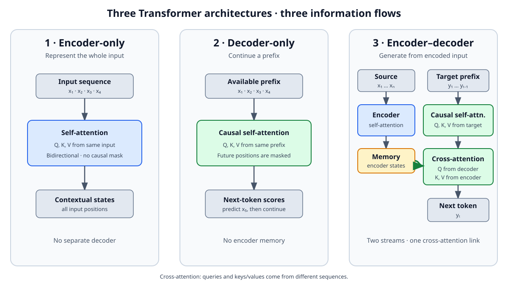

<!--
LLM-LAB-PAGE-MAP v1
id: "fr/transformer-architectures"
scope: "Compare les architectures Transformer encodeur seul, encodeur-décodeur et décodeur seul par leur flux d'information, leurs masques, leurs objectifs d'entraînement typiques et leurs usages ; distingue explicitement architecture, objectif et tâche, sans prétendre que ces trois familles couvrent toutes les architectures de modèles de langage."
purpose: "Le lecteur doit pouvoir expliquer comment chaque famille traite le contexte, identifier les différences entre attention bidirectionnelle, causale et attention croisée, et comprendre pourquoi le choix d'architecture ne détermine pas à lui seul l'objectif d'entraînement ni l'usage."
suggested_route:
  previous: null
  next: null
hierarchy:
  parents: ["fr/llm-overview"]
  children: []
related: ["fr/transformer-history", "fr/transformer", "fr/cross-attention"]
tags: ["type:concept-lesson", "destination:understand", "topic:transformer-architectures", "level:core", "language:fr", "status:published"]
-->

::: {.chapter-lead}
Les Transformers ne forment pas une architecture unique. Selon que le réseau utilise un encodeur, un décodeur ou les deux, l'information circule différemment : une séquence peut être représentée dans les deux directions, transformée en une autre séquence, ou prolongée token par token. Ces choix influencent les usages possibles, mais ne déterminent pas à eux seuls l'objectif d'entraînement.
:::

::: {.callout-note .learning-outcomes collapse="true" title="Objectifs d’apprentissage"}
Vous pourrez :
- comparer encodeur seul, encodeur-décodeur et décodeur seul selon le contexte accessible et le flux d’information ;
- distinguer attention bidirectionnelle, attention causale et attention croisée ;
- séparer architecture, objectif d’entraînement et tâche, sans généraliser les associations typiques.
:::

## Vue comparative

| Famille | Flux d'information | Masque et attention | Objectifs typiques | Usages fréquents | Exemples |
|---|---|---|---|---|---|
| **Encodeur seul** | L'encodeur transforme une séquence entière en représentations contextualisées. | Auto-attention généralement bidirectionnelle : chaque position peut exploiter les autres positions de l'entrée. | Prédiction de tokens masqués (*masked language modeling*), parmi d'autres objectifs possibles. | Classification, recherche sémantique, extraction et représentation de texte. | BERT, RoBERTa |
| **Encodeur-décodeur** | L'encodeur représente l'entrée ; le décodeur produit une séquence cible en s'appuyant sur cette représentation. | Attention de l'encodeur sur l'entrée ; auto-attention causale du décodeur ; attention croisée vers les états de l'encodeur. | Reconstruction, débruitage ou apprentissage texte-vers-texte, selon le modèle. | Traduction, résumé, transformation d'une séquence en une autre. | Transformer original, T5 |
| **Décodeur seul** | Le décodeur prolonge un préfixe en produisant des représentations utiles à la prédiction suivante. | Auto-attention causale : une position ne consulte pas les tokens futurs. | Prédiction autorégressive du prochain token, dans les GPT classiques. | Continuation et génération conditionnée par un prompt. | GPT, GPT-2 |

## Les trois architectures en un schéma

{fig-alt="Encodeur seul : auto-attention bidirectionnelle. Décodeur seul : auto-attention causale. Encodeur-décodeur : auto-attention dans l'encodeur, auto-attention causale dans le décodeur et attention croisée vers la mémoire de l'encodeur." width=100%}

Le point distinctif de l'architecture encodeur-décodeur est que le décodeur peut consulter les représentations produites par l'encodeur. Ce mécanisme est appelé **attention croisée**. Son fonctionnement détaillé relève d'un [approfondissement avancé](cross-attention.qmd) : il n'est pas nécessaire pour comprendre la comparaison générale des architectures.

### Encodeur seul : contextualiser une entrée

Un encodeur traite généralement la séquence fournie comme un tout. Avec une attention bidirectionnelle, la représentation d'un token peut intégrer des informations situées avant et après lui dans l'entrée. C'est adapté à des tâches où l'on veut représenter, classer ou comparer un texte complet.

Dans BERT, l'objectif de pré-entraînement emblématique consiste à prédire des tokens masqués à partir de leur contexte gauche et droit. Cet objectif exploite l'architecture ; il ne constitue pas la définition de tout encodeur.

### Encodeur-décodeur : transformer une séquence en une autre

L'encodeur construit une représentation de l'entrée. Le décodeur génère ensuite la sortie, généralement de façon autorégressive, en combinant son propre contexte déjà produit et l'information issue de l'encodeur via l'attention croisée (*cross-attention*).

Cette séparation est naturelle lorsque l'entrée et la sortie jouent des rôles distincts : traduire une phrase, résumer un document ou convertir un texte dans un autre format. L'article Transformer de 2017 et T5 sont des exemples importants de cette famille. Le détail du mécanisme — notamment la provenance distincte de Q, K et V — est traité dans l'[approfondissement avancé consacré à l'attention croisée](cross-attention.qmd).

### Décodeur seul : prolonger un préfixe

Un décodeur seul utilise un masque causal : pour calculer la représentation à une position, il ne peut pas consulter les tokens futurs. En entraînement autorégressif, chaque position apprend à prédire le token qui suit le préfixe disponible. À l'inférence, le système répète cette prédiction et ajoute chaque token sélectionné au contexte.

C'est l'architecture retenue dans le parcours de construction du petit GPT de LLM Lab. Ce choix rend la génération inspectable étape par étape ; il ne signifie pas que tous les LLM sont des décodeurs seuls.

## Architecture, objectif et tâche : trois notions différentes

Ces termes sont souvent confondus, alors qu'ils répondent à des questions différentes :

- **Architecture** : quelles opérations et quelles connexions organisent le calcul ?
- **Objectif d'entraînement** : quelle quantité le modèle apprend-il à prédire ou à optimiser ? Exemples : token masqué, prochain token, séquence débruitée.
- **Tâche d'utilisation** : quel problème le système doit-il résoudre ? Exemples : classer, traduire, résumer ou générer.

Une même famille peut être entraînée avec plusieurs objectifs ; un objectif proche peut être décliné dans plusieurs architectures. Le tableau présente des associations fréquentes, pas des correspondances obligatoires.

## Le périmètre de cette comparaison

Les trois familles décrites ici sont les grandes configurations du **Transformer**. Elles ne couvrent pas toutes les architectures de modèles de langage ou de séquence : des modèles à espace d'état, des architectures récurrentes et des systèmes hybrides existent également. Inversement, un Transformer n'est pas nécessairement un LLM : l'architecture ne renseigne pas à elle seule sur l'échelle, les données ou les capacités du modèle.

Pour une lecture facultative des architectures qui dépassent ce socle Transformer, voir l’étude de cas sur les [architectures hybrides et Nemotron](hybrid-llm-architectures.qmd). L’[historique des Transformers](transformer-history.qmd) situe ces architectures dans l’évolution de la recherche ; le calcul interne du [GPT décodeur seul retenu dans ce projet](transformer.qmd) en montre une réalisation particulière.

::: {.callout-note title="Repère — les LLM ne sont pas tous des Transformers purs"}
Le Transformer est une architecture majeure, pas une obligation. D'autres modèles utilisent des **états récurrents** pour résumer le passé avec une mémoire compacte, ou combinent ces états avec quelques couches d'attention. D'autres encore utilisent une **activation parcimonieuse** : seuls certains réseaux experts traitent chaque token. Ces choix changent les compromis entre accès précis au contexte, mémoire, calcul et capacité. Il suffit ici de retenir que plusieurs architectures peuvent résoudre le problème de modélisation du langage ; les mécanismes de Mamba, MoE et les architectures hybrides sont détaillés dans l'[étude de cas Nemotron](hybrid-llm-architectures.qmd).
:::

## Complexité et parallélisme : deux notions à ne pas confondre

L'attention dense d'un Transformer effectue un nombre d'interactions qui croît comme \(T^2\) avec la longueur de séquence \(T\). Pourtant, ces interactions sont largement parallélisables pendant l'entraînement et le préremplissage (*prefill*). À l'inverse, une récurrence peut demander un travail linéaire en \(T\), tout en dépendant de l'état calculé à l'étape précédente. Enfin, la génération autorégressive standard reste séquentielle entre tokens, même si chaque étape utilise des opérations parallèles.

Retenez trois questions distinctes : **combien de calcul ? quelle mémoire ? quelle chaîne de dépendances ?** Le [guide avancé sur la complexité et le parallélisme](llm-computational-complexity.qmd) les analyse en détail.

::: {.self-check}

## Vérifier sa compréhension

[Exercices approfondis sur ce thème](exercises.qmd#transformer).

1. **Pourquoi BERT peut-il exploiter des tokens situés après le token à représenter ?** Parce que son encodeur utilise généralement une attention bidirectionnelle sur toute l'entrée ; il n'est pas soumis au masque causal d'un GPT.
2. **Quelle opération distingue particulièrement un décodeur d'un encodeur-décodeur ?** Dans le second, le décodeur dispose d'une attention croisée vers les représentations produites par l'encodeur.
3. **Le prochain-token prediction définit-il tous les Transformers ?** Non. C'est un objectif typique des décodeurs autorégressifs, pas une propriété de tous les Transformers.
4. **Un Transformer est-il nécessairement un LLM ?** Non. L'architecture ne détermine ni la taille du modèle ni son statut de LLM.
:::

::: {.language-switch}
**Langue :** [Français](transformer-architectures.qmd) · [English](../en/transformer-architectures.qmd)
:::
