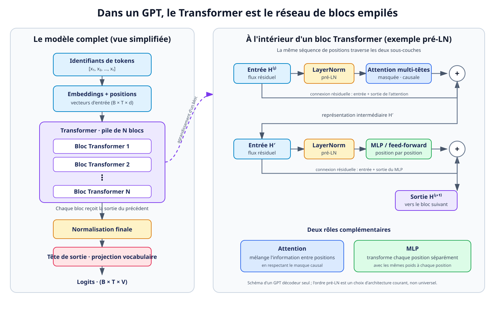
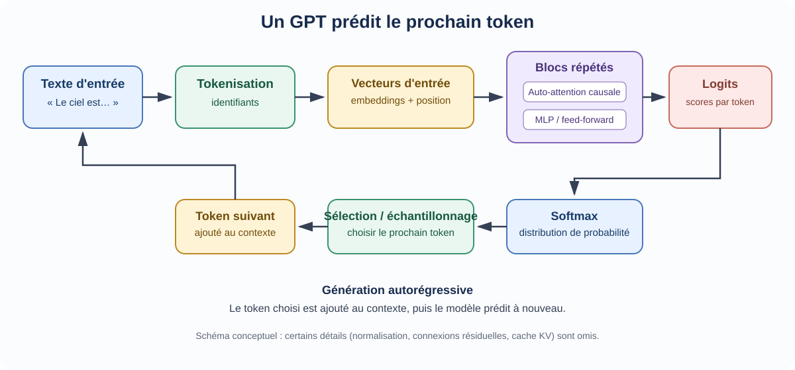
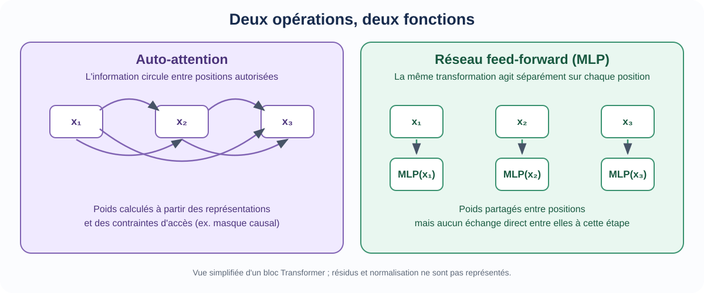

<!--
LLM-LAB-PAGE-MAP v1
id: "fr/transformer"
summary: "Présente l’architecture d’un GPT décodeur seul, du réseau de blocs Transformer à la tête de sortie, puis suit une passe avant jusqu’aux logits. Distingue l’attention, le bloc répété et le modèle complet."
scope: "Suit le calcul d’un GPT autorégressif à l’intérieur du réseau, depuis les représentations d’entrée jusqu’aux logits, en se concentrant sur les blocs Transformer, l’auto-attention, le MLP, les connexions résiduelles et la normalisation ; la préparation du texte et la boucle de génération sont seulement situées, pas réenseignées."
purpose: "Le lecteur doit pouvoir reconnaître la structure d’un Transformer décodeur seul, distinguer sous-couche d’attention, bloc et réseau complet, puis suivre une passe avant jusqu’aux logits sans la confondre avec la génération."
suggested_route:
  previous: "fr/contextualized-representations"
  next: "fr/queries-keys-values"
hierarchy:
  parents: ["fr/index", "fr/llm-overview"]
  children: ["fr/embedding-space", "fr/positional-encoding", "fr/contextualized-representations", "fr/queries-keys-values", "fr/scaled-dot-product-attention", "fr/logits", "fr/tensors"]
related: ["fr/text-data","fr/transformer-block-walkthrough","fr/transformer-exercises"]
tags: ["type:system-overview", "destination:understand", "topic:transformer", "level:overview", "language:fr", "status:published"]
-->


::: {.chapter-lead}
Un **GPT** est un modèle de langage construit autour d'un **Transformer décodeur seul**. Le Transformer ne désigne pas une étape de traitement placée entre deux composants : c'est une architecture de réseau neuronal. Dans un GPT décodeur seul, son cœur est une pile de blocs Transformer qui transforment les représentations des tokens. À partir de ces représentations, le réseau calcule des **logits**, c'est-à-dire un score pour chaque token du vocabulaire.

Cette page montre d'abord à quoi ressemble cette architecture, puis suit une passe avant à travers ses blocs jusqu'aux logits. Elle s'arrête à la sortie du réseau : la conversion des logits en probabilités et la sélection du prochain token appartiennent au décodage, pas au calcul interne du Transformer.
:::

Le schéma qui suit présente deux niveaux de lecture : le GPT complet, pour situer le flux des données, puis un bloc agrandi, pour comprendre les opérations répétées. Nous suivrons ensuite ce flux de l'entrée du réseau jusqu'aux logits, sans refaire la tokenisation ni la boucle de génération.

## Le Transformer : le réseau au cœur d'un GPT

{#fig-transformer-stack fig-alt="En haut, le réseau complet : identifiants de tokens, embeddings et information positionnelle, pile de N blocs Transformer, normalisation finale, projection vers le vocabulaire et logits. En bas, le détail d'un bloc pré-LN : une normalisation puis une auto-attention multi-têtes causale, une connexion résiduelle, puis une normalisation, un MLP appliqué position par position et une seconde connexion résiduelle." width=100%}

*La pile de blocs constitue le Transformer du GPT représenté ici. Le détail agrandi montre une organisation pré-LN courante ; l'ordre des sous-couches et les variantes de normalisation peuvent différer selon les modèles.*

Dans un GPT décodeur seul, les blocs sont **empilés** : la sortie de l'un devient l'entrée du suivant. Chaque bloc transforme la séquence de représentations, sans choisir lui-même le prochain token. Après le dernier bloc, une normalisation finale et une projection vers le vocabulaire produisent les logits.

Cette représentation concerne la famille **décodeur seul**, utilisée notamment par les GPT autorégressifs. Les Transformers ne se limitent pas à cette architecture : la [comparaison des architectures Transformer](transformer-architectures.qmd) montre ce qui change dans un encodeur seul ou un modèle encodeur-décodeur.

### Situer le réseau dans la génération

{fig-alt="Pipeline complet : texte, tokenisation, embeddings et information positionnelle, blocs Transformer répétés, logits, softmax, sélection du prochain token puis ajout au contexte." width=100%}

Ce second schéma répond à une autre question : il replace le réseau dans le processus complet. **La pile de blocs au centre est le Transformer montré juste au-dessus** ; les opérations en amont préparent son entrée, tandis que softmax, sélection et réinjection du token se situent en aval. La boucle de décodage intervient après la sortie du réseau.

## 1. Des identifiants aux représentations d'entrée

Le réseau ne reçoit pas directement du texte : il reçoit une séquence d'identifiants de tokens, convertis en vecteurs par une table d'embeddings. Une information de position est également intégrée, soit aux embeddings, soit au calcul d'attention selon l'architecture. Les blocs Transformer transforment ensuite ces vecteurs en représentations contextualisées : un même token peut contribuer à des états différents selon le contexte.

Le passage du texte aux identifiants est expliqué dans [texte et tokenisation](text-data.qmd) ; la [page sur les embeddings](embedding-space.qmd) montre comment ces identifiants deviennent des vecteurs. L'[information positionnelle](positional-encoding.qmd) explique comment le modèle tient compte de l'ordre des tokens. Ici, nous gardons ces étapes comme point de départ pour nous concentrer sur ce que les blocs en font. Pour les formes et axes des tableaux manipulés, voir [Tenseurs](tensors.qmd).

## 2. Les blocs Transformer

La pile représentée plus haut est composée de blocs de même type, répétés en profondeur. Chaque bloc combine deux opérations principales :

- **Auto-attention :** chaque position puise dans les positions autorisées par le masque — y compris sa propre position dans un GPT causal — pour affiner sa représentation. Par exemple, dans « Adam met la glace au congélateur parce qu'elle fond », l'attention peut faire entrer l'information portée par *la glace* dans la représentation du pronom *elle*. Dans GPT, un masque causal interdit de lire les tokens futurs.
- **Réseau feed-forward (MLP) :** un petit réseau de neurones appliqué à chaque position séparément, avec les mêmes poids partout. Il combine typiquement des projections linéaires et une activation non linéaire pour produire une représentation transformée ; sa conception précise varie selon l'architecture.

Les blocs utilisent aussi des **connexions résiduelles** et des **normalisations**. Une connexion résiduelle ajoute à la représentation qui circule dans le réseau une correction calculée par une sous-couche, au lieu de remplacer entièrement cette représentation. Elle fournit ainsi un chemin direct à l'information et au gradient :

\[
x_{\text{sortie}} = x_{\text{entrée}} + F(x_{\text{entrée}}).
\]

La normalisation (*LayerNorm*, dans les GPT classiques) centre et normalise les composantes du vecteur caché de chaque position, indépendamment des autres positions. Selon l'architecture, elle est placée avant ou après certaines sous-couches. Dans un bloc **pré-LN** typique, on a par exemple $x' = x + \operatorname{Attention}(\operatorname{LN}(x))$, puis $x'' = x' + \operatorname{MLP}(\operatorname{LN}(x'))$. C'est un exemple de conception, pas une formule universelle : l'ordre pré-LN/post-LN et les variantes de normalisation diffèrent entre modèles.

Le schéma décrit le rôle des composants sans imposer une implémentation unique. Pour voir comment ces opérations sont organisées dans le code de référence — notamment l'ordre pré-LN, les projections et les chemins résiduels — suivez la [visite guidée du bloc Transformer](transformer-block-walkthrough.qmd).

{fig-alt="L'auto-attention permet des échanges entre positions autorisées ; le même réseau feed-forward est appliqué séparément à chaque position." width=100%}

La distinction utile n'est pas que l'attention « comprendrait » les tokens et que le MLP ne le ferait pas : les deux transformations sont apprises. L'attention mélange l'information entre positions ; le MLP transforme chaque représentation localement, avec des poids partagés entre les positions.

Une image mentale utile : **l'attention rassemble un mélange contextuel d'informations provenant d'autres positions**, puis le **MLP traite la représentation ainsi enrichie à chaque position**. La première opération échange de l'information entre positions ; la seconde transforme chaque position indépendamment. L'analogie a ses limites : l'attention calcule des sommes pondérées de vecteurs de valeur appris, et non une recherche ou une collecte littérale de notes lisibles par un humain.

L'**attention multi-têtes** effectue plusieurs calculs d'attention en parallèle, puis combine leurs résultats. Pour le parcours d'apprentissage essentiel, il suffit de retenir qu'elle offre plusieurs voies de calcul complémentaires.

::: {.callout-note collapse="true" title="Pour aller plus loin : le fonctionnement des têtes d'attention"}
Chaque tête possède ses propres projections apprises des requêtes, clés et valeurs ; les têtes *peuvent donc* apprendre des motifs de correspondance ou exploiter des relations différentes. Leurs sorties sont concaténées, puis mélangées par une projection de sortie. Il ne faut toutefois pas supposer que chaque tête possède une spécialisation nette et interprétable par un humain : c'est une question empirique, pas une garantie de l'architecture.
:::

### Profondeur et largeur : deux dimensions de l’architecture

Deux termes reviennent souvent pour décrire la taille d’un Transformer :

- **Profondeur (*depth*) :** nombre de blocs Transformer empilés dans le réseau.
- **Largeur (*width*) :** dimension des représentations qui circulent entre les blocs. Dans un GPT classique, elle correspond généralement à `d_model`, souvent appelée *hidden size* ou dimension du flux résiduel.

Ces termes ne sont pas interchangeables avec les autres dimensions internes : le **nombre de têtes d’attention** indique combien de mécanismes sont calculés en parallèle ; `d_head` désigne la dimension des vecteurs d’une tête ; `d_ff` désigne la dimension intermédiaire du MLP, qui peut être plus grande que `d_model`.

Le mot *width* est parfois utilisé plus largement pour d’autres dimensions internes : il faut donc vérifier quelle dimension est visée dans un article ou une fiche modèle. Pour les formes des tenseurs et les dimensions des projections, voir [Tenseurs](tensors.qmd) ; pour une configuration concrète, voir la [visite guidée de la configuration GPT](gpt-config-walkthrough.qmd). Profondeur et largeur décrivent la structure, mais ne suffisent pas à prédire les performances.

L'auto-attention est la sous-couche qui permet aux positions autorisées d'échanger de l'information. Pour suivre son calcul étape par étape, la page [Q/K/V](queries-keys-values.qmd) présente les trois projections apprises ; l'[attention à produit scalaire](scaled-dot-product-attention.qmd) détaille les scores et leur normalisation ; le [masque causal](causal-masking.qmd) explique pourquoi un GPT ne consulte pas les tokens futurs. Ces approfondissements portent sur le mécanisme d'attention à l'intérieur d'un bloc, et non sur l'architecture complète.

### Trois niveaux à ne pas confondre

Il est utile de distinguer trois échelles :

1. **La sous-couche d'attention** calcule comment chaque position combine les valeurs provenant des positions autorisées. Les projections Q/K/V et le calcul des poids appartiennent à cette sous-couche.
2. **Le bloc Transformer** associe cette attention à une transformation feed-forward (MLP), avec des chemins résiduels et des normalisations. Pour le bloc pré-LN de référence, son contrat peut s'écrire :

   \[ H^{(\ell+1)} = \mathcal{B}_{\theta_\ell}(H^{(\ell)}; M), \qquad H^{(\ell)},H^{(\ell+1)} \in \mathbb{R}^{B\times T\times d}. \]

   Le bloc transforme les représentations sans sélectionner de token ni produire directement une distribution sur le vocabulaire.
3. **Le GPT assemblé** prépare les représentations d'entrée, applique une pile de blocs, puis une normalisation finale et une projection vers le vocabulaire. Dans le modèle de référence, le flux passe ainsi de \(B\times T\) IDs à \(B\times T\times d\) états, puis à \(B\times T\times V\) logits.

Autrement dit : l'attention est une sous-couche ; le bloc est l'unité répétée ; GPT est le modèle qui assemble ces blocs avec ses interfaces d'entrée et de sortie. La [visite guidée du bloc](transformer-block-walkthrough.qmd) montre une implémentation particulière, tandis que la [visite guidée de l'assemblage GPT](gpt-model-walkthrough.qmd) suit leur intégration dans le modèle complet.

## 3. Des représentations aux logits

Après le dernier bloc, la normalisation finale et la tête de sortie produisent les **logits** : un score non normalisé pour chaque token du vocabulaire. La [leçon consacrée aux logits](logits.qmd) explique ce que ces scores représentent ; celle sur les [probabilités de sortie](probabilites.qmd) montre comment *softmax* les convertit en distribution. Le réseau s'arrête à ces scores : choisir un token, l'ajouter au contexte et relancer le calcul relève de la [génération autorégressive](generation.qmd).

## Vérifier sa compréhension

Pour prolonger cette vérification par des problèmes progressifs sur les embeddings, les résidus, la normalisation et le MLP, consultez les [exercices consacrés au Transformer](exercises.qmd#transformer).

Cette vérification porte sur la structure du bloc et le rôle des connexions résiduelles.

1. Quelle opération permet à une position d'intégrer de l'information provenant d'autres positions, et laquelle transforme chaque position indépendamment ?
2. Pourquoi les connexions résiduelles ne remplacent-elles pas la transformation calculée par une sous-couche ?

Afficher les réponses et le raisonnement

1. L'auto-attention mélange l'information entre positions autorisées ; le MLP applique une transformation position par position, avec des poids partagés.
2. La connexion résiduelle additionne la sortie de la sous-couche à son entrée : $x_{sortie}=x_{entrée}+F(x_{entrée})$. Elle préserve un chemin direct à travers le bloc tout en laissant la sous-couche apporter une transformation apprise.

<!-- Legacy section anchors: see the linked companion page. -->

## Explorer en pratique

L'[atelier d'exploration de GPT-2](transformer-explainer.qmd) permet d'observer ces mécanismes sur un modèle réel : conduire des expériences contrôlées et examiner les limites de la visualisation. C'est un exercice d'analyse indépendant — utile, mais pas nécessaire pour suivre le flux décrit ici.

## Entraînement et inférence : deux organisations du calcul

Pendant l'entraînement autorégressif, le masque causal permet de calculer en parallèle les prédictions associées aux différentes positions d'une séquence, à partir des entrées et cibles décalées. En génération, les **pas successifs de production des tokens** sont séquentiels, car chaque nouveau token dépend du précédent ; une passe avant peut néanmoins traiter en parallèle les positions du contexte déjà disponible.

La construction des fenêtres, le décalage entrées/cibles et les masques d'entraînement sont détaillés dans [Exemples d'entraînement](training-examples.qmd). Le coût du préremplissage, du décodage et du cache KV est étudié dans l'[approfondissement sur la complexité](llm-computational-complexity.qmd).

## Limites et idées reçues

- **« Un GPT est seulement une couche d'attention. »** Non : il s'agit d'une architecture comprenant des embeddings, des blocs répétés, des transformations feed-forward, des connexions résiduelles, des normalisations et une tête de sortie.
- **« Les tokens sont des mots. »** Pas nécessairement : un token peut être un mot, un morceau de mot, un signe de ponctuation ou un autre fragment.
- **« Une probabilité élevée garantit une réponse vraie. »** Non : la distribution est apprise pour prédire les tokens observés dans les données ; vérité factuelle et calibration nécessitent d'autres évaluations.
- **« Les poids d'attention révèlent à eux seuls le raisonnement du modèle. »** Non : ils ne suffisent pas à établir l'influence causale d'une information sur la sortie.
- **« Tous les Transformers sont des GPT. »** Non : l'architecture originale de 2017 utilisait un encodeur et un décodeur ; GPT est une famille autorégressive de type décodeur seul.

Pour retrouver les visualisations, l'article fondateur et les ressources d'implémentation, consultez la [rubrique Approfondir consacrée au Transformer](deepen.qmd#ressources-transformer). Ces ressources sont facultatives et ne font pas partie du parcours principal.

## S’exercer

Les questions et exercices de cette leçon sont regroupés sur sa [page d’exercices dédiée](exercises/transformer.qmd).



::: {.language-switch}
**Langue :** [Français](transformer.qmd) · [English](../en/transformer.qmd)
:::
