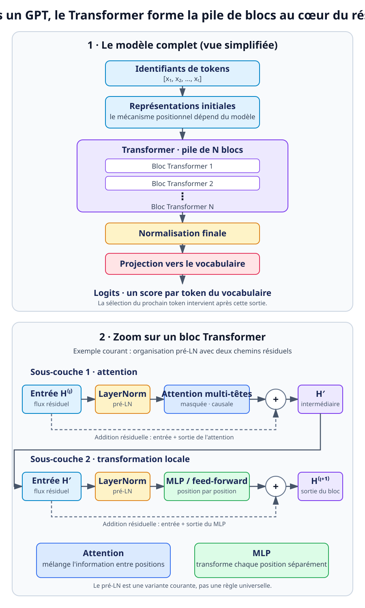
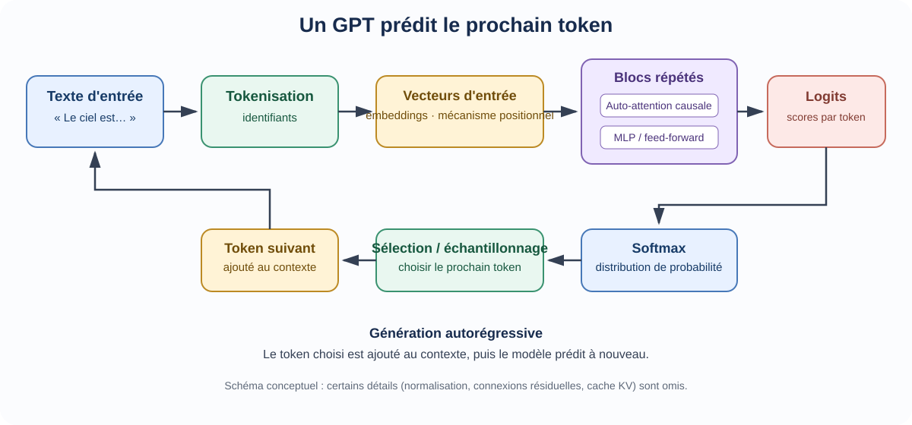

<!--
LLM-LAB-PAGE-MAP v1
id: "fr/transformer"
summary: "Suit le calcul d'un GPT décodeur seul depuis les représentations d'entrée, à travers les blocs Transformer répétés, jusqu'aux logits."
scope: "Présente le flux de calcul du GPT décodeur seul, le rôle général des blocs répétés et la frontière entre passe avant et décodage."
purpose: "Tracer le chemin des représentations jusqu'aux logits, expliquer ce que répète un bloc Transformer et distinguer le calcul du réseau de la génération du token suivant."
suggested_route:
  previous: "fr/contextualized-representations"
  next: "fr/queries-keys-values"
hierarchy:
  parents: ["fr/index", "fr/llm-overview", "fr/transformer-architectures"]
  children: ["fr/queries-keys-values", "fr/scaled-dot-product-attention", "fr/logits"]
related: ["fr/transformer-history", "fr/text-data", "fr/embedding-space", "fr/positional-encoding", "fr/contextualized-representations", "fr/contextualized-representations-advanced", "fr/tensors", "fr/generation", "fr/transformer-block-walkthrough", "fr/gpt-model-walkthrough", "fr/transformer-exercises"]
revision_support:
  status: integrated_sufficient
  evidence:
    - anchor: revision-summary
      note: "La leçon se concentre sur le flux représentations → blocs → logits et sur les rôles essentiels de l'attention, du MLP et du flux résiduel. Les détails des sous-couches et de la normalisation sont dans contextualized-representations-advanced ; le schéma de 2017 est dans transformer-history ; les dimensions détaillées sont dans tensors. Les exercices restent sur la page Practice dédiée."
tags: ["type:system-overview", "destination:understand", "topic:transformer", "level:overview", "language:fr", "status:published"]
-->


::: {.chapter-lead}
Un **GPT** est un modèle de langage construit autour d'un **Transformer décodeur seul**. Le Transformer ne désigne pas une étape de traitement placée entre deux composants : c'est une architecture de réseau neuronal. Dans un GPT décodeur seul, son cœur est une pile de blocs Transformer qui transforment les représentations des tokens. À partir de ces représentations, le réseau calcule des **logits**, c'est-à-dire un score pour chaque token du vocabulaire.

Cette page montre d'abord à quoi ressemble cette architecture, puis suit une passe avant à travers ses blocs jusqu'aux logits. Elle s'arrête à la sortie du réseau : la conversion des logits en probabilités et la sélection du prochain token appartiennent au décodage, pas au calcul interne du Transformer.
:::

::: {.callout-tip title="Le Transformer en une minute" #revision-summary}
Un GPT décodeur seul est un réseau Transformer composé de blocs répétés. Dans chaque bloc, l’auto-attention mélange l’information entre positions autorisées, le MLP transforme chaque position, les connexions résiduelles fournissent un chemin direct et la normalisation aide à contrôler l’échelle des activations. La pile produit des représentations finales puis des logits ; le choix du prochain token appartient au décodage.
:::

  <a class="step-item" href="contextualized-representations.qmd">1. Entrée représentée</a>
  →
  2. Bloc Transformer
  →
  3. État final
  →
  <a class="step-item" href="logits.qmd">4. Logits</a>

Le schéma qui suit présente deux niveaux de lecture : le GPT complet, pour situer le flux des données, puis un bloc agrandi, pour comprendre les opérations répétées. Nous suivrons ensuite ce flux de l'entrée du réseau jusqu'aux logits, sans refaire la tokenisation ni la boucle de génération.

## Le Transformer : le réseau au cœur d'un GPT

<figure id="fig-transformer-stack">
  <picture>
    <source media="(max-width: 600px)" srcset="../images/transformer-stack-fr-mobile.svg">
    
  </picture>
  <figcaption>Le premier panneau situe le réseau complet ; le second détaille un bloc pré-LN courant. L’attention mélange l’information entre positions, tandis que le MLP transforme chaque position séparément.</figcaption>
</figure>

*La pile de blocs constitue le Transformer du GPT représenté ici. Le détail agrandi montre une organisation dite **pré-LN** : chaque sous-couche est précédée de sa normalisation. C'est une disposition courante ; l'ordre des sous-couches et les variantes de normalisation peuvent différer selon les modèles.*

Dans un GPT décodeur seul, les blocs sont **empilés** : la sortie de l'un devient l'entrée du suivant. Chaque bloc transforme la séquence de représentations, sans choisir lui-même le prochain token. Après le dernier bloc, une normalisation finale et une projection vers le vocabulaire produisent les logits.

Après la passe avant, vous pourrez [comparer ce GPT au schéma de 2017](#historical-transformer-diagram).

Cette représentation concerne la famille **décodeur seul**, utilisée notamment par les GPT autorégressifs. Les Transformers ne se limitent pas à cette architecture : la [comparaison des architectures Transformer](transformer-architectures.qmd) montre ce qui change dans un encodeur seul ou un modèle encodeur-décodeur.

### Situer le réseau dans la génération

<figure id="fig-gpt-data-flow">
  <picture>
    <source media="(max-width: 600px)" srcset="../images/gpt-data-flow-fr-mobile.svg">
    
  </picture>
  <figcaption>Le schéma replace la pile Transformer dans la boucle complète de génération : le token sélectionné est ajouté au contexte, puis une nouvelle prédiction est calculée avec les mêmes paramètres.</figcaption>
</figure>

Ce second schéma répond à une autre question : il replace le réseau dans le processus complet. **La pile de blocs au centre est le Transformer montré juste-au-dessus** ; les opérations en amont préparent son entrée, tandis que softmax, sélection et réinjection du token se situent en aval. La boucle de décodage intervient après la sortie du réseau.

## 1. De l'entrée au premier bloc

Les leçons précédentes ont établi comment le texte devient une suite d'identifiants, puis comment ces identifiants deviennent des vecteurs auxquels l'architecture apporte une information de position. Le premier bloc reçoit donc une séquence de représentations, et non du texte brut. Dans le GPT du projet à encodage positionnel absolu additif, les embeddings de tokens et de positions sont additionnés avant le premier bloc. Ce n’est pas une règle universelle : avec RoPE, l’information positionnelle intervient sur les requêtes et les clés après projection, dans l’attention. Les détails restent dans les leçons sur les [embeddings](embedding-space.qmd), l'[information positionnelle](positional-encoding.qmd) et les [représentations contextualisées](contextualized-representations.qmd).

identifiants → représentations initiales → entrée du premier bloc

Le préfixe « C'est une bonne situation, ça, scribe ? » traverse ensuite la pile de blocs avant que le modèle ne produise les logits du prochain token. La continuation se construit au fil de la boucle de génération ; elle n'est pas écrite à l'avance dans le prompt.

## 2. Les blocs Transformer

La pile est composée de blocs de même type, répétés en profondeur. Chaque bloc transforme la séquence de représentations en conservant sa longueur et sa largeur : il associe deux sous-couches complémentaires.

- **Auto-attention multi-têtes :** chaque position agrège de l'information provenant des positions autorisées par le masque. Dans un GPT, le [masque causal](causal-masking.qmd) interdit l'accès aux tokens futurs. Les projections qui alimentent ce calcul sont étudiées dans la leçon [Q/K/V](queries-keys-values.qmd), puis le calcul des scores et de l'agrégation dans [l'attention à produit scalaire mise à l'échelle](scaled-dot-product-attention.qmd).
- **MLP (feed-forward network) :** transforme chaque position séparément, avec des paramètres partagés entre positions. Il apporte une transformation non linéaire locale, sans mélanger directement les positions.

Chaque sous-couche s'insère dans le **flux résiduel** : sa correction est ajoutée à la représentation qui circule, et une normalisation accompagne les transformations. L'ordre précis varie selon les architectures (pré-LN, post-LN, RMSNorm, etc.). Cette leçon en donne le rôle ; la page d'[approfondissement sur les représentations contextualisées](contextualized-representations-advanced.qmd) explique le détail des sous-couches, des connexions résiduelles et de la normalisation. La [visite guidée du bloc](transformer-block-walkthrough.qmd) reste, elle, consacrée à l'implémentation Python.

### Parallélisme à l'entraînement, génération séquentielle

Pendant l'entraînement, les tokens d'une séquence sont connus : le réseau peut calculer en parallèle les représentations de plusieurs positions, tandis que le masque causal empêche chacune d'utiliser les tokens futurs. Cela supprime la dépendance récurrente position par position propre aux RNN.

Pendant la génération, le token suivant dépend des tokens déjà produits : les étapes de décodage restent donc autorégressives. Le cache clé-valeur (KV cache) évite de recalculer certaines clés et valeurs du passé, mais ne supprime pas cette dépendance séquentielle. La [leçon sur la génération](generation.qmd) distingue le traitement initial du prompt (prefill) et la production incrémentale (decode).

- **Entraînement :** `t₁ t₂ t₃ t₄` → une passe masquée ; les positions sont calculées en parallèle.
- **Génération :** `t₁` → `t₂` → `t₃` → … chaque étape dépend du token précédent.

### Profondeur et largeur : deux dimensions de l'architecture

- **Profondeur (depth) :** nombre de blocs Transformer empilés.
- **Largeur (width) :** dimension \(d_{\mathrm{model}}\) des représentations qui circulent dans le flux résiduel.

Ces deux dimensions décrivent la structure générale, mais ne suffisent pas à prédire les performances. Les dimensions internes \(d_{\mathrm{head}}\) et \(d_{\mathrm{ff}}\), les formes des tenseurs et les valeurs de référence de GPT-2 sont regroupées dans la page [Tenseurs](tensors.qmd) ; la [visite guidée de la configuration GPT](gpt-config-walkthrough.qmd) montre leur emploi dans le modèle du projet.

### Trois niveaux à ne pas confondre

1. **La sous-couche d'attention** échange de l'information entre les positions autorisées.
2. **Le bloc Transformer** associe cette attention à un MLP, avec des connexions résiduelles et une normalisation.
3. **Le GPT complet** assemble les représentations d'entrée, une pile de blocs, puis une normalisation finale et une tête de sortie.

L'attention est une partie du bloc ; le bloc est l'unité répétée ; le Transformer ne désigne pas à lui seul le GPT complet.

## 3. Des représentations aux logits

La sortie du dernier bloc est l'**état final** du réseau. La normalisation finale puis la tête de sortie produisent les **logits** : un score non normalisé pour chaque token du vocabulaire. La tête de sortie est une simple projection linéaire : chaque représentation de dimension `d_model` devient un vecteur de `vocab_size` scores (50 257 pour GPT-2).

`sortie du dernier bloc → normalisation finale → projection vers le vocabulaire → logits`

En aval, hors du réseau : `logits → softmax → probabilités → token choisi`.

Pour notre préfixe d'exemple avec les dimensions de GPT-2 : chaque position ressort du dernier bloc comme un vecteur de 768 nombres, qui devient 50 257 scores. Pour prolonger un préfixe sans padding, la génération utilise les **logits de sa dernière position** ; le masque causal garantit qu'ils ne dépendent que des tokens déjà connus. La [leçon consacrée aux logits](logits.qmd) explique ce que ces scores représentent ; celle sur les [probabilités de sortie](probabilites.qmd) montre comment *softmax* les convertit en distribution. Le réseau s'arrête à ces scores : choisir un token, l'ajouter au contexte et relancer le calcul relève de la [génération autorégressive](generation.qmd).

<!-- Legacy section anchors: see the linked companion page. -->



::: {.language-switch}
**Langue :** [Français](transformer.qmd) · [English](../en/transformer.qmd)
:::

## Exercices

Les questions et exercices de cette leçon sont regroupés sur sa [page d’exercices dédiée](exercises/transformer.qmd).

## Approfondir

  Ressources complémentaires
  Explorer l'atelier interactif facultatif et les ressources complémentaires de cette leçon.

<h3>Atelier interactif facultatif</h3>

L'<a href="transformer-explainer.qmd">atelier d'exploration de GPT-2</a> permet d'observer ces mécanismes sur un modèle réel : conduire des expériences contrôlées et examiner les limites de la visualisation. C'est un exercice d'analyse indépendant — utile, mais non nécessaire pour suivre cette leçon.

<h3 id="pour-approfondir">Pour approfondir</h3>

Pour retrouver les visualisations et les ressources d'implémentation, consultez la <a href="deepen.qmd#ressources-transformer">rubrique Approfondir consacrée au Transformer</a>. La lecture guidée du schéma fondateur de 2017 se trouve dans <a href="transformer-history.qmd#historical-transformer-diagram">l'historique des Transformers</a>. Pour une première vue d'ensemble complémentaire, voir aussi <a href="https://dev.to/nishanthan-k/understanding-transformer-the-architecture-behind-modern-ai-55o8">Understanding Transformer: The Architecture Behind Modern AI</a>. Ces ressources sont facultatives et ne font pas partie du parcours principal.

## Pour retrouver le schéma fondateur

La lecture guidée du Transformer encodeur-décodeur de 2017 a été déplacée dans [l'historique des Transformers](transformer-history.qmd#historical-transformer-diagram), où elle rejoint la chronologie et le contexte de recherche.
