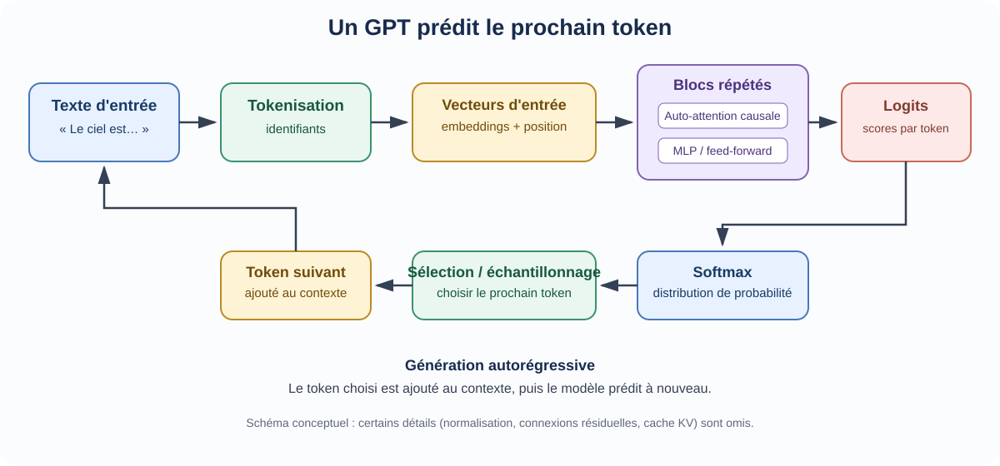
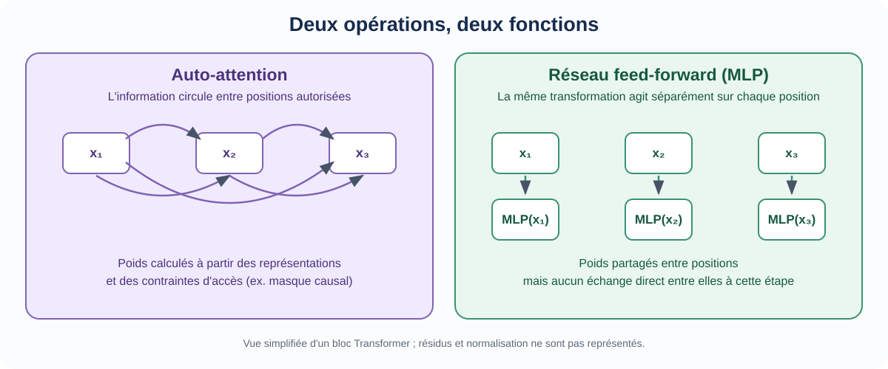
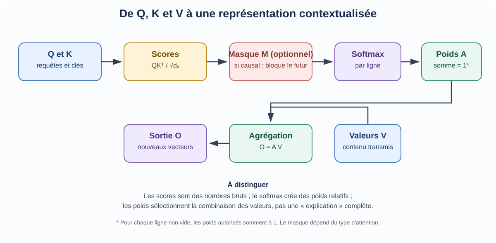

::: {.chapter-lead}
Un **GPT** est un modèle de langage fondé sur un Transformer autorégressif : à partir d'un contexte de tokens, il estime une distribution sur le token suivant. Pour comprendre le système, il faut distinguer le flux des données, les paramètres appris et la boucle de génération. Cette page donne la vue d'ensemble ; les pages liées détaillent chaque opération.
:::

## Le parcours complet, en un schéma

{fig-alt="Pipeline conceptuel : texte, tokenisation, embeddings et position, blocs Transformer répétés, logits, softmax, choix du prochain token puis ajout au contexte." width=100%}

Le schéma montre le chemin conceptuel d'une génération. Il omet volontairement certains détails d'implémentation, notamment les connexions résiduelles, la normalisation, le cache des clés et valeurs (*KV cache*) et les variantes d'échantillonnage.

## 1. Du texte aux représentations

Le tokenizer transforme le texte en identifiants de tokens. Une matrice d'embedding associe à chaque identifiant un vecteur appris. Une information de position est également fournie, par exemple par un encodage ajouté aux vecteurs ou par une méthode intégrée au calcul d'attention comme [RoPE](positional-encoding.qmd).

Il faut distinguer l'embedding initial d'un token de sa représentation **contextualisée** : les couches du Transformer mettent progressivement à jour les vecteurs en tenant compte du contexte. Voir [l'espace des embeddings](embedding-space.qmd) et les [tenseurs](tensors.qmd).

## 2. Les blocs Transformer

Un bloc combine principalement deux opérations :

- **Auto-attention :** chaque position combine de l'information venant des positions autorisées. Dans GPT, le masque causal empêche de lire les tokens futurs.
- **Réseau feed-forward (MLP) :** applique la même transformation apprise à chaque position, indépendamment des autres positions à cette étape.

Les blocs incluent aussi des connexions résiduelles et des normalisations. Leur ordre précis dépend de l'architecture : le schéma de cette page est une abstraction, pas une spécification d'un modèle particulier.

{fig-alt="L'auto-attention permet des échanges entre positions autorisées ; le même réseau feed-forward est appliqué séparément à chaque position." width=100%}

La distinction importante n'est pas que l'attention « comprend » les tokens et que le MLP ne le fait pas : les deux transformations sont apprises. L'attention mélange l'information entre positions ; le MLP transforme chaque représentation localement, avec des poids partagés entre les positions.

### Comprendre le calcul d'attention

{fig-alt="Q et K produisent des scores qui sont mis à l'échelle et masqués avant le softmax. Les poids obtenus combinent les valeurs V pour produire les vecteurs de sortie." width=100%}

1. [**Requêtes, clés et valeurs (Q, K, V)**](queries-keys-values.qmd) — trois projections apprises donnent des rôles distincts aux représentations.
2. [**Attention à produit scalaire mise à l'échelle**](scaled-dot-product-attention.qmd) — les scores issus de $QK^\top$ sont normalisés par $\sqrt{d_k}$ puis convertis en poids par le *softmax*.
3. [**Masque causal**](causal-masking.qmd) — exclut les positions futures avant le *softmax*.
4. [**Encodage positionnel et RoPE**](positional-encoding.qmd) — introduit l'information sur l'ordre des tokens.

Les poids d'attention ne sont pas une explication complète d'une prédiction. Ils décrivent une étape d'agrégation ; les projections, les valeurs, les autres têtes, les couches suivantes et la sortie finale interviennent également.

## 3. Des représentations aux probabilités

Après les blocs, une projection de sortie produit des **logits** — des scores non normalisés associés au vocabulaire. Le *softmax* les transforme en une distribution de probabilité. Ces probabilités ne signifient pas automatiquement que le modèle est bien calibré : voir [logits](logits.qmd), [probabilités](probabilites.qmd) et [vraisemblance](vraisemblance.qmd).

Pendant la génération, une règle de sélection choisit le token suivant : maximum, échantillonnage ou méthode plus élaborée. Ce token est ajouté au contexte, puis le modèle recommence. La génération est donc **autorégressive** ; elle ne consiste pas en une seule prédiction de toute la réponse.

## Entraînement et génération : deux modes à ne pas confondre

Pendant l'entraînement d'un modèle autorégressif, les positions d'une séquence peuvent être calculées en parallèle grâce au décalage entre entrées et cibles et au masque causal. Lors de la génération ordinaire, le prochain token dépend du contexte effectivement disponible : le modèle avance étape par étape. Des optimisations comme le cache KV évitent de recalculer certaines clés et valeurs déjà produites.

Cette distinction explique pourquoi « le modèle prédit le prochain token » reste vrai dans les deux cas, alors que l'organisation des calculs diffère.

## Limites et idées reçues

- **« Un GPT est seulement une couche d'attention. »** Non : il s'agit d'une architecture comprenant des embeddings, des blocs répétés, des transformations feed-forward, des connexions résiduelles, des normalisations et une tête de sortie.
- **« Les tokens sont des mots. »** Pas nécessairement : un token peut être un mot, un morceau de mot, un signe de ponctuation ou un autre fragment.
- **« Une probabilité élevée garantit une réponse vraie. »** Non : la distribution est apprise pour prédire les tokens observés dans les données ; vérité factuelle et calibration nécessitent d'autres évaluations.
- **« Les poids d'attention révèlent à eux seuls le raisonnement du modèle. »** Non : ils ne suffisent pas à établir l'influence causale d'une information sur la sortie.
- **« Tous les Transformers sont des GPT. »** Non : l'architecture originale de 2017 utilisait un encodeur et un décodeur ; GPT est une famille autorégressive de type décodeur seul.

## Pour poursuivre

- [Tenseurs](tensors.qmd) — lire les formes et les axes des données.
- [Espace des embeddings](embedding-space.qmd) — distinguer vecteurs initiaux et représentations contextualisées.
- [Requêtes, clés et valeurs](queries-keys-values.qmd) — comprendre les projections de l'attention.
- [Attention à produit scalaire mise à l'échelle](scaled-dot-product-attention.qmd) — suivre les opérations mathématiques.
- [Masque causal](causal-masking.qmd) — comprendre l'accès au contexte précédent.
- [Fondations mathématiques](mathematical-foundations.qmd) — relier logits, probabilités, vraisemblance et loss.
- [Historique des Transformers](transformer-history.qmd) — replacer les choix architecturaux dans leur contexte.

## Pour approfondir, selon votre besoin

Il n'est pas nécessaire de consulter toutes les ressources. Choisissez celle qui répond à votre question actuelle ; revenez aux autres si vous cherchez une autre explication ou davantage de détails techniques.

### Construire l'intuition avec des visualisations

- [3Blue1Brown — *Transformers, the tech behind LLMs*](https://www.3blue1brown.com/lessons/gpt/) : une explication animée du système, des embeddings aux blocs Transformer, aux logits et à la génération.
- [3Blue1Brown — *Attention in transformers, step by step*](https://www.3blue1brown.com/lessons/attention/) : une explication visuelle ciblée de l'attention, du masquage, des têtes multiples et de la cross-attention.
- [Jay Alammar — *The Illustrated Transformer*](https://jalammar.github.io/illustrated-transformer/) : une explication visuelle pas à pas du **Transformer original encodeur-décodeur**. Elle éclaire la conception de 2017, mais ne représente pas tous les GPT modernes.
- [Jay Alammar — *The Illustrated GPT-2*](https://jalammar.github.io/illustrated-gpt2/) : une présentation visuelle plus directement liée aux modèles de type GPT à décodeur seul.

### Relier les équations à une implémentation

- [Vaswani et al. (2017), *Attention Is All You Need*](https://arxiv.org/abs/1706.03762) : l'article primaire décrivant la formulation du Transformer original. Il présente une architecture encodeur-décodeur ; GPT est une famille ultérieure à décodeur seul.
- [Harvard NLP — *The Annotated Transformer*](https://nlp.seas.harvard.edu/annotated-transformer/) : une implémentation exécutable et annotée, liée à l'article original. Elle aide à relier les équations au code, mais son architecture et ses choix d'entraînement ne définissent pas tous les LLM modernes.
- [PyTorch — attention à produit scalaire mise à l'échelle](https://docs.pytorch.org/docs/stable/generated/torch.nn.functional.scaled_dot_product_attention.html) : le contrat d'API d'une opération, pas une explication ou une implémentation complète d'un Transformer.

### Suivre un parcours structuré

- [Sebastian Raschka — *Build a Large Language Model (From Scratch)*](https://www.sebastianraschka.com/llms-from-scratch/) et [le dépôt source](https://github.com/rasbt/LLMs-from-scratch) : un parcours associant livre et code sur les données, l'attention, l'implémentation de GPT, le préentraînement et le fine-tuning. C'est une référence importante, pas l'ordre de lecture obligatoire de ce site.
- [Raschka — conseils de lecture](https://github.com/rasbt/LLMs-from-scratch/blob/main/ch01/reading-recommendations.md) : conseils pour construire d'abord une vue d'ensemble, puis approfondir avec le code.
- [DeepLearning.AI — *How Transformer LLMs Work*](https://www.deeplearning.ai/courses/how-transformer-llms-work) : un cours vidéo compact de Jay Alammar et Maarten Grootendorst sur la tokenisation, les embeddings, l'attention, les blocs modernes et quelques variantes d'efficacité. L'accès et les conditions du cours peuvent évoluer.

Ces ressources ont des rôles différents : les visualisations construisent l'intuition, l'article primaire documente la formulation originale, le code annoté rend visibles les choix d'implémentation et la documentation d'API précise le contrat d'une opération de bibliothèque. Elles sont complémentaires, mais non interchangeables. Lorsqu'une explication simplifie un mécanisme ou qu'une implémentation adopte une convention particulière, vérifiez les hypothèses et le périmètre avant de généraliser.
::: {.language-switch}
**Langue :** [Français](transformer.qmd) · [English](../en/transformer.qmd)
:::
