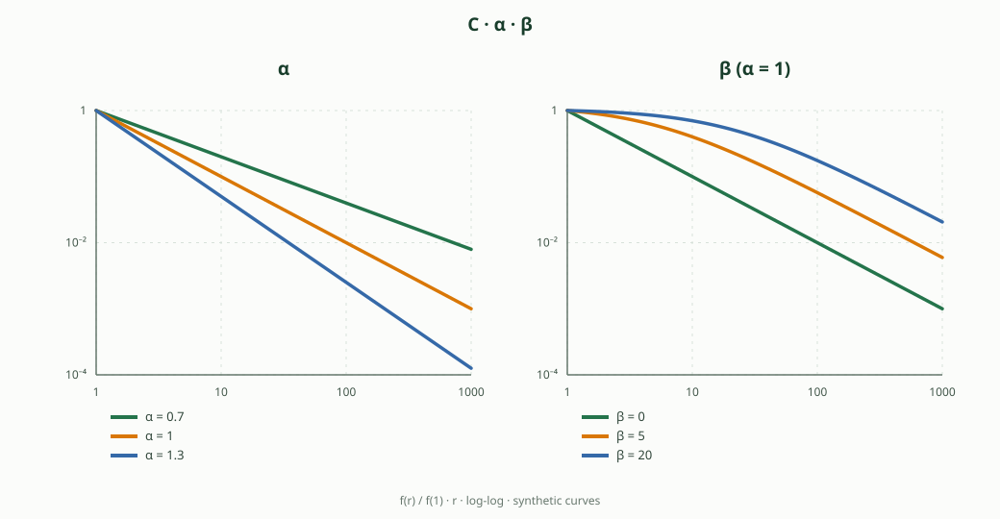

<!--
LLM-LAB-PAGE-MAP v1
id: "fr/zipf-law-deep-dive"
summary: "Approfondit la loi de Zipf : variante de Mandelbrot, données multilingues, histoire, applications et limites."
scope: "Rassemble les extensions mathématiques, résultats empiriques comparatifs, repères historiques et usages en analyse de corpus, recherche d'information et étude des modèles."
purpose: "Interpréter les résultats empiriques sans généralisation abusive et relier la statistique rang-fréquence aux usages concrets."
domain: "probabilistic-foundations-training"
suggested_route:
  previous: null
  next: null
hierarchy:
  parents: ["fr/advent-calendar-story-day-01"]
  children: []
related: ["fr/exercises-zipf-law", "fr/text-data", "fr/tokenization-strategies"]
tags: ["type:deep-dive", "destination:deepen", "topic:zipf-law-deep-dive", "level:advanced", "language:fr", "status:published"]
-->

::: {.chapter-lead}
La leçon du calendrier a établi la relation rang–fréquence et ses limites. Cet approfondissement rassemble les éléments qui demandent davantage de recul : modèles plus flexibles, comparaison entre corpus, histoire et usages dans les systèmes de traitement du langage.
:::

**Retour à l'histoire :** [Pourquoi le mot « je » revient-il si souvent ?](advent-calendar-story-day-01.qmd).

## La loi de Zipf-Mandelbrot {#zipf-mandelbrot}

La forme simple décrit imparfaitement certaines distributions, en particulier les tout premiers rangs. Mandelbrot a proposé une généralisation :

$$
f(r) \propto \frac{1}{(r+\beta)^\alpha}
$$

Le paramètre $\beta$ décale le rang. Lorsque $\beta=0$, on retrouve la loi de Zipf classique. Pour $\beta>0$, la décroissance relative est moins brutale entre les tout premiers rangs ; lorsque $r$ devient très supérieur à $\beta$, la queue retrouve une pente asymptotique gouvernée par $-\alpha$. On peut isoler cet effet en comparant les fréquences à celle du rang 1 :

$$
\frac{f(r)}{f(1)}=\left(\frac{1+\beta}{r+\beta}\right)^\alpha.
$$

Le facteur d'échelle $C$ s'annule dans ce rapport : les courbes comparent la forme des distributions, indépendamment de leur niveau absolu de fréquence.

Ainsi, $\beta$ modifie surtout la courbure autour des premiers rangs ; il ne représente ni le nombre de mots-outils, ni une cause linguistique. Il ajoute un paramètre qui peut améliorer l'ajustement de certaines données, mais pas nécessairement de toutes. Il faut comparer les résidus et la stabilité des paramètres, idéalement sur des données réservées, plutôt que préférer automatiquement le modèle le plus flexible.

{#fig-advent-zipf-parameter-effects fig-alt="Deux graphiques en échelle logarithmique. À gauche, augmenter alpha rend la décroissance plus rapide. À droite, augmenter beta adoucit la courbure des premiers rangs ; la pente de la longue traîne reste gouvernée par alpha." width=100%}

*Courbes synthétiques normalisées pour que la fréquence relative au rang 1 vaille 1. Elles isolent l'effet des paramètres ; elles ne sont pas ajustées à un corpus réel.*

Par exemple, au rang 10 avec $\beta=0$, les valeurs $\alpha=0{,}7$, $1$ et $1{,}3$ donnent des fréquences relatives d'environ $0{,}20$, $0{,}10$ et $0{,}05$. Au rang 2 avec $\alpha=1$, les valeurs $\beta=0$, $5$ et $20$ donnent environ $0{,}50$, $0{,}86$ et $0{,}95$. Toutes les courbes valent 1 au rang 1 ; $\beta$ modifie surtout les premiers rangs, tandis que $\alpha$ gouverne la pente de la longue traîne.

Cette extension rappelle qu'une loi empirique est un modèle à ajuster et à évaluer, pas une formule à appliquer sans vérifier ses hypothèses.

## Observations multilingues {#observations-multilingues}

La régularité n'est pas limitée au français ou à l'anglais. Pour éviter de comparer des chiffres issus de corpus incompatibles, voici un extrait d'une même étude consacrée au langage adressé aux jeunes enfants (*child-directed speech*). Les auteurs ont agrégé des corpus de conversations et estimé les paramètres d'une distribution de Zipf-Mandelbrot.

| Langue | Âge des enfants | Corpus | Occurrences lexicales | Types | $\alpha$ | $\beta$ | Pearson $r$ |
|---|---:|---:|---:|---:|---:|---:|---:|
| Anglais britannique | 2–42 mois | 12 | 6 311 249 | 27 476 | 1,57 | 19,48 | 0,970 |
| Français | 11–42 mois | 8 | 1 540 284 | 19 327 | 1,53 | 17,98 | 0,990 |
| Allemand | 5–42 mois | 7 | 2 168 002 | 37 018 | 1,42 | 12,69 | 0,998 |
| Espagnol | 11–42 mois | 12 | 353 104 | 10 057 | 1,39 | 9,96 | 0,994 |
| Japonais | 6–42 mois | 6 | 941 006 | 25 648 | 1,30 | 7,12 | 0,993 |

*Source : Lavi-Rotbain et Arnon (2023), étude 1. « Occurrences » traduit ici le nombre de mots comptés dans les transcriptions ; les types sont les formes orthographiques distinctes. $\alpha$ est l'exposant et $\beta$ le décalage de la loi de Zipf-Mandelbrot. r est la corrélation de Pearson entre les fréquences observées et les fréquences attendues par le modèle. Ce n’est ni un exposant, ni une preuve que la distribution suit une loi de puissance stricte.*

Ces résultats montrent deux choses :

1. Une distribution proche de Zipf-Mandelbrot est observée dans des langues de familles différentes.
2. L'exposant estimé varie : il ne faut donc pas remplacer les données d'un corpus par une valeur universelle de $\alpha$.

**Attention à l'interprétation.** Ces chiffres concernent le langage adressé aux enfants, pas l'ensemble des textes écrits ou parlés de chaque langue. Les corpus n'ont ni la même taille ni exactement les mêmes propriétés. La comparaison illustre une régularité translinguistique dans un cadre expérimental précis ; elle ne permet pas de classer les langues selon une prétendue « conformité à Zipf ».

L'étude a également montré que les paramètres dépendent de la taille des échantillons et du choix de l'unité linguistique. Les auteurs ont notamment retenu un seuil minimal de 100 000 occurrences pour leurs estimations principales. Ils définissent un mot par sa forme orthographique, agrègent les conversations par langue et attribuent aléatoirement les rangs aux formes ex æquo. Leur résultat est qualifié de *near-Zipfian* : il s'agit d'une proximité empirique, pas d'une loi de puissance exacte. C'est une raison supplémentaire de ne pas tirer de conclusion générale à partir de notre texte de 217 occurrences.

## Une histoire plus ancienne que son nom

La loi porte le nom de George Kingsley Zipf, mais l'histoire commence avant lui.

- **1916 — Jean-Baptiste Estoup.** Ce sténographe français décrit une régularité entre le rang et la fréquence des mots dans *Gammes sténographiques*. Des travaux historiques signalent des observations préparatoires dès 1912 ; 1916 constitue un repère bibliographique important.
- **Années 1930 — George Kingsley Zipf.** Zipf étudie et popularise cette relation dans ses travaux sur la fréquence relative des mots, notamment *The Psycho-Biology of Language* (1935).
- **1949 — Une diffusion plus large.** Dans *Human Behavior and the Principle of Least Effort*, Zipf étend son analyse à d'autres phénomènes humains et sociaux. C'est cet ouvrage qui contribue fortement à installer son nom dans la littérature.
- **1953 — Benoît Mandelbrot.** Il développe une généralisation qui améliore l'ajustement de certaines distributions linguistiques, aujourd'hui connue sous le nom de loi de Zipf-Mandelbrot.

L'appellation « loi de Zipf » est donc un raccourci historique : pour la statistique lexicale, « loi d'Estoup-Zipf » rend mieux compte de cette filiation.

## À quoi sert-elle concrètement ?

La loi de Zipf n'est pas une étape de calcul exécutée par un modèle de langage. Un Transformer ne consulte pas cette formule à chaque prédiction. C'est avant tout un **modèle descriptif**. Pour comprendre ce qu'elle apporte réellement, distinguons son usage direct des méthodes qui exploitent seulement des statistiques de fréquence.

| Situation | Rôle de Zipf | Ce qu'il ne faut pas lui attribuer |
|---|---|---|
| Analyser un corpus | Comparer directement une distribution rang–fréquence à une loi de Zipf ou de Zipf–Mandelbrot | Un écart ne diagnostique pas à lui seul une erreur ou une mauvaise qualité du corpus |
| Indexer et rechercher des documents | Fournir éventuellement une approximation descriptive de l'inégalité des fréquences dans une collection | TF-IDF, BM25 et la compression d'index ne sont pas des applications de la formule de Zipf : ces méthodes exploitent des statistiques de fréquence pour leurs propres calculs |
| Étudier les données d'entraînement | Décrire la longue traîne et situer le problème des unités rares | Les algorithmes de tokenisation ne dérivent pas directement de la loi de Zipf |
| Comparer des textes générés | Comparer directement leurs distributions rang–fréquence à celles de textes de référence | Une courbe proche de Zipf ne prouve ni la qualité du texte ni sa richesse lexicale |

### 5.1 Décrire et auditer un corpus

On peut compter les formes, les classer, tracer la courbe rang-fréquence et comparer la distribution à un modèle de Zipf ou de Zipf-Mandelbrot. Cette analyse aide à :

- comparer des corpus de genres, de périodes ou de langues différents ;
- repérer une distribution anormale, par exemple à cause de doublons, de bruit ou de texte généré automatiquement ;
- mesurer l'importance de la longue traîne et la part des formes très rares ;
- vérifier comment la normalisation, la lemmatisation ou le filtrage modifient le vocabulaire.

La loi sert ici de **référence statistique** : un écart peut être informatif, mais ne prouve pas à lui seul qu'un corpus est mauvais.

### 5.2 Concevoir des systèmes de recherche d'information

Dans un moteur de recherche, les termes n'apparaissent pas tous le même nombre de fois dans une collection de documents. Cette inégalité des fréquences est une propriété des données que l'on peut parfois décrire par une approximation de Zipf. Elle compte pour l'organisation et la taille des index.

En revanche, la compression des listes de documents et le classement des résultats reposent sur des mécanismes spécifiques. TF-IDF et BM25 exploitent notamment des fréquences de termes et de documents ; ils ne calculent pas une loi de Zipf. Le lien est donc **statistique et indirect** : Zipf aide à caractériser la distribution sous-jacente, tandis que les méthodes de recherche utilisent ces statistiques selon leurs propres objectifs.

### 5.3 Comprendre les difficultés d'apprentissage des modèles de langage

Les corpus d'entraînement sont eux aussi très déséquilibrés :

- les unités fréquentes fournissent de nombreux exemples ;
- les unités rares disposent de moins d'observations ;
- les mots inconnus ou les formes nouvelles posent un problème de couverture du vocabulaire ;
- les choix de tokenisation déterminent comment cette longue traîne est répartie entre mots entiers et sous-mots.

La longue traîne aide à formuler le problème de couverture : un système doit pouvoir représenter des formes peu observées ou inédites. Les unités sous-lexicales apportent une réponse pratique en réutilisant des fragments. Le lien avec Zipf reste toutefois **indirect** : BPE et les autres méthodes de tokenisation construisent leur segmentation à partir de règles et de statistiques propres à leur objectif ; elles n'appliquent pas la formule de Zipf. Celle-ci ne détermine donc ni l'algorithme de tokenisation ni la taille optimale du vocabulaire.

Il faut surtout distinguer deux distributions. La courbe de Zipf décrit une **fréquence marginale dans un corpus** : combien de fois chaque forme ou token apparaît, tous contextes confondus. Un modèle autorégressif calcule au contraire, à chaque position, une distribution **conditionnelle au contexte** :

$$
p_\theta(x_t\mid x_{<t}).
$$

La fréquence d'un token dans le corpus influence le nombre d'exemples observés pendant l'entraînement, mais elle n'est pas sa probabilité prédite dans un contexte donné. Un token globalement rare peut être très probable après un préfixe particulier ; un token globalement fréquent peut être improbable dans ce même contexte.

### 5.4 Évaluer les distributions produites par un modèle

On peut comparer directement les distributions rang–fréquence des textes humains et des textes générés par un modèle. Une différence peut signaler une concentration différente des fréquences ou une longue traîne plus ou moins marquée. Pour interpréter cette comparaison, il faut contrôler la langue, la longueur des textes, le tokenizer, la normalisation et les paramètres d'échantillonnage. Une courbe rang–fréquence ne permet cependant pas, à elle seule, de conclure à une répétition excessive, à une diversité lexicale insuffisante ou à une qualité moindre. **Elle ne mesure pas directement la richesse lexicale.** Elle décrit comment les fréquences se répartissent entre les formes ; deux textes de richesse comparable peuvent avoir des courbes différentes selon leur longueur, leur sujet, leur genre et leur normalisation. Inversement, une courbe proche de Zipf ne garantit pas un vocabulaire riche. Pour étudier la diversité lexicale, il faut des mesures complémentaires et des protocoles qui contrôlent notamment la longueur des textes.

Des travaux récents étudient même les liens entre distribution des tokens, choix de vocabulaire et performances en aval. Il s'agit d'un axe de recherche, pas encore d'une règle universelle de conception. Il faut en particulier distinguer la distribution des mots dans un corpus de celle des tokens produits par un tokenizer : le découpage en sous-mots change l'objet statistique étudié.

**En résumé :** Zipf est utilisée pour caractériser des données, comparer des distributions et formuler des hypothèses sur les systèmes qui les exploitent. Elle n'est ni un algorithme d'apprentissage, ni une explication causale complète de la langue.

### Sources

- Estoup, J.-B. (1916), *Gammes sténographiques*, Institut sténographique de France — repère historique sur l'observation de la relation rang-fréquence.
- Zipf, G. K. (1935), *The Psycho-Biology of Language* — formulation et diffusion de l'analyse des fréquences lexicales.
- Zipf, G. K. (1949), *Human Behavior and the Principle of Least Effort* — ouvrage qui popularise largement cette régularité.
- Mandelbrot, B. (1953), “An informational theory of the statistical structure of language” — généralisation de la relation rang-fréquence.
- Petruszewycz, M. (1973), [*L'histoire de la loi d'Estoup-Zipf : documents*](https://www.numdam.org/item/MSH_1973__44__41_0/) — repères documentaires sur les origines de la loi.
- Piantadosi, S. T. (2014), [*Zipf’s word frequency law in natural language: A critical review and future directions*](https://doi.org/10.3758/S13423-014-0585-6) — revue critique des régularités, des méthodes d'estimation et des explications proposées.
- Lavi-Rotbain, O. et Arnon, I. (2023), [*Zipfian Distributions in Child-Directed Speech*](https://doi.org/10.1162/opmi_a_00070) — étude multilingue des fréquences dans le langage adressé aux enfants.
- Linders, G. M. et Louwerse, M. M. (2023), [*Zipf’s law revisited: Spoken dialog, linguistic units, parameters, and the principle of least effort*](https://doi.org/10.3758/s13423-022-02142-9) — extension de l'analyse à la conversation et à plusieurs unités linguistiques.
- He, Y., Zeng, Q. et Jiang, M. (2025), [*Pre-trained Models Perform the Best When Token Distributions Follow Zipf’s Law*](https://aclanthology.org/2025.emnlp-main.1421/) — étude récente du lien entre distributions de tokens, taille du vocabulaire et performances.

[Retour au calendrier](scientific-calendar.qmd).

::: {.language-switch}
**Langue :** [Français](zipf-law-deep-dive.qmd) · [English](../en/zipf-law-deep-dive.qmd)
:::
